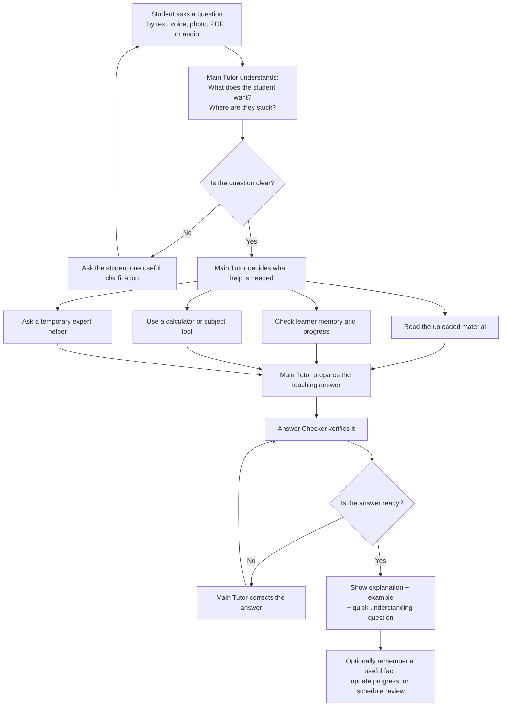
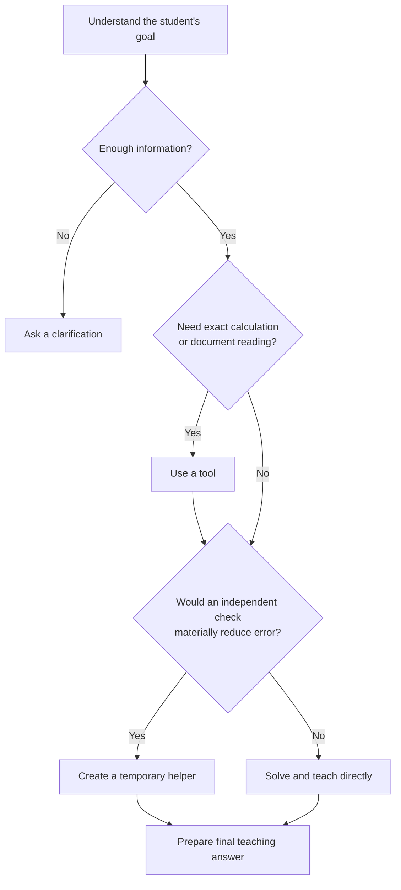

# Learning Agent: Simple Overview

This file is the product architecture for PrepWise. Implementation details live in
`README.md`. The graph around the agent is deliberately small; educational decisions
happen inside the Main Tutor, not as keyword routing.

Copied from the architecture plan (`LEARNING_AGENT_SIMPLE_OVERVIEW.md`). The
**Live on `beta-main`** section at the end is the only addition — it maps this
plan onto the code without changing the plan.

## The basic idea

Think of the platform as **one responsible personal tutor for each student**.

That tutor:

1. understands what the student is trying to do;
2. checks the question and any uploaded material;
3. decides what help it needs;
4. solves or explains the problem;
5. gets the answer checked;
6. teaches the student, instead of only giving the result;
7. remembers useful learning information;
8. decides what the student should do next.

The student does not choose an agent, model, tool, or learning method.

## Complete workflow

The Main Tutor does not use every helper every time. For a simple question, it
can answer directly. It uses tools or temporary helpers only when they improve
the answer.

## The roles

### 1. Main Tutor

This is the student's Learning Agent.

It owns the complete interaction:

- understands the question;
- chooses the teaching method;
- decides which tools or helpers are useful;
- combines all findings;
- produces the final answer;
- decides whether anything should be remembered;
- asks a short question to confirm understanding.

Only the Main Tutor communicates with the student.

### 2. Tools

Tools are not agents. They perform specific jobs and return results.

| Tool | Simple meaning | Example |
|---|---|---|
| Material reader | Reads a photo, PDF, document, or transcript | Extract the equation from a worksheet |
| Calculator | Performs exact arithmetic | Verify `64 × 102` |
| Mathematics tool | Solves or simplifies symbolic mathematics | Factor an equation |
| Diagram tool | Creates a useful visual explanation | Draw a force diagram |
| Curriculum tool | Finds relevant syllabus or learning material | Find the expected Grade 8 method |
| Research tool | Checks reliable external information | Verify a scientific fact |
| Memory lookup | Finds useful things previously learned about the student | Student prefers visual examples |
| Learner progress | Reads the student's current goals and difficulties | Student is practising fractions |
| Save memory | Saves one useful future preference or fact | Recipes help this student understand ratios |
| Progress update | Proposes an evidence-based learning update | Student demonstrated long division correctly |
| Review scheduler | Suggests when the topic should be reviewed | Revisit quadratic equations in three days |
| Permission request | Stops before a consequential action | Ask before submitting or publishing anything |

The architecture already supports all these tool categories. The first
subject-specific tool currently connected is the calculator. OCR, symbolic
mathematics, diagrams, curriculum retrieval, and research are the next
capabilities to connect.

### 3. Temporary Expert Helper

The Main Tutor can create a temporary helper for one narrow task.

Examples:

- “Independently check this calculation.”
- “Find the first incorrect step in the uploaded solution.”
- “Try a different explanation suitable for a younger learner.”
- “Look for a counterexample to this claim.”
- “Compare these two solution methods.”

The temporary helper:

- receives one clear job;
- sees only the material needed for that job;
- can use only allowed tools;
- returns findings to the Main Tutor;
- cannot talk to the student;
- cannot save memory or change progress;
- cannot schedule anything;
- cannot create another helper.

It disappears when the task is finished.

### 4. Answer Checker

After the Main Tutor prepares an answer, a fresh checker reviews it.

The checker asks:

- Is the answer correct?
- Does it actually answer the student's question?
- Is the explanation understandable?
- Did it use the uploaded evidence correctly?
- Is uncertainty stated honestly?
- Is the language appropriate for the student?
- Is the understanding question useful?

If the answer is weak, the checker returns a corrected complete answer. The
student sees only the checked result.

The checker is a fresh review role under the same learner-owned agent, not a
second tutor competing for control.

### 5. Background Learning Coach

This is the same Learning Agent working later, after platform events occur.

It may examine:

- completed lessons;
- practice answers;
- test performance;
- skipped activities;
- scheduled review times;
- previous explanations that did or did not help.

It can decide to:

- do nothing;
- update its understanding;
- change the study plan;
- schedule a review;
- suggest a useful activity;
- start a new learning conversation.

There is no rule such as “three wrong answers means send a notification.” The
Learning Agent examines the full context and chooses the least intrusive useful
action.

### 6. Platform Content Worker

This worker supports the platform rather than one student.

It can help with:

- syllabus research;
- lesson creation;
- question generation;
- localization;
- content maintenance;
- checking whether published material is still valid.

It cannot read or change a student's private learning state unless a separate,
authorized flow explicitly provides that access.

## How the Main Tutor chooses what to do

The decision is based on meaning and context, not keyword routing.

## Example: student uploads a mathematics solution

The student says:

> I uploaded my solution. Why is my final answer wrong?

The platform works like this:

1. The Main Tutor reads the message.
2. It uses the material reader to inspect the uploaded page.
3. It identifies the student's method and the first uncertain step.
4. It uses the calculator to verify the arithmetic.
5. If the problem is complex, it asks a temporary helper to check the solution
   independently.
6. The Main Tutor combines the evidence into a step-by-step explanation.
7. The Answer Checker verifies the explanation and calculation.
8. The student receives:
   - the first incorrect step;
   - why it is incorrect;
   - the corrected method;
   - one similar example;
   - one short question to check understanding.
9. If useful, the tutor proposes a learning note such as:
   “The learner understands the method but often loses signs when expanding
   brackets.”

## What is controlled by the agent and the platform

| Learning Agent decides | Platform guarantees |
|---|---|
| What the student means | Only the correct student's information is accessible |
| Whether clarification is needed | Tools and models come from approved lists |
| How to explain the concept | Files and workflow data are encrypted |
| Whether a tool or helper is useful | Tools receive validated input |
| Whether memory or progress matters | Temporary helpers have strict permissions |
| What should be remembered | Consequential actions wait for permission |
| Whether follow-up is useful | Answers and updates commit safely |
| Which approved model fits the task | Cost, time, and step limits are enforced |

The Learning Agent makes educational decisions. The platform handles identity,
permissions, limits, encryption, reliability, and audit records.

## One-sentence architecture

**Student asks → Main Tutor understands → uses only useful tools or temporary
helpers → Answer Checker verifies → student receives a teaching answer →
platform optionally remembers and follows up.**

---

## Live on `beta-main`

This section is the connection map, not a second architecture. Roles 1–5 exist.
Role 6 does not. Curriculum retrieval is already connected (further than the
generic plan assumed). Student input is still text-only.

| Role | Status | Code |
|---|---|---|
| 1. Main Tutor | Connected | `agents/learning_agent.py`, `skills/learning_agent.yaml` |
| 2. Tools | Connected where listed below | `mcp_tools/*` via `@tool` in `agents/runtime/toolbelt.py` |
| 3. Temporary experts | Connected | `agents/experts.py`, `mcp_tools/handoff.py` (`consult_expert`) |
| 4. Answer Checker | Connected (checker rewrites; the flowchart's Main-Tutor-corrects-then-recheck loop is not wired) | `agents/answer_checker.py` |
| 5. Background Learning Coach | Connected (may remember and schedule; cannot change the study plan, suggest an activity, or start a conversation) | `agents/learning_coach.py` |
| 6. Platform Content Worker | Not built | — |

The LangGraph around this is only structural: `bootstrap → [button click?] → graded_fast_path | learning_agent → context_manager`. Free text always goes to the Main Tutor. There is no intent enum.

### Tool categories

| Overview tool | Live tool | Status |
|---|---|---|
| Material reader | — | Not connected. Chat is text-only; no photo/PDF/voice/audio ingest. |
| Calculator | `calculate` | Connected. `mcp_tools/compute_tools.py`. Arithmetic only. |
| Mathematics tool | `solve_symbolically` | Connected. `mcp_tools/symbolic_tools.py`. Sympy algebra (solve, differentiate, integrate, simplify). Separate from `calculate`. |
| Physics tools | `check_dimensions`, `verify_result`, `check_student_work`, `convert_units` | Connected. `mcp_tools/physics_tools.py`. Dimensional consistency, substitution checks, first broken step, and unit conversion. |
| Diagram tool | — | Not connected. Retrieved content can include stored figures; the agent cannot generate a diagram. |
| Curriculum tool | `resolve_concept`, `retrieve_content`, `open_material`, `suggest_next_material` | Connected. Further than the generic plan assumed. Locally (`RETRIEVAL_BACKEND=local`) this runs on a derived 1016-concept syllabus and a 10k-item corpus with citations, novelty tracking and a deterministic retrieval gate — see `RETRIEVAL.md`. The deployed path is unchanged. |
| Research tool | — | Not connected. |
| Memory lookup | `get_learner_context` | Connected, but migration `006_learner_memory.sql` is not applied live, so recall degrades. |
| Learner progress | `get_learner_context` (same call) | Connected. |
| Save memory | `remember_about_learner` | Connected; same migration 006 caveat. |
| Progress update | `record_attempt` | Connected. Proficiency maths stays deterministic. |
| Review scheduler | `schedule_review` | Connected; same migration 006 caveat. |
| Permission request | toolbelt `consequential` flag | Connected as a mechanism, not a named tool the model calls. |

Experts: composers `worked_solution`, `socratic_guide`, `practice_set`, `quiz_builder`; analysts `verifier`, `error_locator`, `alt_explainer`, `comparer`. Depth ≥ 1 cannot spawn experts, write memory, schedule, or talk to the student (`EXPERT_SCOPES`).

### What this architecture forbids, and what still contradicted it

- The student must not pick an agent. The old five-card “Study team” roster (`AgentRosterPanel`, `get_agent_signals` catalog of tutor / syllabus / doubt_resolver / practice_coach / mentor_briefing) is leftover facade UI. The panel is now a no-op so chat no longer presents a team of agents.
- `mcp_tools/__init__.py` used to map those five facade names to tools (`AGENT_TOOLS`). That registry is gone. Live tools register with `@tool` and are imported from `agents/learning_agent.py::_import_tools`.
- Dashboard “Custom session” still offers Learn / Revise / Practice as a session starter. That is a prompt, not an agent picker; it is a product tension with “the student does not choose a learning method,” left as-is.

### Not yet built (do not pretend they are live)

- Voice, photo, PDF, audio student input
- Material reader, diagram generation, research
- Platform Content Worker
- Coach actions: change study plan, suggest an activity, start a new conversation
- Checker loop where the Main Tutor corrects and the checker runs again. The checker rewrites once and returns that text. It does not send the draft back for another tutor pass.
- Apply `db/migrations/006_learner_memory.sql` on the live database
