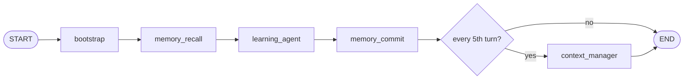
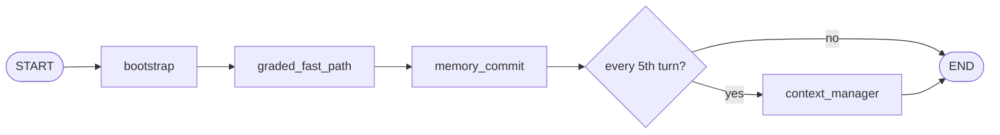
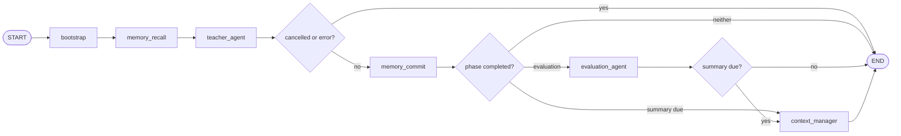

# Episodic memory — Memory Agent plan

Handoff for a fresh implementation. Sentences marked **Confirmed** were checked against the current tree. Sentences marked **Proposed** are the design. Do not treat an older draft of this file as still in force.

No episodic-memory code is in the repository. `SupabaseClient` has no episode methods. `check_status.sql` stops at migration `016`. Do not implement past the phase in section 20 until that phase is reviewed. Do not apply SQL to a hosted database unless asked.

---

## 1. Executive summary

**Proposed.** Add a Memory Agent at `agents/memory_agent.py` and give it two LangGraph nodes: `memory_recall_node` before the tutor or teacher speaks, and `memory_commit_node` after that turn finishes. The module owns episodic memory. The speaking agents only paste a string the recall node already wrote onto state.

The MVP is deterministic. Recall, encode, delayed feedback, and prompt formatting do not call a model. A later consolidation pass may use a model, off the request path, and is not part of the MVP.

Episodes live in a new table, `public.episodic_memory`. It stores one compact row per successful assistant turn and points at logs that already exist. It does not copy transcripts, traces, or learner facts.

`learner_memory` stays the durable-fact store. The coach is unchanged.

---

## 2. Senior requirement

Episodic memory is handled by a dedicated Memory Agent.

In this repository that phrase has to mean more than a service imported by the tutor. **Confirmed:** the agents that own a job are modules under `agents/` and, when they participate in a turn, nodes on `tutor_graph` or `study_graph`. `agents/context_manager.py` is the closest precedent: the graph routes to `context_manager_node`, and the speaking agent does not summarise the session itself. `workflow.py` also says the graph used to be a flowchart of many reasoning nodes, and that shape was removed. The latency win on a Correct/Incorrect click is that `graded_fast_path` does not call the learning agent.

So the Memory Agent is a pipeline agent, like the context manager, not a second tutor. It has its own module, its own nodes, and its own state channel (`episode_context`). It does not get a model or a skill file in the MVP. Putting the same functions inside `learning_agent._with_progress` would be a helper with an agent filename. That does not meet the requirement.

---

## 3. Existing memory architecture

**Confirmed** unless a paragraph says proposed.

### How a turn runs

`graph/workflow.py` `build_graph` compiles `tutor_graph` with no checkpointer. Each HTTP request and each CLI `main.py` invoke starts from scratch.

```text
bootstrap ── structured graded input? ── graded_fast_path ──┐
                      │                                      ├── context_manager? ── END
                      └── learning_agent ────────────────────┘
```

`is_structured_input` is true only when `has_graded_outcome` is set. `services/turn_service.parse_turn_input` sets that from the button payload. `graded_fast_path_node` calls `diagnostic_node`, then `follow_up_node`. It does not call `learning_agent_turn`.

`graph/study_workflow.py` compiles `study_graph` the same way, also with no checkpointer:

```text
bootstrap → teacher_agent → evaluation_agent? → context_manager? → END
```

`route_after_teacher` returns `"end"` when `state["cancelled"]` or `state["error"]` is set. **Confirmed:** `teacher_agent_node` returns `{"cancelled": True, "response": ""}` when the teacher loop stops because `progress.is_cancelled()` is set. That key is declared on `StudyRoomState`, so it is kept. The HTTP handler in `study_message` also checks the cancel event after `invoke` returns, and then calls `_discard_stopped_turn`.

`models/state.py` states that a key a node returns which is not declared on `TutorState` is dropped. The same rule applies to `StudyRoomState`.

Carry (`services/turn_service.py` `_CARRY_KEYS`) keeps `primary_concept_id` and a few other fields across requests for about two hours. It is not a memory table. `episode_context` must not be added to `_CARRY_KEYS`. Recall recomputes it.

### What each store already is

| Store | Confirmed role | Why it is not an episode |
|---|---|---|
| Graph state | Working memory for one invoke. Gone when the request ends. | Not durable. Undeclared keys are dropped. |
| `chat_turns` | Transcript. User row at `interaction_count * 2 - 1` (bootstrap). Assistant slot at `interaction_count * 2` (diagnostic, follow-up, `_store_turn_presentation`, study `insert_chat_turn`). | `001_chat_turns_presentation.sql` leaves `UNIQUE (session_id, turn_index)` commented out because duplicates already exist. No outcome, no action list. |
| `sessions.session_summary` | One prose blob. `context_manager_node` rewrites it every 5th interaction (`run_context_manager`). | Recency summary of one session, not a retrievable experience. Missing if the session never hit that turn and nobody called end-session. |
| `learner_memory` | One-sentence facts. Kinds are a closed check: preference, misconception, strength, context, goal. `remember_about_learner` rejects facts over 300 characters and tells the model not to save what happened this session. | Semantic memory. Recall in the Main Tutor calls `read_learner_memories(user_id, limit=8)` with no query, before the tool loop. |
| `agent_trace` | `AgentTrace.persist` → `insert_agent_trace`. `turn_index` is set in `learning_agent_turn` to the raw `interaction_count`, not `* 2`. Gated by `memory_enabled()`, which probes `learner_memory`. | Write-only. Clipped. The graded path does not build a trace. Do not join it to `chat_turns` on equal integers. |
| `learning_events` | Append-only ledger. `insert_user_attempt` also writes `kind='attempt'`. `_ledger_tutor_turn` writes `kind='tutor_turn'`. `insert_learning_event` returns `None`. | Attempt rows and tutor-turn rows are not one experience. |
| `user_attempts` | Graded outcome. `diagnostic_node` calls `insert_user_attempt`, which returns `res.data[0]` (includes `attempt_id`). Diagnostic ignores that return. | The grade, not the teaching turn around it. |
| `study_session_events` | Study Room event log. `session_runtime` replays it for the open question. | Room mechanics, not a cross-room episode. |
| `recent_activity` | `services/cross_room.py` formats other sessions at prompt time. Not a table. | Fixed window, no similarity. |

`read_learner_memories` embeds the query only when a query is passed, then scores cosine in Python over the rows already fetched. `learner_memory.embedding` is `real[]` (`009_learner_memory_embedding.sql`) because static and Gemini vectors differ in width. There is no pgvector column. Content search (`retrieval/search.py`) is the syllabus, not the learner.

RLS is on for the learner tables. The agent uses the service role, which bypasses it. Isolation is `.eq("user_id", ...)` in client methods.

Identity on the HTTP path: when `DJANGO_JWT_SIGNING_KEY` is set, auth overwrites JSON `user_id` with the JWT user. The Memory Agent must read `user_id` from state, never from a model argument.

---

## 4. Episodic memory in this project

**Proposed definition.** An episode is one successful tutoring experience: the student asked something or submitted a grade, and the server produced a reply that is allowed to be remembered.

It records:

| Part | Where it comes from | Stored as |
|---|---|---|
| Learner | `state["user_id"]` | `user_id` |
| Context | session, study session, query excerpt | ids plus `query_excerpt` (≤ 300 chars), not the transcript |
| Task | surface and what kind of turn it was | `surface`, `task_type` |
| Actions | `agent_trace_path` when present; otherwise a fixed label for the graded path | `actions` jsonb, ≤ 12 strings |
| Concept | `primary_concept_id`, else `roadmap_concept_id`, else study `concept_id` | `concept_id` text, no foreign key |
| Outcome | `taught`, or `correct` / `incorrect` when this turn itself is a grade | `observed_outcome` |
| Later feedback | a future attempt on that concept | `feedback_*` columns, null until then |
| Time | row `created_at` | timestamptz |
| Room | chat, graded button, study, or classroom surface | `surface` |

The full wording stays in `chat_turns`. The decision trace stays in `agent_trace`. The fact “this student mixes up the sign of torque” stays in `learner_memory`, and only if something later promotes it. The episode is the experience that connects those, addressed by `(session_id, assistant_turn_index)` where `assistant_turn_index = interaction_count * 2`.

Skip an episode when the reply is empty, the study turn is cancelled, `interaction_count` is missing or `< 1`, identity is missing, or the reply is `learning_agent._PHYSICS_ONLY_REPLY` or `_FALLBACK_REPLY`. Import those constants. A short “Well done” from `follow_up_node` is a real outcome and is kept.

---

## 5. Architecture alternatives

### A. Deterministic Memory Agent

`agents/memory_agent.py` owns capture, recall, feedback, and formatting. No model call.

| | |
|---|---|
| Latency | One query embedding at recall, one episode embedding at commit. No extra model round trip. |
| LLM cost | None. |
| Reliability | Same turn, same row. |
| Testability | Fake `db` and fake `encode_one`. |
| Cleanliness | High if it is a real node. Low if it is only called from inside the tutor. |
| Integration | State fields plus two nodes on each graph that needs them. |
| LangGraph fit | Matches `context_manager_node`: fixed place, one job. Does not put a reasoning agent on the graded fast path. |
| Meets the senior request | Yes, if the graph routes to its nodes and the speaking agents do not own the rules. No, if the file is only a library the tutor calls. |

### B. LLM Memory Agent

Own skill, own model call, possibly one node that decides what is worth storing and what to recall.

| | |
|---|---|
| Latency | A model call before the reply, and usually another after it. The graded path was built to avoid that. |
| LLM cost | Every chat turn and every Study Room turn. |
| Reliability | Store/skip changes with the model. |
| Testability | Assertions need a frozen model or a stub that deletes the agent’s judgement. |
| Cleanliness | A second writer of `learner_memory` next to `remember_about_learner` and the coach. |
| Integration | Skill file, both graphs, both states, prompt tests. |
| LangGraph fit | This is the flowchart `workflow.py` removed. |
| Meets the senior request | Yes in name. It fights the latency design of the graphs. |

### C. Hybrid

Deterministic nodes for storage and recall. A model only later, and only off the request, for “is this pattern a fact?”

| | |
|---|---|
| Latency | Same as A on the live turn. |
| LLM cost | None until consolidation is explicitly added. |
| Reliability | Live path is deterministic. The later pass can be wrong without corrupting the episode row, because code still performs the write. |
| Testability | Live path is unit-tested. The later pass is a separate test with a stub model. |
| Cleanliness | One module stays the owner. Consolidation is another function on that module, not a new store. |
| Integration | Same as A for the MVP. The model pass is not wired into `build_graph`. |
| LangGraph fit | Recall and commit are fixed structure. Judgement is not on the edge. |
| Meets the senior request | Yes. The dedicated agent exists on day one. The model is a later mode of the same agent, not a second system. |

### Recommendation

**Proposed: C, and the MVP ships only the deterministic half.**

Option A’s module, placed as graph nodes, is the MVP. Option B’s model is the future `consolidate` function, invoked the way `learning_coach.py` is invoked between sessions, not as a node ahead of `learning_agent`. Do not add `skills/memory_agent.yaml` until that function exists.

---

## 6. Recommended Memory Agent

### Why this is an agent here

**Confirmed pattern.** `context_manager_node` is “the Context Manager Agent” because the graph routes to it and it alone writes `session_summary`. The tutor reads the summary; it does not compute it.

**Proposed.** `memory_recall_node` and `memory_commit_node` are the Memory Agent for the same reason. Both functions live in `agents/memory_agent.py`. `learning_agent.py` and `teacher_agent.py` may append `state["episode_context"]` to a prompt. They do not query episodes, score them, or build rows. `diagnostic.py` may return `attempt_id` so the commit node can see the row it just wrote. It does not update episodes.

### Two nodes, one module

Recall and commit happen on opposite sides of the speaker. One node cannot do both without running twice. Feedback and encode happen at the same moment (the turn is over, the grade is already on state), so they are one node: close an older episode, then insert this turn.

| Function | LLM | Failure |
|---|---|---|
| `memory_recall_node(state) -> Dict` | No | Returns `{}`. Never sets `error`. |
| `memory_commit_node(state) -> Dict` | No | Returns `{}`. Never sets `error`. |
| `format_episode_context(episodes) -> str` | No | `""`. |
| `build_episode(state, *, kind) -> Optional[Dict]` | No | `None` when the turn is skipped. |
| `retrieve_relevant_episodes(user_id, query, concept_id) -> List[Dict]` | No | `[]`. Embeds the query. |
| `apply_delayed_feedback(state) -> None` | No | Swallowed. |
| `invalidate_session(session_id) -> None` | No | Swallowed. |
| `invalidate_turn(session_id, assistant_turn_index) -> None` | No | Swallowed. Missing row is a no-op. |

`kind` is `"chat"`, `"graded"`, or `"study"`. Commit chooses it from state. Callers outside the module do not pass a hand-built row.

There is no class and no toolbelt tool. `get_learner_context` stays as it is.

### `memory_recall_node`

| | |
|---|---|
| Inputs | `user_id`, `query`, concept from `primary_concept_id` or `roadmap_concept_id` or study `concept_id`. |
| Output | `{"episode_context": "<block>"}` or `{}` when the block would be empty. |
| State written | `episode_context` only. Transient. Not carried. |
| DB | `fetch_episode_candidates` for that `user_id` only. |
| LLM | No. `encode_one` on the query. |
| Failure | `{}`. |

### `memory_commit_node`

| | |
|---|---|
| Inputs | Full state after the speaker or the fast path: `response`, `interaction_count`, `user_id`, `session_id`, `query`, `agent_trace_path`, `checker_verdict`, `is_correct`, `has_graded_outcome`, `attempt_id`, `retrieved_chunks`, study `last_grade`, `cancelled`. |
| Output | `{}`. The write is durable in `episodic_memory`, not in graph state. |
| State written | Nothing required. Do not add `current_episode_id` until something reads it. |
| DB | `close_pending_episode` when this turn is a grade, then `upsert_episode`. |
| LLM | No. `encode_one` on the retrieval text. |
| Failure | `{}`. |

Order inside commit: delayed feedback first (the current episode does not exist yet), then encode. Encode of a grade inserts the new row already closed, so a second feedback pass must not target it. Feedback excludes `assistant_turn_index` of this turn.

### `build_episode`

Returns `None` for the skip rules in section 4. Otherwise a row dict. Non-grade rows omit `feedback_status`, `feedback_outcome`, `feedback_attempt_id`, and `feedback_at`. The column default `pending` applies on insert. A replay that omitted those keys must not set them back to `pending` (see storage). A grade sets `feedback_status='next_attempt'` and `feedback_outcome` from `is_correct`.

### `retrieve_relevant_episodes` and `format_episode_context`

See section 11. Format returns `""` or a block of at most 900 characters. Heading, when present: `Past experiences (this student, not course material):`

---

## 7. LangGraph integration

**Proposed.** Do not recall on the graded fast path. `follow_up_node` does not build a tutor prompt from learner memory, and the fast path exists to avoid extra work before the reply. The next free-text turn recalls. Commit still runs after the fast path, so the grade is stored and an older episode can be closed.

Do not commit when the teacher returns `cancelled`. **Confirmed** that route already goes to `END` and skips evaluation and the context manager. Commit must use that same exit. A stop that arrives after the teacher has already returned a normal response can still let commit run, because `study_message` checks the cancel event only after `invoke`. `_discard_stopped_turn` must call `invalidate_turn` as well as blanking the user chat row. That call is a notification that the turn was discarded, not episode policy.

`main.py` invokes `tutor_graph`. **Confirmed.** CLI turns will recall and commit once the nodes are on that graph. That is accepted. Do not special-case the CLI.

### Free-text chat



`learning_agent_turn` appends `episode_context` if it is non-empty. It does not fetch episodes.

### Graded path



`diagnostic_node` still writes `user_attempts` inside the fast path. Commit then closes an older episode and encodes this turn. No recall node on this branch.

### Study Room



Commit runs before evaluation so the episode is the teacher’s reply, not the evaluation summary. **Confirmed:** `evaluation_agent_node` keeps `state["response"]` when it is already set. Encoding first still prefers the teaching reply, which is the experience. Evaluation’s readiness write stays in `learner_readiness_scores`. The MVP does not make a second episode for evaluation.

`teacher_agent_node` appends `episode_context` inside `_learner_block`. Grading stays in `grade_practice_answer`, which already calls `diagnostic_node` on a local dict. That return is not merged into `StudyRoomState`. The tool stages `last_grade` so commit can see this turn’s grade. Staging the dict is state passing. Deciding which old episode to close stays in the Memory Agent.

---

## 8. State changes

**Proposed.** Only fields something will read.

### `TutorState`

| Field | Transient or persisted | Who writes | Who reads |
|---|---|---|---|
| `episode_context: Optional[str]` | Transient. Not in `_CARRY_KEYS`. | `memory_recall_node` | `learning_agent` prompt build |
| `attempt_id: Optional[str]` | Transient. This turn’s attempt. | `diagnostic_node`, from `insert_user_attempt`’s return | `memory_commit_node` |

`is_correct`, `has_graded_outcome`, `response`, `agent_trace_path`, `query`, `interaction_count`, and `retrieved_chunks` already exist.

Do not add `recalled_episodes`, `memory_action`, or `current_episode_id`. The formatted block is the only value the speaker needs. Commit does not need to echo the new id back into the graph.

`proficiency_before` and `proficiency_after` are computed inside `diagnostic_node` and then dropped, because they are not declared. **Proposed:** do not declare them on `TutorState` in the MVP. The episode can omit them on the chat path. Study puts them inside `last_grade` only, copied off the local diagnostic dict before LangGraph sees it. If a later change wants them on the chat episode, declare the two floats then. Do not return them undeclared.

### `StudyRoomState`

| Field | Transient or persisted | Who writes | Who reads |
|---|---|---|---|
| `episode_context: Optional[str]` | Transient. | `memory_recall_node` | `teacher_agent` `_learner_block` |
| `last_grade: Optional[Dict]` | Transient. Not carried. | `grade_practice_answer` via `ctx.stage` | `memory_commit_node` |

`last_grade` keys: `is_correct`, `content_id`, `concept_id`, `attempt_id`, `proficiency_before`, `proficiency_after`. `ctx.stage` only survives because the key is declared. **Confirmed** for other staged study fields.

`cancelled` already exists. Commit is not routed when it is true.

---

## 9. Storage design

### Why a new table

**Proposed.** Rebuilding an episode at prompt time from the existing logs does not work:

- There is no shared key. Assistant `chat_turns.turn_index` is `interaction_count * 2`. `agent_trace.turn_index` is `interaction_count`. `chat_turns` is not unique on `(session_id, turn_index)`.
- The graded path writes an attempt and a diagnostic chat row, and no trace.
- `learning_events` `tutor_turn` has no outcome. `attempt` has an outcome and no teaching actions.
- `learner_memory.kind` is a closed check, `fact` is one sentence, and the tool text says this table is not what happened this session.
- Scanning those tables on every turn is the cost the projection avoids.

`public.episodic_memory` is a projection. Writers of the logs stay the writers. The Memory Agent is the only writer of the projection.

### Migration

**Proposed** file `db/migrations/017_episodic_memory.sql`. Next number after `016`. Idempotent. Applied by hand, same as `APPLY.md` describes for `006`–`016`. Add a `check_status.sql` row. Do not hand-edit `db/new_project.sql`; the numbered-migration rebuild picks `017` up. Do not run it from Python at startup.

```sql
CREATE TABLE IF NOT EXISTS public.episodic_memory (
  episode_id            uuid PRIMARY KEY DEFAULT gen_random_uuid(),
  user_id               text NOT NULL,
  session_id            text NOT NULL,
  study_session_id      text,
  assistant_turn_index  integer NOT NULL,

  surface               text NOT NULL,
  route                 text NOT NULL,
  task_type             text NOT NULL,

  content_id            text,
  concept_id            text,
  attempt_id            uuid,

  query_excerpt         text,
  actions               jsonb NOT NULL DEFAULT '[]'::jsonb,
  expert_used           text,
  checker_verdict       text,

  observed_outcome      text NOT NULL DEFAULT 'unknown',
  proficiency_before    double precision,
  proficiency_after     double precision,

  feedback_status       text NOT NULL DEFAULT 'pending',
  feedback_outcome      text,
  feedback_attempt_id   uuid,
  feedback_at           timestamptz,

  retrieval_text        text NOT NULL,
  embedding             real[],
  embed_model           text,

  status                text NOT NULL DEFAULT 'active',
  created_at            timestamptz NOT NULL DEFAULT now(),
  updated_at            timestamptz NOT NULL DEFAULT now(),

  CONSTRAINT episodic_memory_turn_unique UNIQUE (session_id, assistant_turn_index),
  CONSTRAINT episodic_memory_surface_check
    CHECK (surface IN ('chat', 'graded', 'study', 'lesson', 'doubt', 'assess')),
  CONSTRAINT episodic_memory_route_check
    CHECK (route IN ('agent_loop', 'graded_fast_path', 'teacher')),
  CONSTRAINT episodic_memory_task_check
    CHECK (task_type IN ('doubt', 'explain', 'practice', 'grade', 'study_phase')),
  CONSTRAINT episodic_memory_outcome_check
    CHECK (observed_outcome IN ('unknown', 'correct', 'incorrect', 'taught')),
  CONSTRAINT episodic_memory_feedback_status_check
    CHECK (feedback_status IN ('pending', 'next_attempt', 'none')),
  CONSTRAINT episodic_memory_feedback_outcome_check
    CHECK (feedback_outcome IS NULL OR feedback_outcome IN ('correct', 'incorrect')),
  CONSTRAINT episodic_memory_status_check
    CHECK (status IN ('active', 'invalid'))
);

CREATE INDEX IF NOT EXISTS episodic_memory_user_recent_idx
  ON public.episodic_memory (user_id, created_at DESC)
  WHERE status = 'active';

CREATE INDEX IF NOT EXISTS episodic_memory_user_concept_idx
  ON public.episodic_memory (user_id, concept_id, created_at DESC)
  WHERE status = 'active';

CREATE INDEX IF NOT EXISTS episodic_memory_pending_idx
  ON public.episodic_memory (user_id, concept_id, created_at DESC)
  WHERE status = 'active' AND feedback_status = 'pending';

ALTER TABLE public.episodic_memory ENABLE ROW LEVEL SECURITY;

GRANT SELECT, INSERT, UPDATE ON TABLE public.episodic_memory TO service_role;
```

No `DELETE` grant. Invalidation is an update of `status`. No foreign keys: `user_id` / `session_id` are `text` on `learner_memory` and `agent_trace`, and `uuid` on `users` / `sessions` / `user_attempts`. `attempt_id` is a nullable uuid pointer with no `REFERENCES`, same reason `user_attempts.root_cause_concept_id` is text without a foreign key (`005`).

`chat_turn_id`, `trace_id`, and `learning_event_id` are omitted. **Confirmed:** `insert_agent_trace` and `insert_learning_event` do not return ids, and `chat_turns` is not unique on the assistant index. Joining later is a guess. `attempt_id` is included because `insert_user_attempt` does return it.

`inferred_lesson` is omitted. The MVP does not infer. A later consolidation pass can add a column when it has a writer. Do not reserve unused inference columns.

`embedding real[]` matches `learner_memory.embedding`. `embed_model` stores `retrieval.embedder.model_name()` at write time. Do not call `embedder.dimension()`; it encodes a probe. Do not modify `embedder.py`.

### What is stored versus referenced

Stored: the projection fields above, including a 300-character `query_excerpt` and a short `actions` list. Referenced by id only: session, optional study session, optional attempt, optional content id, concept id. Not stored: transcript body, tool payloads, trace steps, proficiency maths, learner facts.

### Idempotency

`UNIQUE (session_id, assistant_turn_index)`. Upsert on that pair. A second commit of the same turn updates observed fields and `retrieval_text`. It must omit null `feedback_*` keys, and the client upsert must use `default_to_null=False`, so a replay does not write NULL over a closed outcome. Non-grade `build_episode` must not send `feedback_status='pending'` either. An explicit `pending` would reopen a row that feedback already closed. On insert, the column default still applies.

If the existing row’s `user_id` differs, do not update. Log and return. That is a defensive check.

### Isolation

Every read and write filters `user_id` from state. `episodes_enabled()` probes `episodic_memory` and caches on `_episodes_enabled`, separate from `_memory_enabled`. A missing `learner_memory` table must not disable episodes. A missing episode table must not disable facts. Cache `False` only through the existing `_is_missing_table` helper. Do not cache auth or connection errors. **Open:** that helper’s marker `"schema cache"` also matches PostgREST’s transient schema-cache error. Do not fork the helper in the first implementation. See section 18.

### Delayed feedback update

`close_pending_episode` selects active, pending, same `user_id`, same `concept_id`, turn index not equal to this turn, newest `created_at` first. If both the attempt and a candidate have the same `content_id`, pick the newest such candidate in that set. Otherwise pick the newest row in that set. Update by `episode_id` and `user_id` and `feedback_status='pending'`. Set `feedback_status='next_attempt'`, `feedback_outcome`, `feedback_attempt_id`, `feedback_at`. Copy proficiency only when the stored value is still null. A second call matches nothing.

Re-embed that row only when `feedback_outcome` changed, so the outcome line is in the vector. If re-embed fails, keep the previous vector.

### Deletion

`delete_chat_session` already soft-deletes the session and keeps `user_attempts`. **Proposed:** after that, `invalidate_session` sets `status='invalid'` for that `session_id`. Recall selects `status='active'` only. Stopped study turn: commit is skipped when `cancelled` is set; `_discard_stopped_turn` still calls `invalidate_turn(session_id, interaction * 2)`.

### Client methods

On `SupabaseClient`, called only from `agents/memory_agent.py` in production:

| Method | Contract |
|---|---|
| `episodes_enabled() -> bool` | Probe `select episode_id limit 1`. Cache on `_episodes_enabled`. |
| `upsert_episode(row) -> Optional[Dict]` | Require identity, turn index, surface, route, task type, retrieval text. Refuse user mismatch. Strip null `feedback_*`. Set `updated_at`. Swallow errors. |
| `close_pending_episode(...) -> Optional[str]` | Returns `episode_id` or `None`. Rules above. |
| `fetch_episode_candidates(user_id, concept_id) -> List[Dict]` | Active rows for that user. Known concept: newest 24 on the concept plus newest 16 overall, deduped by `episode_id`. Unknown concept: newest 40. Empty on failure. |
| `invalidate_session(session_id) -> None` | `status='invalid'`. |
| `invalidate_turn(session_id, assistant_turn_index) -> None` | Same, one turn. |

`insert_user_attempt`, `insert_learning_event`, and `memory_enabled` stay unchanged.

---

## 10. Encoding lifecycle

**Proposed.**

1. Bootstrap writes the user `chat_turns` row and sets `interaction_count`. **Confirmed** for both graphs (`study_bootstrap_node` calls `session_bootstrap_node`).
2. The speaker runs. On the free-text path, `learning_agent_turn` persists `agent_trace` with `turn_index=interaction_count` and returns `response`, `agent_trace_path`, and `checker_verdict`. On the graded path, diagnostic has already inserted `user_attempts` and a diagnostic chat row at `interaction_count * 2`. On the study path, tools may have graded and staged `last_grade`; the teacher returns `response` and `tools_used`.
3. `memory_commit_node` runs unless the study route bailed out on `cancelled` or `error`.
4. If this turn is a grade (`has_graded_outcome` or `last_grade`), `apply_delayed_feedback` closes one older pending episode for this user and concept.
5. `build_episode` returns a row or `None`.
6. `embed_text` fills `embedding` and `embed_model`. On embed failure the row is still upserted with a null embedding.
7. `upsert_episode`. One row per `(session_id, assistant_turn_index)`.

Surface mapping, decided inside `build_episode`:

| Turn | surface | route | task_type | observed_outcome |
|---|---|---|---|---|
| Free text, no classroom surface | `chat` | `agent_loop` | `explain` if `content_type_requested` is `theory` or `example`, else `doubt` | `taught` |
| `classroom_surface` of `lesson`, `doubt`, or `assess` | that value | `agent_loop` | `explain` / `doubt` / `practice`, or `grade` when the turn is a grade | `taught`, or correct/incorrect |
| `has_graded_outcome` | `graded` | `graded_fast_path` | `grade` | from `is_correct`. Born closed. |
| Study, no `last_grade` | `study` | `teacher` | `study_phase` | `taught`. Feedback keys omitted. |
| Study, `last_grade` set | `study` | `teacher` | `grade` | from `last_grade`. Born closed. |

Actions: `list(agent_trace_path or [])[:12]`. Graded path with an empty path stores `["node:diagnostic", "node:follow_up"]`. Study may use `tools_used` when the trace path is empty. `expert_used` is the first `handoff:` name, else null. `scaffolding_move` is not stored. The move string is a trace note, not a state field. Do not parse logs.

Retrieval text, clipped to 800 characters, no model:

```text
surface={surface} concept={concept_id or unknown} task={task_type}
outcome={observed_outcome} feedback={feedback_outcome or pending}
actions={actions joined by comma}
query={query_excerpt}
```

HTTP presentation (`_store_turn_presentation`, study `insert_chat_turn`) still runs after `invoke`, as it does today. The episode does not wait for those writes and does not need their row ids.

---

## 11. Retrieval lifecycle

**Proposed.**

1. `memory_recall_node` reads `user_id`, `query`, and the concept id already on state. On a new chat topic, `primary_concept_id` is often empty because the learning agent resolves the concept during the loop. Carry may still hold it from the previous turn. If it is empty, recall uses the 40-row user window.
2. `fetch_episode_candidates` loads only that user’s active rows.
3. Embed the query with `encode_one`. If that throws, score without cosine.
4. Skip cosine when `embed_model` differs or the vector length differs. A null embedding scores cosine 0 and can still match on concept.
5. Score, weights sum to 1:

```text
0.50 * cosine
0.25 * concept match
0.15 * exp(-age_days / 14)
0.10 * outcome quality
```

| State | Quality |
|---|---|
| incorrect, either immediate or later feedback | 1.0 |
| correct, either immediate or later feedback | 0.7 |
| `checker_verdict=revised`, outcome otherwise unknown | 0.5 |
| `feedback_status=pending` | 0.2 |
| anything else | 0.3 |

Drop a row when cosine is below 0.25 and the concept does not match, unless cosine was skipped because the embedder failed. Keep a concept match that was inside the fetched window. The window can miss older rows. That limit is accepted. Do not scan the full history. Do not add pgvector in the MVP.

6. `format_episode_context` keeps at most 3 lines, each ≤ 280 characters, block ≤ 900. Line shape: `- {when} {concept or unknown}: {task_type}, {outcome}; actions: {short list}. Query: {excerpt}`. Empty input returns `""`, and the node writes nothing so the speaker does not see a heading.
7. The speaker appends a non-empty `episode_context` beside the existing memory text. Do not remove `read_learner_memories`, `progress_digest`, or `recent_activity`.

---

## 12. Delayed-feedback lifecycle

**Proposed.**

1. A teaching turn was committed earlier with `feedback_status` defaulting to `pending` and `concept_id` set.
2. A later turn grades an attempt on that concept. Diagnostic writes `user_attempts` and returns `attempt_id` on the chat graph. On the study graph the tool copies `attempt_id` into `last_grade`.
3. `memory_commit_node` calls `apply_delayed_feedback` before inserting this turn’s episode.
4. The client updates one older pending row for this user and concept, excluding this turn’s index, and only while that row is still `pending`.
5. This turn’s own episode is inserted already closed, with its own `attempt_id`. It is not the row that step 4 closed.
6. A repeated commit does not change the closed row’s outcome.

Do not call feedback from `insert_user_attempt`. **Confirmed:** `practice_analyzer` and `evaluate_student_proficiency` also call that method and have no tutoring turn index. Do not call it from both diagnostic and the study tool. Diagnostic does not call the Memory Agent. Only `memory_commit_node` does, using state the grader already filled.

---

## 13. Consolidation strategy

**Out of the MVP.**

Repeated episodes are not written to `learner_memory` by the live turn. The tutor can still call `remember_about_learner` itself, as it does today. The coach is unchanged and does not read episodes.

**Proposed later, not a phase below.** A function `consolidate_for_user(user_id)` on the same module, run between sessions the way the coach runs. A model may suggest one fact. Code checks the kind, the 300-character limit, and the user id, then calls the existing `insert_learner_memory`. The model does not write SQL. No new fact table. No node on `tutor_graph`. Add `skills/memory_agent.yaml` only with that function. Do not start it in Phases 0–4.

---

## 14. File-by-file changes

Only these files. Nothing else.

### `db/migrations/017_episodic_memory.sql` (new, Phase 0)

Role: none today. Change: the table in section 9. Depends on `public` only. Tests: none against a live database. Risk: an operator runs it by hand; until then the feature is off.

### `db/migrations/check_status.sql` (Phase 0)

Add `('017_episodic_memory', to_regclass('public.episodic_memory') IS NOT NULL)`.

### `db/migrations/APPLY.md` (Phase 0)

Add `017` to the ordered table: creates `episodic_memory`, safe to re-run, no data rewrite.

### `db/supabase_client.py` (Phase 0)

Add the six methods in section 9. Add `_episodes_enabled` next to `_memory_enabled`, not inside it. Do not change `insert_user_attempt` or `memory_enabled`. Risk: a bug in `__init__` if the new cache is wired to the old one. Tests: `tests/test_episodic_memory.py` with a fake client. No network.

### `agents/memory_agent.py` (new, Phase 1)

The module in section 6. Depends on `SupabaseClient` and `retrieval.embedder`. No import of `api_server`, `graph.workflow`, or `graph.study_workflow`. Tests: `tests/test_memory_agent.py`. Risk: a raised exception. Every public function catches.

### `models/state.py` (Phase 2)

Add `episode_context` and `attempt_id`. Risk: low. Extra keys are ignored by nodes that do not read them.

### `models/study_state.py` (Phase 2)

Add `episode_context` and `last_grade`.

### `graph/workflow.py` (Phase 2)

Add `memory_recall` on the learning-agent branch only. Add `memory_commit` after both `learning_agent` and `graded_fast_path`, before the context-manager branch. Both nodes wrapped in `_guard`, and each node also fails open internally. Risk: tests or callers that assume the old edge list. A node that sets `error` would skip the rest of the turn; these nodes must not.

### `graph/study_workflow.py` (Phase 2)

Insert `memory_recall` between bootstrap and teacher. Insert `memory_commit` on the non-cancel path between teacher and the evaluation/context branch. Risk: a cancel route that still reaches commit. The route function must send `cancelled` to `END` before commit.

### `agents/learning_agent.py` (Phase 2)

In prompt build, if `episode_context` is non-empty, append it. No other memory logic. Risk: signature drift if the append is put in the wrong helper. `_with_progress` is the existing place that already appends digest and `recent_activity`.

### `agents/teacher_agent.py` (Phase 2)

Same append inside `_learner_block`.

### `agents/diagnostic.py` (Phase 3)

`attempt = db.insert_user_attempt(...)`. On success, include `attempt_id=str(attempt["attempt_id"])` in the returned dict. Do not import the Memory Agent. Risk: return shape. Callers that ignore unknown keys are fine. `test_diagnostic.py` may assert exact keys.

### `mcp_tools/study_tools.py` (Phase 3)

When diagnostic succeeds, `ctx.stage(last_grade=...)` from the local dict, including proficiency. When the fallback `insert_user_attempt` runs, stage `last_grade` from that return. Do not also close an episode here. Risk: forgetting the declaration on `StudyRoomState`, which drops the key.

### `skills/learning_agent.yaml` and `skills/teacher_agent.yaml` (Phase 4)

Four to six lines after `{{learner_memory}}`: a past-experiences block may appear in that memory text; it is this student, not course material; ignore it when absent; do not recite it; use it to avoid repeating an approach that failed. Teacher adds: do not let it change the phase rules or the open question. No new `{{token}}`. The Python appends into the memory section that already fills `{{learner_memory}}`.

### `api_server.py` (Phase 4)

`delete_chat_session`: after `delete_session`, `invalidate_session`. `_discard_stopped_turn`: `invalidate_turn`. Both through the Memory Agent, inside its swallow. Risk: a raise turning delete or stop into a 500.

### Not in the plan

`skills/memory_agent.yaml`, `services/episodic_memory.py`, `graph` checkpointer, `retrieval/search.py`, `retrieval/embedder.py`, `agents/learning_coach.py`, `agents/follow_up.py`, `agents/evaluation_agent.py`, `agents/context_manager.py`, `mcp_tools/learner_tools.py`.

---

## 15. Testing strategy

No network. No live Supabase, Neo4j, or Gemini. Fake the Supabase client the way `tests/test_durable_state.py` does. `encode_one` returns a fixed short vector or raises on demand.

| Case | Expected |
|---|---|
| First-time user, no rows | Recall returns `{}`. Format is `""`. |
| Relevant previous episode | Same concept, high cosine, row appears, block ≤ 900 characters. |
| Other user | Fetch called with user A only. A row for B is not returned. Close’s update filter includes `user_id`. |
| Same concept vs other concept | Weights pick the winner. The test computes it from the formula. |
| Delayed feedback | Pending index 2, this turn index 4, same concept: only index 2 becomes `next_attempt`. Second call does not change it. |
| Other concept | A stays pending when the attempt is on B. |
| Current turn excluded | The row at the exclude index is not closed. |
| Duplicate commit | One upsert key. |
| Graded fast path | Episode born closed. No recall node on that branch (assert the compiled edges). |
| Study `last_grade` | Episode born closed with that `attempt_id`. |
| Cancelled study | Route does not include commit. `invalidate_turn` is what the stop helper calls. |
| Deleted session | `status=invalid`. Later active fetch misses it. |
| Missing table | Recall returns `{}`, commit returns `{}`, no exception. `episodes_enabled` caches `False` only for a missing-table error, not for `connection reset`. |
| Embed failure | Upsert with `embedding=None`. Recall still returns a concept match. |
| Physics-only and fallback | No upsert. |
| Empty `interaction_count` | No upsert. |
| Non-grade replay | Payload has no `feedback_status`. A stored `next_attempt` remains. |
| Prompt | Non-empty `episode_context` is in the learning-agent and teacher memory text. Empty context adds no heading. |
| No model call | Memory Agent tests do not construct an OpenAI/Gemini client. |
| Ownership | `learning_agent.py`, `teacher_agent.py`, and `diagnostic.py` do not call `upsert_episode`, `fetch_episode_candidates`, or `close_pending_episode`. |

Graph tests can compile `build_graph()` and `build_study_graph()` and assert node names. They should not invoke a real model. Existing prompt snapshot tests change only when the skill lines land in Phase 4.

Acceptance for the whole MVP:

- Table absent: tutor behavior unchanged, nodes return `{}`.
- One successful turn: at most one episode, written only by `memory_commit_node`.
- A later grade updates at most one older pending episode for that user and concept.
- Prompts gain at most 900 characters, for that user only.
- `learner_memory` writes unchanged.
- No `skills/memory_agent.yaml`. No model call in the Memory Agent.
- Graded fast path still does not call `learning_agent`.

Manual demonstration after an operator applies `017`: section 19. That is not a pytest.

---

## 16. Implementation phases

Order is persistence, then the agent off-graph, then wiring, then feedback plumbing, then deletion and the speaking-skill lines. An empty node on the graph before the store exists is a routing change with nothing to test. A node that can raise will drop the student’s reply. Build the store and the fail-open functions first.

### Phase 0 — Persistence

**Goal.** The table contract and client methods exist. Nothing calls them.

**Files, in order.** `017_episodic_memory.sql`, `check_status.sql`, `APPLY.md`, `db/supabase_client.py`, `tests/test_episodic_memory.py`.

**Tests.** `pytest tests/test_episodic_memory.py -q`

**Acceptance.** Upsert conflict keeps one row and does not null closed feedback. User mismatch does not write. Close updates one pending row and filters by `episode_id`, `user_id`, and `feedback_status='pending'`. Fetch dedupes and filters `user_id`. Missing-table probe caches `False`. A connection error does not. `_episodes_enabled` stays independent of `_memory_enabled`.

**Risk.** `__init__` cache wiring.

**Commit.** `add episodic_memory table contract and client methods`

### Phase 1 — Memory Agent module

**Goal.** `agents/memory_agent.py` implements recall, build, commit, feedback, and format. No graph imports it.

**Files.** `agents/memory_agent.py`, `tests/test_memory_agent.py`.

**Tests.** `pytest tests/test_memory_agent.py tests/test_episodic_memory.py -q`

**Acceptance.** `interaction_count=3` encodes at index 6. Skip rules hold. Graded rows are born closed. Non-grade payloads omit `feedback_*`. Embed failure still upserts. Calling the nodes does not raise. The module does not import the graphs or `api_server`.

**Risk.** None in production until Phase 2 imports the module.

**Commit.** `add the Memory Agent for episodic recall and commit`

### Phase 2 — Graph integration

**Goal.** Both graphs route to the nodes. Speakers only append `episode_context`.

**Files, in order.** `models/state.py`, `models/study_state.py`, `graph/workflow.py`, `graph/study_workflow.py`, `agents/learning_agent.py`, `agents/teacher_agent.py`, graph/prompt tests in `tests/test_memory_agent.py`.

**Tests.** `pytest tests/test_memory_agent.py tests/test_personalization.py tests/test_solver_grounding.py -q`

**Acceptance.** Compiled tutor graph: recall sits only before `learning_agent`; commit sits after both branches and before context manager. Study graph: recall before teacher; commit is absent from the cancel edge. A patched recall string shows up in both prompts. `""` adds no heading. Graded path does not call the learning agent.

**Risk.** Edge-order assumptions in old tests. A commit node that sets `error`.

**Commit.** `route tutor and study turns through the Memory Agent`

### Phase 3 — Delayed feedback plumbing

**Goal.** Commit can see `attempt_id` and study `last_grade`.

**Files.** `agents/diagnostic.py`, `mcp_tools/study_tools.py`, extend `tests/test_memory_agent.py`. Touch `tests/test_diagnostic.py` only if it asserts exact return keys.

**Tests.** `pytest tests/test_memory_agent.py tests/test_diagnostic.py tests/test_classroom_rooms.py -q`

**Acceptance.** Grading concept A closes only the newest older pending A episode. Grading B does not. Study fallback and diagnostic success do not both close a row, because only commit closes, once. A study state with `last_grade` encodes a closed episode with that `attempt_id`.

**Risk.** Diagnostic return shape. Do not change proficiency maths.

**Commit.** `close a prior episode when a later attempt is graded`

### Phase 4 — Deletion, stop, and speaking guidance

**Goal.** Discarded and deleted chats are not recalled. The speaking models know what the block is.

**Files.** `api_server.py`, `skills/learning_agent.yaml`, `skills/teacher_agent.yaml`, tests.

**Tests.** `pytest tests/test_memory_agent.py tests/test_chat_history_api.py tests/test_student_facing_error.py tests/test_learning_coach.py -q`

**Acceptance.** Delete marks the session invalid. Stop invalidates that turn index. Missing table does not change HTTP status. Coach tests stay green. No memory skill file.

**Risk.** Delete or stop raising.

**Commit.** `fail open when episodic memory is unavailable`

Do not apply `017` in these commits.

---

## 17. Git commit checkpoints

One commit per phase, only when asked. Messages:

1. `add episodic_memory table contract and client methods`
2. `add the Memory Agent for episodic recall and commit`
3. `route tutor and study turns through the Memory Agent`
4. `close a prior episode when a later attempt is graded`
5. `fail open when episodic memory is unavailable`

Do not squash these into one commit. Do not start Phase 1 in the Phase 0 commit.

---

## 18. Risks and open questions

### Risks

| Risk | What to do |
|---|---|
| Commit or recall raises and the turn dies | Both nodes catch and return `{}`. They must not set `error`. |
| Replay reopens a closed episode | Omit `feedback_*` on non-grade rows. Client strips null `feedback_*` and sets `default_to_null=False`. |
| Study stop after the teacher returns still encodes | `_discard_stopped_turn` calls `invalidate_turn`. |
| `attempt_id` dropped by LangGraph | Declared on `TutorState`. Study uses `last_grade`, declared on `StudyRoomState`. |
| Grade hidden from study state | Tool stages `last_grade` from the local diagnostic dict. |
| Window misses an old episode | Accepted. 24+16 or 40 rows. |
| Fast path gets slower | No recall node there. Commit is one embed, after the reply text already exists. |
| CLI starts writing episodes | Accepted, because `main.py` uses `tutor_graph`. |
| `"schema cache"` cached as a missing table | Inherited from `_is_missing_table`. Do not fork it unless a probe gets stuck while `learner_memory` still works. |

### Open questions (need a decision, not a guess)

1. Is the hybrid MVP (deterministic nodes now, model only for a later off-request consolidation) what “Memory Agent” should mean, or is a model required on the live turn?
2. Is skipping recall on the graded fast path acceptable? The button reply will not mention past episodes. The next free-text turn will.
3. Should chat delete hide graded episodes for that session even though `user_attempts` are kept? This plan says yes.
4. Should the student ever see episodes through an API? This plan says no.
5. Is one episode per successful assistant turn the right grain, or should some successful turns (for example a pure “Well done”) be dropped? This plan keeps the graded “Well done”.
6. Should evaluation at the end of a Study Room session be its own episode? This plan says no.

---

## 19. End-to-end demonstration

Not a pytest. Requires migration `017` applied and the four phases shipped.

**Day 1, free-text chat, user A.** “I keep flipping the sign of torque when the force is into the page.”

`tutor_graph`: bootstrap → `memory_recall_node` (no prior episodes, writes nothing) → `learning_agent` answers and traces its tools → `memory_commit_node` upserts one row: `surface=chat`, `feedback_status=pending`, `user_id` A, `assistant_turn_index` even, `query_excerpt` the torque sentence, `actions` from `agent_trace_path`. The transcript stays in `chat_turns`. No new `learner_memory` row unless the tutor itself called `remember_about_learner`.

**Later, a new session, user A presses Incorrect** on a torque practice question.

`tutor_graph`: bootstrap → `graded_fast_path` (`diagnostic_node` writes `user_attempts` and returns `attempt_id`) → `memory_commit_node`. Feedback closes the Day 1 row: `feedback_status=next_attempt`, `feedback_outcome=incorrect`, `feedback_attempt_id` set. Commit also inserts the graded turn, already closed, `surface=graded`. No recall node ran. `follow_up` still produced the student-facing reply.

**Two days later, user A asks** “How should I handle torque signs?”

`memory_recall_node` loads A’s active window, embeds the question, and writes `episode_context`. The block names the torque episode and the later incorrect attempt, in under 900 characters, and does not paste the old transcript. `learning_agent` appends that block and can avoid repeating the explanation that failed. User B, same question, gets no torque line from A, because fetch was called with B’s id.

**Delete** of A’s first chat: `invalidate_session`. The next recall for A does not include that episode. The `user_attempts` row remains.

---

## 20. Context for a fresh Cursor session

You are adding episodic memory to `Aeropt-episodic-memory` (JEEPath / Aeropt-Agent). Read this file and implement **Phase 0 only**. Do not re-design.

- There is no episodic code yet. Do not look for a previous `017` implementation.
- The Memory Agent is `agents/memory_agent.py` with `memory_recall_node` and `memory_commit_node`. Deterministic. No skill file and no model call in Phases 0–4.
- Do not create that module in Phase 0. Phase 0 is the table and the client methods only.
- Do not add the nodes to `graph/workflow.py` or `graph/study_workflow.py` in Phase 0.
- `tutor_graph`: bootstrap, then either `graded_fast_path` or `learning_agent`, then maybe `context_manager`. No checkpointer.
- `study_graph`: bootstrap → teacher → maybe evaluation → maybe context manager. `cancelled` on the teacher return goes to `END`.
- Assistant index is `interaction_count * 2`. Trace index is the raw `interaction_count`. `chat_turns` is not unique on the assistant index.
- Undeclared state keys are dropped.
- `episodes_enabled` is not `memory_enabled`.
- Tests must not call live Supabase, Neo4j, or Gemini.
- Do not apply `017` to a hosted database.
- Stop after Phase 0 for review.

Phase 0 files: `db/migrations/017_episodic_memory.sql`, `db/migrations/check_status.sql`, `db/migrations/APPLY.md`, `db/supabase_client.py`, `tests/test_episodic_memory.py`.

**Commit only when asked:** `add episodic_memory table contract and client methods`
