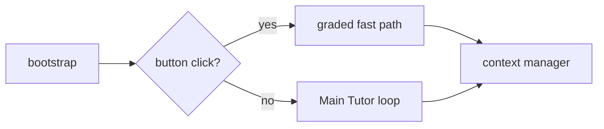

# PrepWise — Tutor Agent

LangGraph Learning Agent for JEE Physics. One Main Tutor owns each student turn:
it calls tools, may consult a temporary expert, then the Answer Checker reviews
the Teaching Answer before the student sees it.

Product architecture: [`ARCHITECTURE.md`](ARCHITECTURE.md). If this file and
that one disagree, `ARCHITECTURE.md` wins.

Port **8001**. Frontend talks to this service for `/chat`. Django (`Aeropt-backend`,
port 8000) owns auth and roadmaps. Both share one Supabase Postgres
(`public` = agent tables, `django` = Django ORM).

## Graph



Free text always goes to the Main Tutor. There is no intent enum.

| Role | File |
|---|---|
| Main Tutor | `agents/learning_agent.py` |
| Toolbelt | `agents/runtime/toolbelt.py` |
| Temporary experts | `agents/experts.py` |
| Answer Checker | `agents/answer_checker.py` |
| Background Coach | `agents/learning_coach.py` |
| Graph | `graph/workflow.py` |
| HTTP | `api_server.py` |

## Tools

Registered with `@tool`, imported from `agents/learning_agent.py::_import_tools`.

`resolve_concept` · `retrieve_content` · `open_material` · `suggest_next_material` ·
`calculate` · `get_learner_context` · `record_attempt` · `remember_about_learner` ·
`schedule_review` · `consult_expert`

Do not add a second registry in `mcp_tools/__init__.py`.

## HTTP

| Method | Path |
|---|---|
| GET | `/health`, `/api/v1/health` |
| POST | `/api/v1/chat/message` (SSE; streams after the checker) |
| POST | `/api/v1/chat/sessions` |
| GET | `/api/v1/chat/sessions`, `/api/v1/chat/sessions/{id}` |
| POST | `/api/v1/chat/end-session` |
| POST | `/api/v1/sandbox/execute` |
| POST | `/api/v1/onboarding/diagnostic` |
| POST | `/api/v1/coach/run` |

## Run

```bash
cp .env.example .env   # fill Neo4j, Supabase, Groq, Gemini
python -m venv .venv && source .venv/bin/activate
pip install -r requirements.txt -r requirements-dev.txt
make ci
python -m uvicorn api_server:app --port 8001 --reload
```

`make deploy` starts `:8001` if `/health` is down.

Live Groq catalog checks: `RUN_LIVE_GROQ_CHECKS=1 python -m pytest tests/test_model_health.py`.

## Still open

Apply `db/migrations/006_learner_memory.sql` on the live database. Without it,
memory and review tools return `saved: false` and the tutor does not remember
the student across sessions.

Do not edit nested `Aeropt-backend-main/` or `Aeropt-frontend-main/` snapshots.
