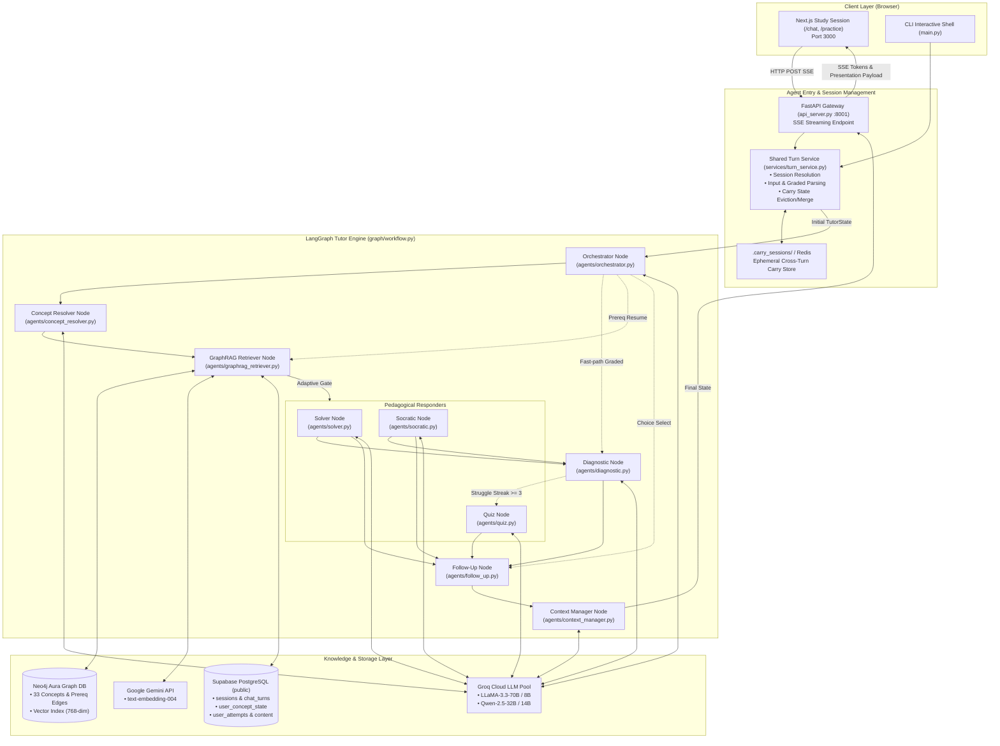
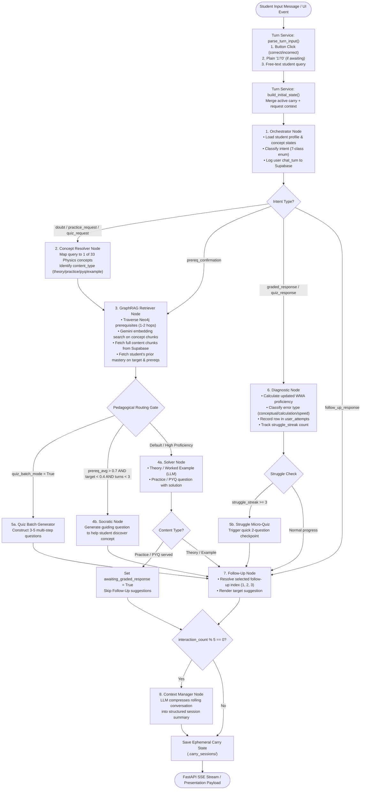

# PrepWise — JEE Tutor Agent (`Aeropt-agent`)

A multi-agent, LangGraph-based AI tutoring and diagnostic system for **JEE Main** and **JEE Advanced Physics**. The agent retrieves curriculum-aligned concepts from a Neo4j knowledge graph, dynamically adapts explanations to student proficiency, tracks learning gaps, and serves structured theory, worked examples, interactive practice questions, and quizzes through an SSE-streaming interface.

Built as part of **PrepWise** in collaboration with **KodeinKGP, IIT Kharagpur**.

---

## Table of Contents

1. [System Architecture](#system-architecture)
2. [End-to-End Execution Flowchart](#end-to-end-execution-flowchart)
3. [Agent Roster & Node Responsibilities](#agent-roster--node-responsibilities)
4. [Turn Service & Session Layer (`services/turn_service.py`)](#turn-service--session-layer)
5. [Intent Classification & Routing Logic](#intent-classification--routing-logic)
6. [GraphRAG Retrieval Engine](#graphrag-retrieval-engine)
7. [Pedagogy Policies & Adaptive Routing](#pedagogy-policies--adaptive-routing)
8. [Cross-Turn Memory & Carry State Lifecycle](#cross-turn-memory--carry-state-lifecycle)
9. [Data Layer: Supabase & Neo4j Schema](#data-layer-supabase--neo4j-schema)
10. [FastAPI Gateway & SSE Streaming API](#fastapi-gateway--sse-streaming-api)
11. [Local Development & Verification](#local-development--verification)

---

## System Architecture

The agent service runs on port **8001** as a standalone FastAPI service. It is loosely coupled with Django (`Aeropt-backend`, port 8000) through shared Supabase PostgreSQL storage (`public` schema for agent telemetry; `django` schema for auth and roadmap), and communicates directly with the Next.js frontend (`Aeropt-frontend`, port 3000) over Server-Sent Events (SSE).



---

## End-to-End Execution Flowchart

Every student message is processed through the compiled LangGraph state machine. Below is the complete execution path showing all conditional branch points:



---

## Agent Roster & Node Responsibilities

| Agent Node | Source File | Core Responsibility | Primary LLM / Model |
|---|---|---|---|
| **Orchestrator** | `agents/orchestrator.py` | Intent classification, session bootstrapping, user turn recording. | `llama-3.1-8b-instant` |
| **Concept Resolver** | `agents/concept_resolver.py` | Entity resolution mapping query to one of 33 canonical Physics concept UUIDs. | `llama-3.1-8b-instant` |
| **GraphRAG Retriever** | `agents/graphrag_retriever.py` | Prerequisite subgraph traversal (Neo4j), vector similarity search, chunk retrieval. | `gemini-embedding-2` (No generative LLM) |
| **Solver** | `agents/solver.py` | Full-depth physics explanation, LaTeX derivations, markdown formatting. | `qwen-2.5-32b` / `llama-3.3-70b-versatile` |
| **Socratic** | `agents/socratic.py` | Guided inquiry and scaffolding when student has strong prerequisites but weak target mastery. | `llama-3.3-70b-versatile` |
| **Diagnostic** | `agents/diagnostic.py` | Exponential decay, weighted moving average (WMA) proficiency math, mistake taxonomy. | `llama-3.1-8b-instant` (error analysis only) |
| **Follow-Up** | `agents/follow_up.py` | Suggesting related sub-concepts, surfacing weak prerequisites, advancing quiz batches. | Deterministic (No LLM) |
| **Quiz** | `agents/quiz.py` | Generating multi-question diagnostic quizzes or struggle checkpoint questions. | `llama-3.3-70b-versatile` / Deterministic chunks |
| **Context Manager** | `agents/context_manager.py` | Periodic rolling conversation compression every 5 interactions. | `llama-3.1-8b-instant` |

---

## Turn Service & Session Layer

All entry points (`main.py` CLI and `api_server.py` HTTP) share [`services/turn_service.py`](services/turn_service.py) to prevent logic drift:

```
                  ┌─────────────────────────────────────┐
                  │        services/turn_service        │
                  └──────────────────┬──────────────────┘
                                     │
         ┌───────────────────────────┼───────────────────────────┐
         ▼                           ▼                           ▼
parse_turn_input()          update_carry()              resolve_session()
Detects UI buttons,         Manages carry lifecycle,    Reads or bootstraps
"1"/"0" practice grades,    clears awaiting flags,      session in Supabase
and legacy formats.         evicts stale retrieval.     with proper validation.
```

### Key Functions
- `parse_turn_input(raw_input, carry, graded_outcome)`: Authoritatively handles UI-button clicks (`correct`/`incorrect`), text replies (`1`/`0`), and legacy `ANSWER::` formatting.
- `update_carry(carry, result, was_graded)`: Ensures retrieved chunks and ephemeral practice flags survive only while awaiting a grade, preventing retrieval poisoning on subsequent turns.
- `clear_stale_practice_carry(carry)`: Evicts pending questions if the student changes topic without answering.

---

## Intent Classification & Routing Logic

The Orchestrator classifies student queries into one of seven intents:

1. `doubt`: Student asks a conceptual physics question (e.g., *"Why does normal force do zero work on an inclined plane?"*). Routes: `ConceptResolver` → `GraphRAG` → `Solver`/`Socratic` → `FollowUp`.
2. `practice_request`: Student asks for a practice or PYQ question. Routes: `ConceptResolver` → `GraphRAG` → `Solver` (formats question) → Skips `FollowUp` until answered.
3. `quiz_request`: Student asks to be tested on a concept. Routes: `ConceptResolver` → `GraphRAG` → `Quiz` (batch mode).
4. `graded_response`: Student submits self-evaluation (`1` for correct, `0` for incorrect, or clicks UI button). Routes directly to `Diagnostic` → `FollowUp`.
5. `prereq_confirmation`: Student agrees to review a suggested weak prerequisite. Routes directly to `GraphRAG` with the injected prerequisite concept ID.
6. `follow_up_response`: Student selects option 1, 2, or 3 from previous follow-up suggestions. Routes to `FollowUp` to show content.
7. `quiz_response`: Student answers a step in an ongoing struggle micro-quiz. Routes: `Diagnostic` → `Quiz` / `FollowUp`.

---

## GraphRAG Retrieval Engine

Retriever execution combines graph traversal with dense vector search:

1. **Prerequisite Subgraph Expansion (Neo4j)**:
   ```cypher
   MATCH path = (target:Concept {concept_id: $concept_id})<-[:PREREQUISITE_OF*1..2]-(prereq:Concept)
   RETURN prereq.concept_id AS prereq_id, length(path) AS distance
   ```
2. **Dense Vector Search**:
   The user query is vectorized via Gemini Embeddings (`text-embedding-004`, 768 dimensions). Neo4j searches indexed content chunks with cosine similarity within the candidate concept set.
3. **Supabase Hydration**:
   Full content chunks, solution walkthroughs, and LaTeX diagrams are hydrated from Supabase `public.content` table by `content_id`.

---

## Pedagogy Policies & Adaptive Routing

### Socratic Gate (`_should_use_socratic`)
The agent switches from direct explanation to Socratic questioning if:
$$\text{Average Prerequisite Proficiency} > 0.70 \quad \text{AND} \quad \text{Target Concept Proficiency} < 0.40 \quad \text{AND} \quad \text{Socratic Turns in Session} < 3$$
If prerequisites are weak ($< 0.70$), the agent does not interrogate the student; it explains the gap directly.

### Diagnostic Proficiency Update (WMA)
Proficiency $P_{t}$ is updated using a Weighted Moving Average:
$$P_t = \alpha \cdot \text{Score}_t + (1 - \alpha) \cdot P_{t-1}$$
- On correct answer: $\text{Score}_t = 1.0$, $\alpha = 0.35$
- On incorrect answer: $\text{Score}_t = 0.0$, $\alpha = 0.45$ (penalizes faster than rewards)
- Time-based decay: $P_{\text{decayed}} = P_t \cdot e^{-\lambda \cdot \Delta t_{\text{days}}}$

---

## Cross-Turn Memory & Carry State Lifecycle

LangGraph invocations are stateless. Cross-turn continuity is preserved through the file-backed carry store (`.carry_sessions/<session_id>.json`):

| Carry Field | Lifetime | Purpose |
|---|---|---|
| `primary_concept_id` | Session-long | Tracks the current active topic. |
| `seen_follow_up_ids` | Session-long | Deduplicates suggested follow-up items. |
| `prior_session_summary` | Session-long | Holds previous session summaries from Context Manager. |
| `awaiting_graded_response` | Single-cycle | Set when practice/PYQ is served; cleared once graded. |
| `retrieved_chunks` | Single-cycle | Held only while question is awaiting grade so Diagnostic knows the question. |
| `presentation_by_turn` | Session-long | Stores rich cards, slides, and quizzes by turn index. |

---

## Data Layer: Supabase & Neo4j Schema

### Supabase (`public` schema)
- `users`: Core student records.
- `sessions`: Study sessions tied to a student and roadmap stage.
- `chat_turns`: Message transcript (`role`, `content`, `turn_index`, `agent_used`, `presentation` JSONB).
- `user_concept_state`: Live concept mastery (`proficiency_score`, `attempts_count`, `last_attempt_at`).
- `user_attempts`: Every question attempt (`is_correct`, `time_taken_sec`, `error_type`).
- `content`: Practice bank, PYQs, theory chunks, and LaTeX equations.

### Neo4j Knowledge Graph
- `(:Concept)` nodes: 33 JEE Physics topics with properties (`concept_id`, `name`, `chapter`, `difficulty_tier`).
- `[:PREREQUISITE_OF]` edges: Directed dependency graph.
- `(:Content)` nodes: Indexed chunks with vector embeddings for semantic search.

---

## FastAPI Gateway & SSE Streaming API

Hosted in `api_server.py` on port `8001`.

| Method | Route | Description |
|---|---|---|
| `POST` | `/api/v1/chat/message` | SSE streaming chat endpoint; yields token events and final structured JSON payload. |
| `POST` | `/api/v1/chat/sessions` | Creates an empty study session. |
| `GET` | `/api/v1/chat/sessions` | Lists recent study sessions for a user. |
| `GET` | `/api/v1/chat/sessions/{id}` | Returns full session transcript and presentation history. |
| `POST` | `/api/v1/chat/end-session` | Flushes Context Manager summary and closes session. |
| `POST` | `/api/v1/sandbox/execute` | Executes proactive study cards from dashboard. |
| `GET` | `/api/v1/agents/status` | Reports active agent catalog and signals. |
| `POST` | `/api/v1/onboarding/diagnostic` | Generates diagnostic probe questions and evaluates placement score. |

---

## Local Development & Verification

```bash
# 1. Activate virtual environment
cd Aeropt-agent
source .venv/bin/activate

# 2. Run full test suite (87 tests)
python -m unittest discover tests/

# 3. Start local development server
python -m uvicorn api_server:app --port 8001 --reload

# 4. Run interactive CLI test session
python main.py
```
