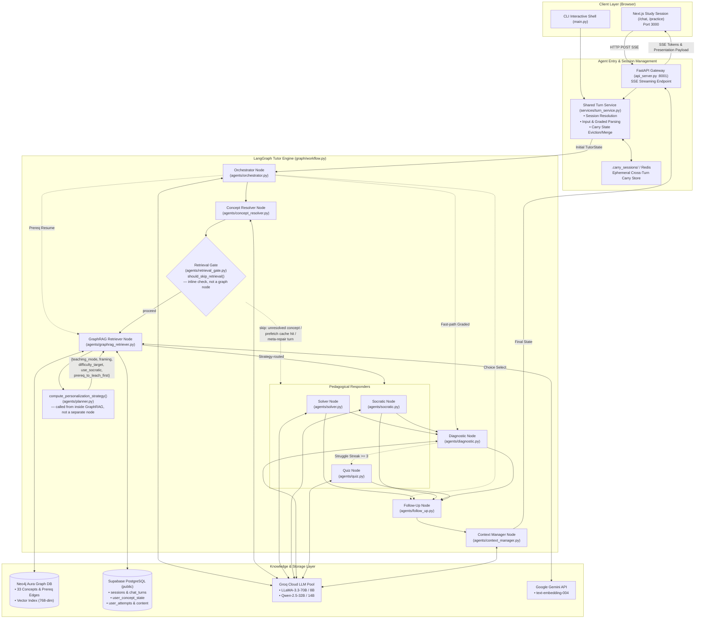
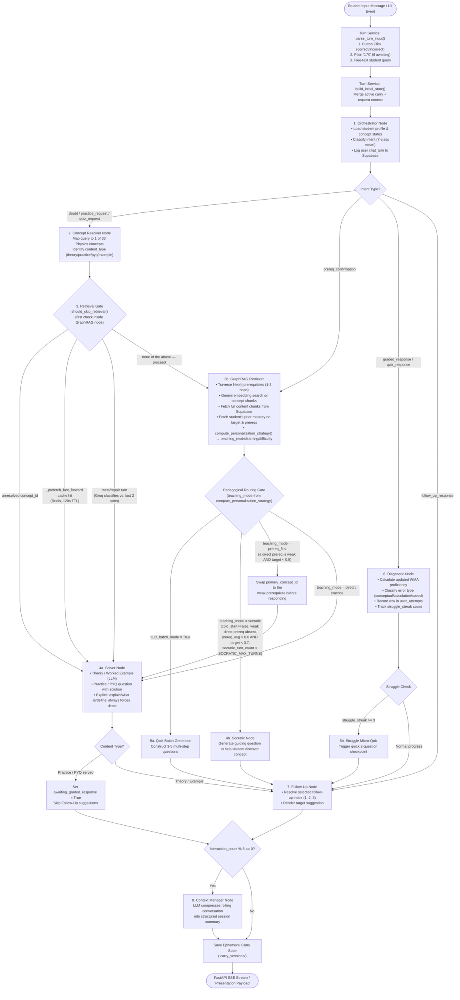
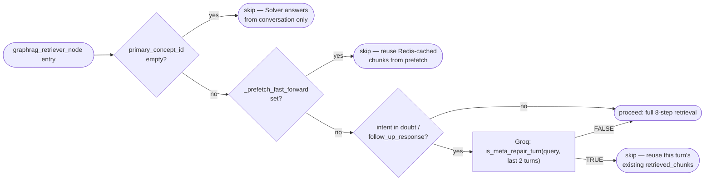
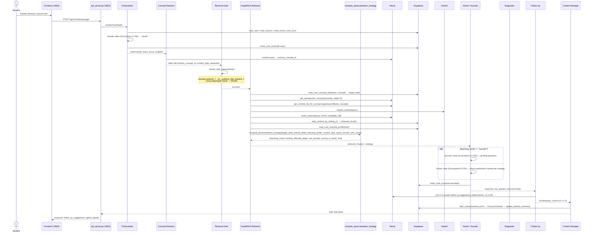
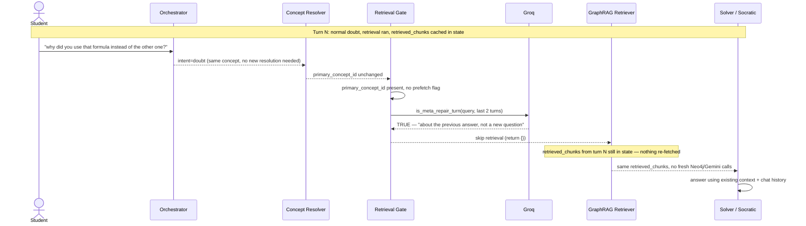
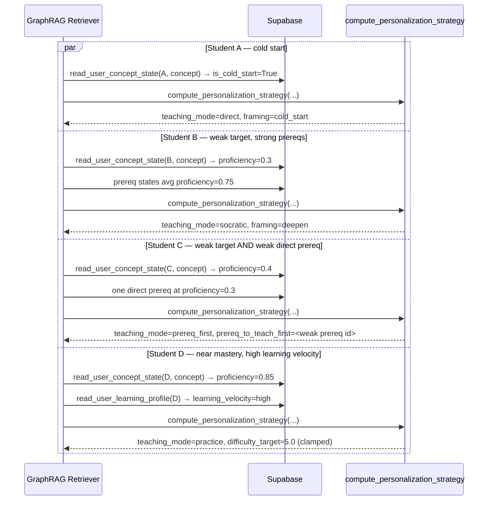
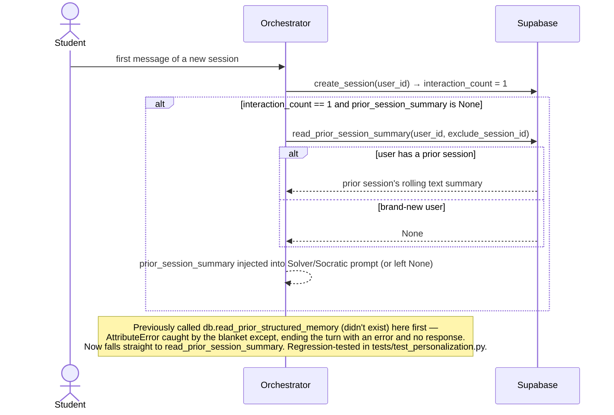
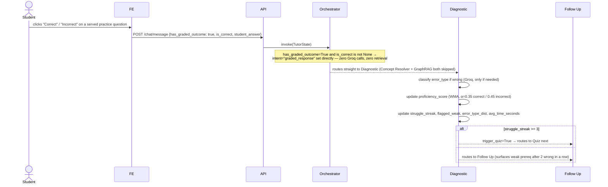
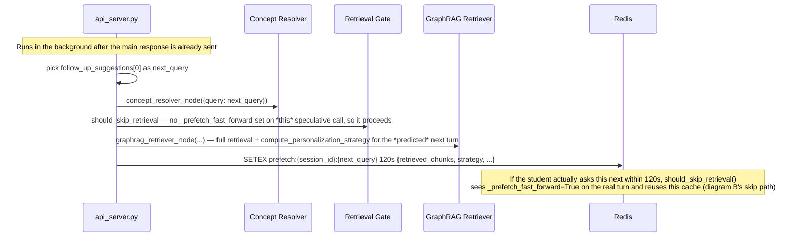

# PrepWise — JEE Tutor Agent (`Aeropt-agent`)

A multi-agent, LangGraph-based AI tutoring and diagnostic system for **JEE Main** and **JEE Advanced Physics**. The agent retrieves curriculum-aligned concepts from a Neo4j knowledge graph, dynamically adapts explanations to student proficiency, tracks learning gaps, and serves structured theory, worked examples, interactive practice questions, and quizzes through an SSE-streaming interface.

Built as part of **PrepWise** in collaboration with **KodeinKGP, IIT Kharagpur**.

---

## Table of Contents

1. [System Architecture](#system-architecture)
2. [End-to-End Execution Flowchart](#end-to-end-execution-flowchart)
3. [Agent Roster & Node Responsibilities](#agent-roster--node-responsibilities)
4. [Turn Service & Session Layer (`services/turn_service.py`)](#turn-service--session-layer)
5. [Intent Classification & Routing Logic](#intent-classification--routing-logic)
6. [GraphRAG Retrieval Engine](#graphrag-retrieval-engine)
7. [Retrieval Gating — Conditional Retrieval](#retrieval-gating--conditional-retrieval)
8. [Pedagogy Policies & Canonical Personalization Strategy](#pedagogy-policies--canonical-personalization-strategy)
9. [Cross-Turn Memory & Carry State Lifecycle](#cross-turn-memory--carry-state-lifecycle)
10. [Data Layer: Supabase & Neo4j Schema](#data-layer-supabase--neo4j-schema)
11. [FastAPI Gateway & SSE Streaming API](#fastapi-gateway--sse-streaming-api)
12. [Sequence Diagrams](#sequence-diagrams)
13. [Local Development & Verification](#local-development--verification)

> **Sept 2026 update:** retrieval is now conditionally skippable (§7, new — was previously dead code), and teaching-mode/framing/difficulty personalization is computed by one canonical function, `agents/planner.py::compute_personalization_strategy` (§8, replaces three previously-drifted, independent heuristics that used to live in `planner.py`, `graphrag_retriever.py`, and `solver.py` separately). The `agent_memory` table and `sessions.structured_memory` column referenced in earlier drafts of this doc were retired (`db/migrations/003_retire_structured_memory.sql`) — they had zero read/write call sites in the running system; cross-session continuity is carried entirely by `sessions.session_summary` (plain text) via `prior_session_summary`.

---

## System Architecture

The agent service runs on port **8001** as a standalone FastAPI service. It is loosely coupled with Django (`Aeropt-backend`, port 8000) through shared Supabase PostgreSQL storage (`public` schema for agent telemetry; `django` schema for auth and roadmap), and communicates directly with the Next.js frontend (`Aeropt-frontend`, port 3000) over Server-Sent Events (SSE).



---

## End-to-End Execution Flowchart

Every student message is processed through the compiled LangGraph state machine. Below is the complete execution path showing all conditional branch points:



---

## Agent Roster & Node Responsibilities

| Agent Node | Source File | Core Responsibility | Primary LLM / Model |
|---|---|---|---|
| **Orchestrator** | `agents/orchestrator.py` | Intent classification, session bootstrapping, user turn recording. | `llama-3.1-8b-instant` |
| **Concept Resolver** | `agents/concept_resolver.py` | Entity resolution mapping query to one of 33 canonical Physics concept UUIDs. | `llama-3.1-8b-instant` |
| **Retrieval Gate** | `agents/retrieval_gate.py` | *Inline check inside GraphRAG Retriever, not a separate graph node.* Decides whether this turn needs fresh retrieval at all — see §7. | `llama3-8b-8192`/Groq small model (meta/repair classification only) |
| **GraphRAG Retriever** | `agents/graphrag_retriever.py` | Prerequisite subgraph traversal (Neo4j), vector similarity search, chunk retrieval, and invokes the canonical personalization strategy (§8). | `gemini-embedding-2` (No generative LLM) |
| **Personalization Strategy** | `agents/planner.py::compute_personalization_strategy` | *Function called from inside GraphRAG Retriever, not a separate graph node.* Canonical teaching_mode/framing/difficulty decision — see §8. | Deterministic (No LLM) |
| **Solver** | `agents/solver.py` | Full-depth physics explanation, LaTeX derivations, markdown formatting. | `qwen-2.5-32b` / `llama-3.3-70b-versatile` |
| **Socratic** | `agents/socratic.py` | Guided inquiry and scaffolding when student has strong prerequisites but weak target mastery. | `llama-3.3-70b-versatile` |
| **Diagnostic** | `agents/diagnostic.py` | Exponential decay, weighted moving average (WMA) proficiency math, mistake taxonomy. | `llama-3.1-8b-instant` (error analysis only) |
| **Follow-Up** | `agents/follow_up.py` | Suggesting related sub-concepts, surfacing weak prerequisites, advancing quiz batches. | Deterministic (No LLM) |
| **Quiz** | `agents/quiz.py` | Generating multi-question diagnostic quizzes or struggle checkpoint questions. | `llama-3.3-70b-versatile` / Deterministic chunks |
| **Context Manager** | `agents/context_manager.py` | Periodic rolling conversation compression every 5 interactions. | `llama-3.1-8b-instant` |

---

## Turn Service & Session Layer

All entry points (`main.py` CLI and `api_server.py` HTTP) share [`services/turn_service.py`](services/turn_service.py) to prevent logic drift:

```
                  ┌─────────────────────────────────────┐
                  │        services/turn_service        │
                  └──────────────────┬──────────────────┘
                                     │
         ┌───────────────────────────┼───────────────────────────┐
         ▼                           ▼                           ▼
parse_turn_input()          update_carry()              resolve_session()
Detects UI buttons,         Manages carry lifecycle,    Reads or bootstraps
"1"/"0" practice grades,    clears awaiting flags,      session in Supabase
and legacy formats.         evicts stale retrieval.     with proper validation.
```

### Key Functions
- `parse_turn_input(raw_input, carry, graded_outcome)`: Authoritatively handles UI-button clicks (`correct`/`incorrect`), text replies (`1`/`0`), and legacy `ANSWER::` formatting.
- `update_carry(carry, result, was_graded)`: Ensures retrieved chunks and ephemeral practice flags survive only while awaiting a grade, preventing retrieval poisoning on subsequent turns.
- `clear_stale_practice_carry(carry)`: Evicts pending questions if the student changes topic without answering.

---

## Intent Classification & Routing Logic

The Orchestrator classifies student queries into one of seven intents:

1. `doubt`: Student asks a conceptual physics question (e.g., *"Why does normal force do zero work on an inclined plane?"*). Routes: `ConceptResolver` → `GraphRAG` → `Solver`/`Socratic` → `FollowUp`.
2. `practice_request`: Student asks for a practice or PYQ question. Routes: `ConceptResolver` → `GraphRAG` → `Solver` (formats question) → Skips `FollowUp` until answered.
3. `quiz_request`: Student asks to be tested on a concept. Routes: `ConceptResolver` → `GraphRAG` → `Quiz` (batch mode).
4. `graded_response`: Student submits self-evaluation (`1` for correct, `0` for incorrect, or clicks UI button). Routes directly to `Diagnostic` → `FollowUp`.
5. `prereq_confirmation`: Student agrees to review a suggested weak prerequisite. Routes directly to `GraphRAG` with the injected prerequisite concept ID.
6. `follow_up_response`: Student selects option 1, 2, or 3 from previous follow-up suggestions. Routes to `FollowUp` to show content.
7. `quiz_response`: Student answers a step in an ongoing struggle micro-quiz. Routes: `Diagnostic` → `Quiz` / `FollowUp`.

---

## GraphRAG Retrieval Engine

Retriever execution combines graph traversal with dense vector search:

1. **Prerequisite Subgraph Expansion (Neo4j)**:
   ```cypher
   MATCH path = (target:Concept {concept_id: $concept_id})<-[:PREREQUISITE_OF*1..2]-(prereq:Concept)
   RETURN prereq.concept_id AS prereq_id, length(path) AS distance
   ```
2. **Dense Vector Search**:
   The user query is vectorized via Gemini Embeddings (`text-embedding-004`, 768 dimensions). Neo4j searches indexed content chunks with cosine similarity within the candidate concept set.
3. **Supabase Hydration**:
   Full content chunks, solution walkthroughs, and LaTeX diagrams are hydrated from Supabase `public.content` table by `content_id`.

---

## Retrieval Gating — Conditional Retrieval

Before September 2026, `graphrag_retriever_node` ran its full 8-step pipeline (Neo4j prereq
traversal, candidate filtering, Gemini embedding call, Neo4j vector search, Supabase text
fetch) unconditionally on every `doubt` / `practice_request` / `quiz_request` /
`prereq_confirmation` turn — a `decide_retrieval_mode` gate existed in `planner.py` but every
one of its branches returned `"retrieve"`, so it never actually skipped anything, and the node
didn't consult it anyway.

`agents/retrieval_gate.py::should_skip_retrieval(state)` now runs as the **first line** of
`graphrag_retriever_node`, before any Neo4j/Gemini/Supabase call, and short-circuits (`return {}`,
leaving whatever `retrieved_chunks`/strategy were already in state from the prior turn) on
three conditions, checked in order:

1. **Unresolved concept** — `primary_concept_id` is empty (Concept Resolver couldn't map the
   query to a known concept). Nothing to retrieve against; Solver answers from conversation
   context alone.
2. **Prefetch fast-forward** — `state["_prefetch_fast_forward"]` is set. This means the student
   picked a follow-up suggestion that `api_server.py::_prefetch_next_query` already
   speculatively retrieved for in the background (Redis, 120s TTL) after the previous turn —
   see the prefetch sequence diagram in §12. Re-running retrieval would just re-fetch the same
   chunks.
3. **Meta/repair turn** — for `doubt`/`follow_up_response` intents, `is_meta_repair_turn(query,
   recent_turns)` asks a small Groq model whether the student is talking *about* the
   immediately preceding answer (*"why was that marked wrong?"*, *"can you shorten that?"*,
   *"explain it differently"*) rather than asking a new physics question. If so, retrieval is
   skipped and Solver/Socratic answers from the existing `retrieved_chunks` plus chat history.

If none of the three apply, retrieval proceeds exactly as described in §6, and its results feed
`compute_personalization_strategy` (§8) before routing to a responder.



## Pedagogy Policies & Canonical Personalization Strategy

`agents/planner.py::compute_personalization_strategy(target_state, prereq_states,
learning_profile, content_type, query, socratic_turn_count)` is the single function that
decides how to teach a given concept to a given student on a given turn. It replaced three
independent, drifted implementations of essentially the same judgment (`planner.py`'s old
teaching-mode matrix — previously dead code, never wired into the live graph;
`graphrag_retriever.py`'s local `_should_use_socratic`/`_compute_prereq_score`; and
`solver.py`'s local `_build_framing`) — all three read the same underlying proficiency data but
could disagree with each other. `graphrag_retriever_node` calls it once per turn (after loading
`target_state`, `prereq_states`, and `user_learning_profile` from Supabase); Solver reads the
resulting `framing` instead of recomputing its own.

**Decision order** (first match wins):

1. `target_state.is_cold_start` → `teaching_mode="direct"`, `framing="cold_start"` — nothing to
   draw out with questions yet, explain from scratch.
2. A **direct** (`hop_count=1`) prerequisite is below `0.5` proficiency **and** the target
   concept is also below `0.5` → `teaching_mode="prereq_first"`, `framing="revisit_gap"`,
   `prereq_to_teach_first` set to that prerequisite's `concept_id`. GraphRAG swaps
   `primary_concept_id` to the prerequisite before the responder runs — the student gets taught
   the gap, not the topic they asked for.
3. Average prerequisite proficiency `> 0.6` **and** target proficiency `< 0.7` →
   `teaching_mode="socratic"`, `framing="deepen"`, **unless** `socratic_turn_count >=
   config.SOCRATIC_MAX_TURNS` (default 3), in which case it force-escalates back to `direct` so
   a student isn't stuck being Socratically questioned forever on one concept.
4. Target proficiency `> 0.7`, **or** the student's `user_learning_profile.preferred_content_type
   == "practice"` and target proficiency `> 0.5` → `teaching_mode="practice"`,
   `framing="mastery_check"` (with an extra bump when `learning_velocity == "high"`).
5. **Explicit overrides applied last, regardless of the above:** if the query contains
   `"explain"`/`"what is"`/`"define"`, force `teaching_mode="direct"` (a mastery-level student
   who explicitly asks for an explanation still gets one, not a drilled practice question); if
   `content_type_requested` is `practice`/`pyq`, also force `direct` (the student explicitly
   asked for a problem, not a Socratic dialogue about one).
6. **Difficulty targeting**, independent of `teaching_mode`: `difficulty_target = proficiency ×
   5`, shifted by `learning_velocity` — `+1.0` for `"high"`, `-0.5` for `"low"`, unchanged for
   `"average"` — then clamped to `[1.0, 5.0]`.

`user_learning_profile.learning_velocity` and `.preferred_content_type` (Supabase
`user_learning_profile` table) are read here — previously stored but never consulted anywhere
in the agent.

### Diagnostic Proficiency Update (WMA)
Proficiency $P_{t}$ is updated using a Weighted Moving Average:
$$P_t = \alpha \cdot \text{Score}_t + (1 - \alpha) \cdot P_{t-1}$$
- On correct answer: $\text{Score}_t = 1.0$, $\alpha = 0.35$
- On incorrect answer: $\text{Score}_t = 0.0$, $\alpha = 0.45$ (penalizes faster than rewards)
- Time-based decay: $P_{\text{decayed}} = P_t \cdot e^{-\lambda \cdot \Delta t_{\text{days}}}$

---

## Cross-Turn Memory & Carry State Lifecycle

LangGraph invocations are stateless. Cross-turn continuity is preserved through the file-backed carry store (`.carry_sessions/<session_id>.json`):

| Carry Field | Lifetime | Purpose |
|---|---|---|
| `primary_concept_id` | Session-long | Tracks the current active topic. |
| `seen_follow_up_ids` | Session-long | Deduplicates suggested follow-up items. |
| `prior_session_summary` | Session-long | Holds previous session summaries from Context Manager. |
| `awaiting_graded_response` | Single-cycle | Set when practice/PYQ is served; cleared once graded. |
| `retrieved_chunks` | Single-cycle | Held only while question is awaiting grade so Diagnostic knows the question. |
| `presentation_by_turn` | Session-long | Stores rich cards, slides, and quizzes by turn index. |

---

## Data Layer: Supabase & Neo4j Schema

### Supabase (`public` schema)
- `users`: Core student records.
- `sessions`: Study sessions tied to a student and roadmap stage.
- `chat_turns`: Message transcript (`role`, `content`, `turn_index`, `agent_used`, `presentation` JSONB).
- `user_concept_state`: Live concept mastery (`proficiency_score`, `attempts_count`, `last_attempt_at`).
- `user_attempts`: Every question attempt (`is_correct`, `time_taken_sec`, `error_type`).
- `user_learning_profile`: Global per-student stats — `learning_velocity`,
  `preferred_content_type`, `weak_chapters`/`strong_chapters`. Now actually read by
  `compute_personalization_strategy` (§8); previously only `weak_chapters` was consulted
  (via `focus_chapters` in the Orchestrator).
- `content`: Practice bank, PYQs, theory chunks, and LaTeX equations.

> **Retired (`db/migrations/003_retire_structured_memory.sql`):** `agent_memory` table and
> `sessions.structured_memory` column. Earlier drafts of this document described them as the
> mechanism for cross-session structured memory managed by Context Manager — an audit found
> zero read/write call sites for either anywhere in the codebase, and a call to a
> `read_prior_structured_memory` method that never existed on `SupabaseClient` was crashing
> turn 1 of every new session (caught silently by Orchestrator's broad exception handler). Both
> were dropped; cross-session continuity is `sessions.session_summary` (plain text, written by
> Context Manager) via `prior_session_summary`, loaded through the real
> `db.read_prior_session_summary` method — see the sequence diagram in §12.

### Neo4j Knowledge Graph
- `(:Concept)` nodes: 33 JEE Physics topics with properties (`concept_id`, `name`, `chapter`, `difficulty_tier`).
- `[:PREREQUISITE_OF]` edges: Directed dependency graph.
- `(:Content)` nodes: Indexed chunks with vector embeddings for semantic search.

---

## FastAPI Gateway & SSE Streaming API

Hosted in `api_server.py` on port `8001`.

| Method | Route | Description |
|---|---|---|
| `POST` | `/api/v1/chat/message` | SSE streaming chat endpoint; yields token events and final structured JSON payload. |
| `POST` | `/api/v1/chat/sessions` | Creates an empty study session. |
| `GET` | `/api/v1/chat/sessions` | Lists recent study sessions for a user. |
| `GET` | `/api/v1/chat/sessions/{id}` | Returns full session transcript and presentation history. |
| `POST` | `/api/v1/chat/end-session` | Flushes Context Manager summary and closes session. |
| `POST` | `/api/v1/sandbox/execute` | Executes proactive study cards from dashboard. |
| `GET` | `/api/v1/agents/status` | Reports active agent catalog and signals. |
| `POST` | `/api/v1/onboarding/diagnostic` | Generates diagnostic probe questions and evaluates placement score. |

---

## Sequence Diagrams

The flowcharts in §1–2 show the graph's static shape; these show the actual call sequence
across services for the flows that matter most, including the two new behaviors from §7–8.

### A. Happy path — new doubt, full retrieval + personalization



### B. Retrieval-gate skip — meta/repair turn reuses prior context



### C. Personalization divergence — identical query, different students



### D. New session, returning student — cross-session continuity (post-fix)



### E. Graded response — deterministic fast path



### F. Speculative prefetch — warming the fast-forward path



---

## Local Development & Verification

```bash
# 1. Activate virtual environment
cd Aeropt-agent
source .venv/bin/activate

# 2. Run full test suite (74 tests, incl. tests/test_retrieval_gate.py and tests/test_personalization.py)
python -m unittest discover tests/

# 3. Start local development server
python -m uvicorn api_server:app --port 8001 --reload

# 4. Run interactive CLI test session
python main.py
```
