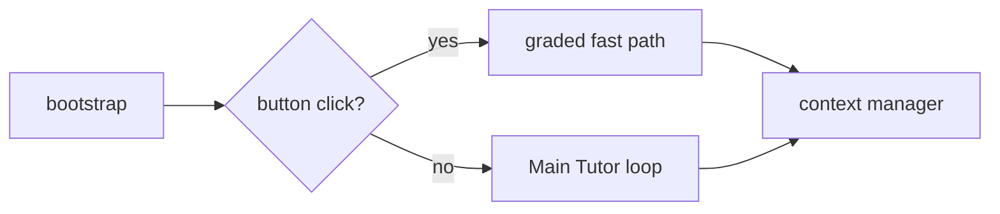

# JEEPath — Tutor Agent

LangGraph Learning Agent for JEE Physics. One Main Tutor owns each student turn:
it calls tools, may consult a temporary expert, then the Answer Checker reviews
the Teaching Answer before the student sees it.

Product architecture: [`ARCHITECTURE.md`](ARCHITECTURE.md). If this file and
that one disagree, `ARCHITECTURE.md` wins. Retrieval: [`RETRIEVAL.md`](RETRIEVAL.md).

Port **8001**. Frontend talks to this service for `/chat`. Django (`Aeropt-backend`,
port 8000) owns auth and roadmaps. Both share one Supabase Postgres
(`public` = agent tables, `django` = Django ORM).

## Graph



Free text always goes to the Main Tutor. There is no intent enum.

| Role | File |
|---|---|
| Main Tutor | `agents/learning_agent.py` |
| Toolbelt | `agents/runtime/toolbelt.py` |
| Temporary experts | `agents/experts.py` |
| Answer Checker | `agents/answer_checker.py` |
| Background Coach | `agents/learning_coach.py` |
| Graph | `graph/workflow.py` |
| HTTP | `api_server.py` |

## Retrieval

Retrieval runs against a dedicated Supabase Postgres instance (`RETRIEVAL_DATABASE_URL`) with `pgvector` and full-text search (`tsvector`):

- **Store**: Supabase Postgres (`stecalgmpaulkkwqlqcx`) using `vector(256)` with HNSW indexes and `ts_rank_cd`.
- **Embedding model**: `minishlab/potion-base-8M` (`DIM = 256`), explicit and enforced at startup.
- **Syllabus**: 1,517 derived concepts across 63 chapters (Physics + NCERT Chemistry).
- **Corpus**: 14,874 items (12,933 Physics, 1,941 Chemistry). Zero cross-subject links.

### Dual Database Setup
- **User DB (`SUPABASE_URL`, `SUPABASE_KEY`)**: Stores user profiles, sessions, chat turns, and served question ledger.
- **Retrieval DB (`RETRIEVAL_DATABASE_URL`)**: Dedicated Postgres pooler connection for content chunks, concept graphs, and pgvector similarity search. (`RETRIEVAL_SUPABASE_URL` / `RETRIEVAL_SUPABASE_KEY` kept for REST reads).

```bash
make push                                         # push corpus & embeddings to Postgres
make push-dry                                     # preview changes without writing
.venv/bin/python -m retrieval.cli "explain torque"  # inspect a retrieval
make retrieval-bench
```

`RETRIEVAL.md` covers how the syllabus is derived, how repeats are prevented and
when retrieval is skipped.

## Environment Variables

| Variable | Required | Description |
|---|---|---|
| `SUPABASE_URL` | Yes | Supabase user project URL (`users`, `sessions`, `chat_turns`) |
| `SUPABASE_KEY` | Yes | Service role key for user DB |
| `RETRIEVAL_DATABASE_URL` | Yes | Postgres connection URI for retrieval project (`content`, `concepts`, `pgvector`) |
| `RETRIEVAL_SUPABASE_URL` | Optional | Retrieval project REST URL (defaults to `SUPABASE_URL`) |
| `RETRIEVAL_SUPABASE_KEY` | Optional | Retrieval project REST key (defaults to `SUPABASE_KEY`) |
| `GROQ_API_KEY` | Optional | Groq API key (tutor reasoning loop) |
| `GEMINI_API_KEY` | Optional | Gemini API key (fallback/diagnostic models) |
| `DJANGO_API_BASE_URL` | Optional | Django backend URL (evidence posting; default: `http://127.0.0.1:8000`) |

## Tools

Registered with `@tool`, imported from `agents/learning_agent.py::_import_tools`.

`resolve_concept` · `retrieve_content` · `open_material` · `suggest_next_material` ·
`calculate` · `get_learner_context` · `record_attempt` · `remember_about_learner` ·
`schedule_review` · `consult_expert`

Do not add a second registry in `mcp_tools/__init__.py`.

## HTTP

| Method | Path |
|---|---|
| GET | `/health`, `/api/v1/health` |
| POST | `/api/v1/chat/message` (SSE; streams after the checker) |
| POST | `/api/v1/chat/sessions` |
| GET | `/api/v1/chat/sessions`, `/api/v1/chat/sessions/{id}` |
| POST | `/api/v1/chat/end-session` |
| POST | `/api/v1/sandbox/execute` |
| POST | `/api/v1/onboarding/diagnostic` |
| POST | `/api/v1/coach/run` |

## Run
 
```bash
# 1. Activate environment
python3 -m venv .venv && source .venv/bin/activate
pip install -r requirements.txt

# 2. Configure environment (.env)
cp .env.example .env
# Set SUPABASE_URL (User DB), RETRIEVAL_DATABASE_URL (Retrieval DB pooler), and LLM keys

# 3. Start Agent server (port 8001)
python -m uvicorn api_server:app --port 8001 --reload
```


Live Groq catalog checks: `RUN_LIVE_GROQ_CHECKS=1 python -m pytest tests/test_model_health.py`.

## Still open

The local corpus is grounded in OpenStax University Physics, which is **CC BY-NC-SA**
— fine locally, not for a commercial release. Replacing it is one parser; see
`RETRIEVAL.md`.

Apply `db/migrations/006_learner_memory.sql` on the live database. Without it,
memory and review tools return `saved: false` and the tutor does not remember
the student across sessions.

Do not edit nested `Aeropt-backend-main/` or `Aeropt-frontend-main/` snapshots.
