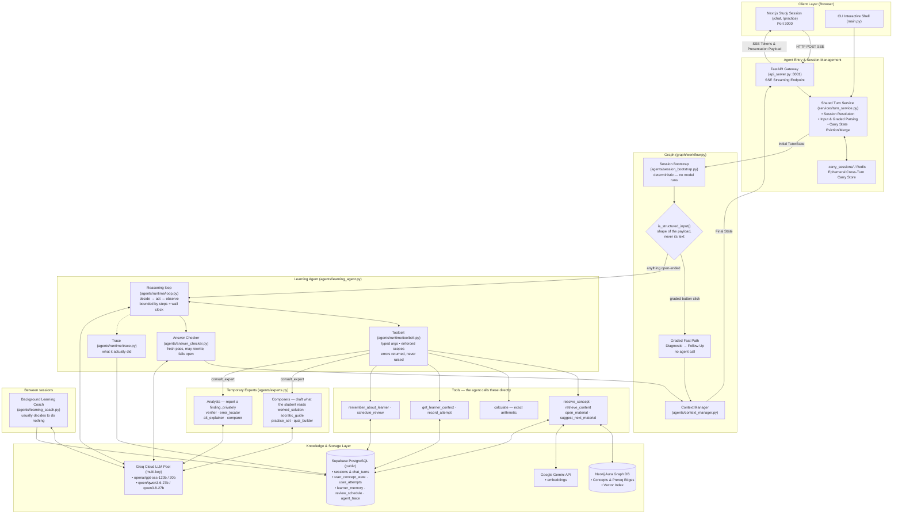
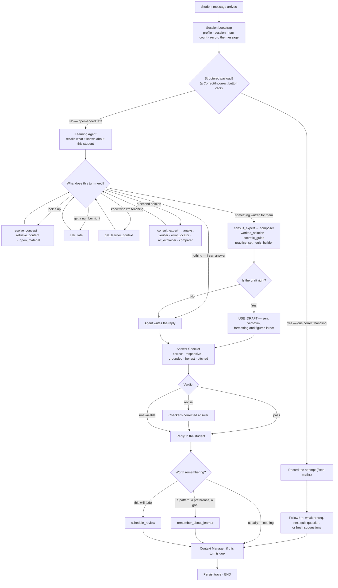
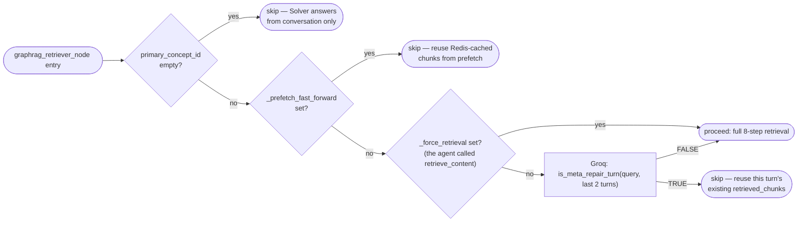
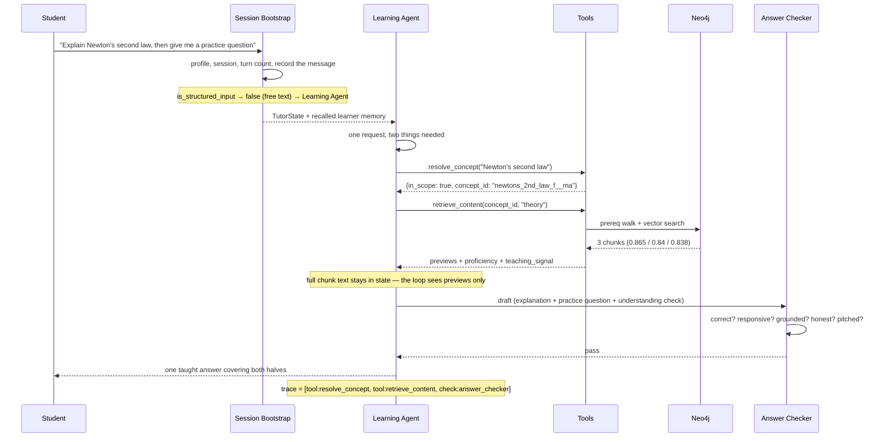
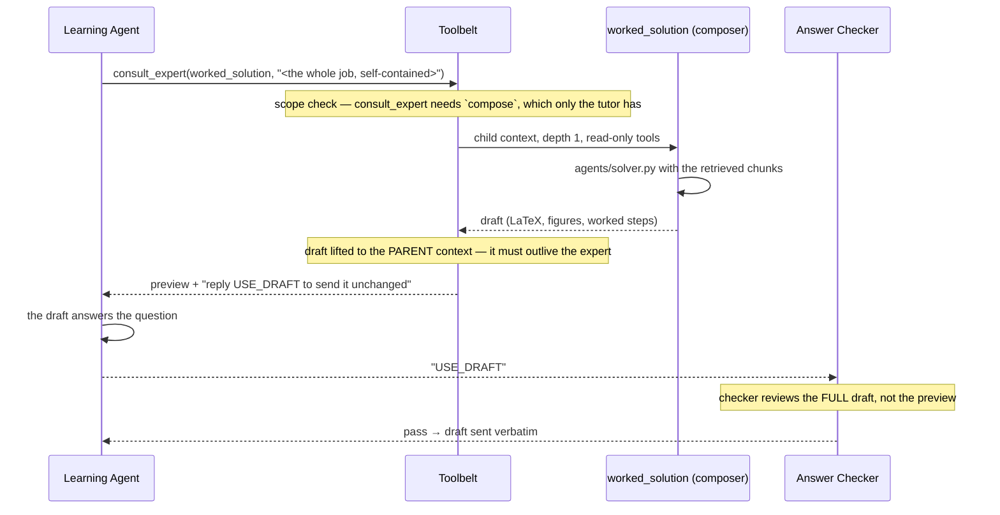
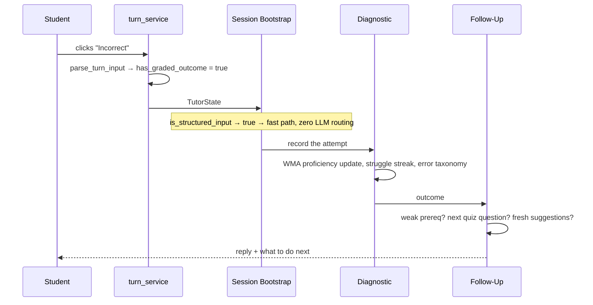
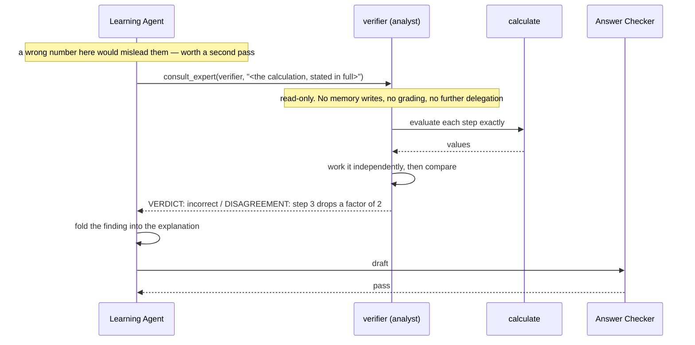
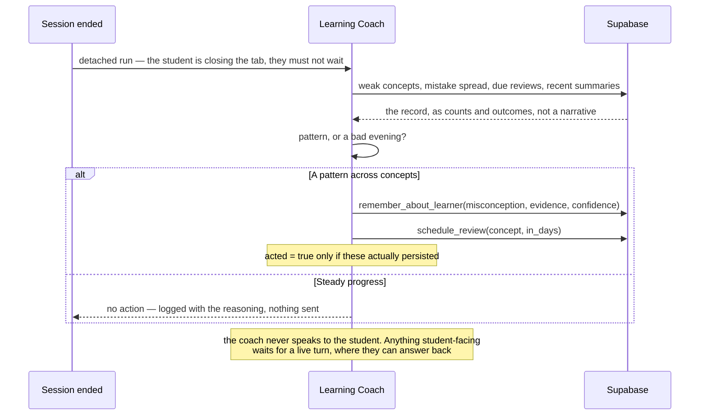
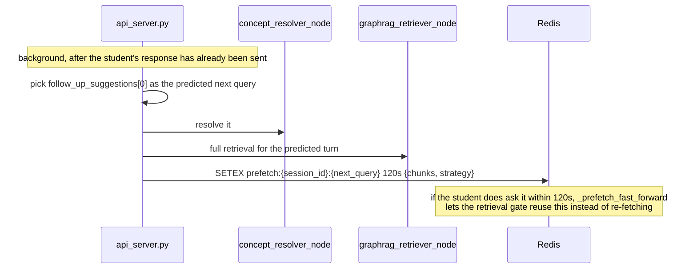

# PrepWise — JEE Tutor Agent (`Aeropt-agent`)

An autonomous AI tutor for **JEE Main** and **JEE Advanced Physics**. One Learning Agent owns
each student's turn: it decides what it needs to look up, whether to compute, whether to hand a
narrow job to a temporary expert, and how to teach the person in front of it. It retrieves
curriculum-aligned material from a Neo4j knowledge graph, adapts to measured proficiency,
remembers what it learns about a student across sessions, and serves theory, worked examples,
practice questions and quizzes over an SSE-streaming interface.

There is no intent enum and no routing table. Every reply is reviewed before the student sees
it, and every turn records the path it actually took.

Built as part of **PrepWise** in collaboration with **KodeinKGP, IIT Kharagpur**.

---

## Table of Contents

1. [System Architecture](#system-architecture)
2. [End-to-End Execution Flowchart](#end-to-end-execution-flowchart)
3. [Components & Responsibilities](#components--responsibilities)
4. [Turn Service & Session Layer (`services/turn_service.py`)](#turn-service--session-layer)
5. [How the Agent Decides](#how-the-agent-decides)
6. [GraphRAG Retrieval Engine](#graphrag-retrieval-engine)
7. [Retrieval Gating — Conditional Retrieval](#retrieval-gating--conditional-retrieval)
8. [Pedagogy Policies & Canonical Personalization Strategy](#pedagogy-policies--canonical-personalization-strategy)
9. [Learner Memory & Cross-Turn State](#learner-memory--cross-turn-state)
10. [Data Layer: Supabase & Neo4j Schema](#data-layer-supabase--neo4j-schema)
11. [FastAPI Gateway & SSE Streaming API](#fastapi-gateway--sse-streaming-api)
12. [Sequence Diagrams](#sequence-diagrams)
13. [Local Development & Verification](#local-development--verification)

> **Sept 2026 — the routing rewrite.** The nine-node graph, the seven-value intent enum and the
> hand-wired conditional edges are gone, replaced by one autonomous Learning Agent that reasons
> in a tool-calling loop (§1, §3, §5). `agents/orchestrator.py` and the five facade agent nodes
> were deleted with them. What survives unchanged is everything that was genuinely
> deterministic — retrieval order, the content cascade, the proficiency WMA — now exposed as
> tools the agent *calls* rather than nodes it is routed through. New alongside it: temporary
> expert subagents (`agents/experts.py`), an Answer Checker on every substantial reply
> (`agents/answer_checker.py`), durable learner memory (migration 006), per-turn decision traces,
> and a Background Learning Coach (`agents/learning_coach.py`).
>
> Wiring the trace up made three long-standing silent failures visible, all fixed in the same
> pass: retrieval timed out on **every** turn (a 600 ms budget against ~1700 ms of real work),
> so every answer was ungrounded while the code believed it had searched — and each miss logged
> a false content-gap event; concept resolution truncated its reply at 100 tokens and reported
> any long concept id as off-syllabus; and a missing `SELECT` grant on `user_learning_profile`
> took the entire retriever down rather than degrading. See §9 for the grant, which still needs
> applying at the deployment.

> **Sept 2026 update:** retrieval is now conditionally skippable (§7, new — was previously dead code), and teaching-mode/framing/difficulty personalization is computed by one canonical function, `agents/planner.py::compute_personalization_strategy` (§8, replaces three previously-drifted, independent heuristics that used to live in `planner.py`, `graphrag_retriever.py`, and `solver.py` separately). The `agent_memory` table and `sessions.structured_memory` column referenced in earlier drafts of this doc were retired (`db/migrations/003_retire_structured_memory.sql`) — they had zero read/write call sites in the running system; cross-session continuity is carried entirely by `sessions.session_summary` (plain text) via `prior_session_summary`.
>
> **Sept 11 2026 hardening pass** (audit + fixes; full detail in `docs/agent_qa_audit_2026-09-11.md` in the top-level `aeropt/` workspace this repo sits under — not tracked in this repo itself): five issues traced back to hallucinated/ungrounded answers, all fixed and regression-tested —
> 1. **Concept Resolver** (§Agent Roster) now delegates to `mcp_tools/resolve_concept_id.py` (lexical fast-path + LLM classification with a real `in_scope` flag) instead of a second, hand-rolled implementation that silently forced `primary_concept_id` to the *first row in the concepts table* whenever the model returned an unrecognized id — i.e. any off-syllabus question got answered as if it were about a random, unrelated concept. Off-syllabus queries now stay genuinely unresolved.
> 2. **Solver / Socratic prompts** now carry an explicit grounding signal (`retrieval_confidence`: `"unresolved" | "low" | "ok"`, surfaced via `agents/solver.py::_grounding_note`) instead of the old "chunks are optional, compose freely" instruction — the model is told plainly when it has no or weak grounding rather than answering confidently either way.
> 3. **Groq model roster** (table below) was silently running on two decommissioned models (`llama-3.1-8b-instant`, `llama-3.3-70b-versatile`) — every classification call and Socratic turn was burning dead round-trips before falling back. Reassigned to the account's actual live catalog; `tests/test_model_health.py` (opt-in, `RUN_LIVE_GROQ_CHECKS=1`) pings every configured model so this doesn't silently drift again.
> 4. **`utils/groq_pool.py`'s multi-key rotation** was dead code — `groq_complete()` never called into it, so a second `GROQ_API_KEY_2` gave no rate-limit resilience. Now wired in: a 429 rotates to the next key immediately (no backoff), and a TPM 413 clamps `max_tokens` before falling to a fallback model.
> 5. **Retrieved chunk text reaches the LLM sanitized**, not raw — `utils/latex_guidelines.py::sanitize_chunk_text_for_prompt()` fixes unicode math symbols / stray literal `\n` / double-escaping before a chunk is shown to Solver, Socratic, or the slide-deck content summarizer, and a new rule in the shared `LATEX_OUTPUT_RULES` tells the model to reconstruct — never copy — a formula that still looks corrupted (OCR/ingestion noise). A separate, independently-duplicated bug (a sentence with 2+ LaTeX macros and few words got wrongly wrapped whole as display math, gluing every word together) was found and fixed on both this side and `Aeropt-frontend`.
>
> **Known limitation, not fixed in the pass above:** practice/PYQ questions (including the answer key) are generated fresh by the LLM (`skills/practice_coach.yaml`) rather than served from verified stored content — `agents/solver.py::_format_practice_response`, the deterministic "assemble from DB, no LLM" formatter its own docstring promises, is dead code, never called. Fixing this touches the practice-question UI contract on `Aeropt-frontend` and needs a product decision (stored-question-verbatim vs. LLM-generated-with-a-verification-step) before anyone changes it.

---

## System Architecture

The agent service runs on port **8001** as a standalone FastAPI service. It is loosely coupled with Django (`Aeropt-backend`, port 8000) through shared Supabase PostgreSQL storage (`public` schema for agent telemetry; `django` schema for auth and roadmap), and communicates directly with the Next.js frontend (`Aeropt-frontend`, port 3000) over Server-Sent Events (SSE).

**One agent owns the student's turn.** There is no intent enum, no router and no per-capability
agent node. A single Learning Agent reasons about each message in a tool-calling loop and
decides for itself what it needs: whether to look something up, whether to compute, whether to
hand a narrow job to a temporary expert, how to teach, and what is worth remembering.

The graph around it is deliberately small. It carries the one decision that is genuinely
structural — does this input have a shape that needs no reasoning at all — plus the bookkeeping
either side of the turn.



### What the agent decides, and what the platform guarantees

The split is the whole design. Everything on the left is judgement that changes with the
student and the turn; everything on the right has one right answer and must not vary.

| The Learning Agent decides | The platform guarantees |
|---|---|
| What the student actually means | A turn only ever touches its own learner's data |
| Whether to ask for clarification | Retrieval order and content cascade are fixed |
| Whether to look anything up, and what | Proficiency maths is never model-improvised |
| Whether to compute, and what | Tool arguments are validated before anything runs |
| Whether to delegate, and to whom | An expert cannot write memory, grade, or delegate |
| How to explain this, to this person | Step and wall-clock budgets, with a forced close |
| Whether anything is worth remembering | Every substantial reply passes the Answer Checker |
| Whether a review should be scheduled | Consequential actions stop and ask first |
| When to stop and just answer | Every turn's decisions are traced and persisted |


## End-to-End Execution Flowchart



The agent does not touch every tool on every turn. A question it can answer well without
looking anything up gets answered, and that restraint is part of the job — an easy turn spent
calling four tools is latency the student pays for.

The budget is real: `LEARNING_AGENT_MAX_STEPS` reasoning steps and
`LEARNING_AGENT_TIME_BUDGET_S` seconds. On overrun the loop withdraws the tools entirely and
forces one closing pass, so running out of budget produces a real answer with an honest caveat
rather than an empty turn.


## Components & Responsibilities

### The turn

| Component | Source File | Responsibility | Model |
|---|---|---|---|
| **Session Bootstrap** | `agents/session_bootstrap.py` | Profile, session, turn count, recording the student's message. Bookkeeping with exactly one right answer. | None — no model runs |
| **Learning Agent** | `agents/learning_agent.py` | Owns the turn. Decides what it needs, calls tools, delegates, teaches, decides what to remember. | `config.LEARNING_AGENT_MODEL` |
| **Reasoning loop** | `agents/runtime/loop.py` | decide → act → observe, bounded by steps and wall clock, with a forced close. | — |
| **Toolbelt** | `agents/runtime/toolbelt.py` | Typed arguments, enforced scopes, permission gating. Tools never raise into the loop. | — |
| **Answer Checker** | `agents/answer_checker.py` | Fresh review of every substantial reply; rewrites when needed. Fails open. | `config.ANSWER_CHECKER_MODEL` |
| **Trace** | `agents/runtime/trace.py` | Records the path an autonomous turn took, since it can no longer be read off a diagram. | — |
| **Graded fast path** | `graph/workflow.py` | Button clicks: record the attempt, then Follow-Up. No agent call. | Diagnostic's error classifier only |
| **Context Manager** | `agents/context_manager.py` | Rolling session summary every `CONTEXT_MANAGER_EVERY_N` interactions. | `config.CONTEXT_MANAGER_MODEL` |
| **Background Coach** | `agents/learning_coach.py` | The same agent between sessions. Usually decides to do nothing. | `config.LEARNING_COACH_MODEL` |

### Tools — the agent calls these directly

Deterministic work stays deterministic. Retrieval order, the content-type cascade and the
proficiency maths are unchanged; only the calling convention moved, so the agent chooses
*whether*, never *how*.

| Tool | Wraps | Notes |
|---|---|---|
| `resolve_concept` | `agents/concept_resolver.py` | Reports honestly when a topic is off-syllabus |
| `retrieve_content` | `agents/graphrag_retriever.py` | Returns previews; full chunks stay in state for the composer |
| `open_material` | `db.read_content_by_ids` | Opens a specific item the student picked |
| `suggest_next_material` | `mcp_tools/generate_suggestions.py` | Sized to proficiency, excludes what they have seen |
| `calculate` | `mcp_tools/compute_tools.py` | Whitelisted-AST evaluator. No `eval`, no imports, no names |
| `get_learner_context` | memory + concept state | Remembered facts, weak concepts, attempts, due reviews |
| `record_attempt` | `agents/diagnostic.py` | The agent supplies the outcome, never the score |
| `remember_about_learner` | `learner_memory` | One atomic fact, with evidence and a confidence |
| `schedule_review` | `review_schedule` | One pending review per concept |
| `consult_expert` | `agents/experts.py` | The handoff. Tutor-only, refuses at depth ≥ 1 |

### Temporary experts

**Composers** draft what the student reads — the existing generators, so their LaTeX rules,
figure handling and practice payloads survive verbatim. The agent may accept a draft unchanged
with `USE_DRAFT`; retyping a composed answer through another model is how careful formatting
quietly gets mangled.

| Composer | Runs | For |
|---|---|---|
| `worked_solution` | `agents/solver.py` | The default when something needs teaching |
| `socratic_guide` | `agents/socratic.py` | When a question would teach more than an answer |
| `practice_set` | `agents/practice_generator.py` | Questions to attempt |
| `quiz_builder` | `agents/quiz.py` | Testing across a concept |

**Analysts** answer a question the tutor has about its own work, in their own small read-only
loop: `verifier` (independently rework a result), `error_locator` (first wrong step in the
student's work), `alt_explainer` (a genuinely different angle after one has failed), `comparer`
(the distinction between two things being conflated).

Every expert, of both kinds, is constrained the same way — and structurally, not by asking:

- one task, stated by the tutor, with only the context that task needs;
- read-only tools: no memory writes, no progress writes, no scheduling;
- no handoffs of its own (`depth >= 1` removes `consult_expert` and the tool refuses anyway);
- no channel to the student. Output goes back to the tutor, always.

`tests/test_experts_and_checker.py` asserts each of those as a property of the toolbelt rather
than trusting a prompt to hold the line.

> Model names live in `config.py`, not in module docstrings — this account's live Groq catalog
> has drifted three times. Re-verify with `tests/test_model_health.py`
> (`RUN_LIVE_GROQ_CHECKS=1`) before trusting any specific name. The Learning Agent's model
> **must support function calling**; one that does not will not error, it will silently stop
> calling tools and degrade into a chatbot with no access to the syllabus.


## Turn Service & Session Layer

All entry points (`main.py` CLI and `api_server.py` HTTP) share [`services/turn_service.py`](services/turn_service.py) to prevent logic drift:

```
                  ┌─────────────────────────────────────┐
                  │        services/turn_service        │
                  └──────────────────┬──────────────────┘
                                     │
         ┌───────────────────────────┼───────────────────────────┐
         ▼                           ▼                           ▼
parse_turn_input()          update_carry()              resolve_session()
Detects UI buttons,         Manages carry lifecycle,    Reads or bootstraps
"1"/"0" practice grades,    clears awaiting flags,      session in Supabase
and legacy formats.         evicts stale retrieval.     with proper validation.
```

### Key Functions
- `parse_turn_input(raw_input, carry, graded_outcome)`: Authoritatively handles UI-button clicks (`correct`/`incorrect`), text replies (`1`/`0`), and legacy `ANSWER::` formatting.
- `update_carry(carry, result, was_graded)`: Ensures retrieved chunks and ephemeral practice flags survive only while awaiting a grade, preventing retrieval poisoning on subsequent turns.
- `clear_stale_practice_carry(carry)`: Evicts pending questions if the student changes topic without answering.

---

## How the Agent Decides

There is no intent classifier. The previous design sorted every message into one of seven
intents and let hand-wired edges do the rest, which meant anything outside those seven —
*"explain X and then quiz me"*, *"how is X different from Y"*, *"why did you mark that
wrong?"* — was forced into the nearest label and routed on that guess.

The agent now reads the message, its own memory of the student, and the conversation, and picks
its own actions. The only structural test left is `graph/workflow.py::is_structured_input`,
and it looks at the **shape** of the payload, never its text:

```python
def is_structured_input(state: TutorState) -> bool:
    return bool(state.get("has_graded_outcome"))
```

`has_graded_outcome` is set by `services/turn_service.parse_turn_input` from a Correct/Incorrect
button payload. That is the one input with exactly one correct handling and nothing to reason
about — and it is most of the traffic, so it is where the latency budget is won.

The moment that test starts inspecting what the student *said*, it has become an intent
classifier again and the whole problem returns.
`tests/test_pipeline_alignment.py::test_message_text_never_reaches_the_fast_path_test` exists
to fail if that happens.

### Observability

An autonomous path cannot be read off a diagram, so each turn records one:

```
['tool:resolve_concept', 'tool:retrieve_content', 'handoff:worked_solution', 'check:answer_checker']
```

Available on the turn result as `agent_trace_path`, alongside `agent_stop_reason`
(`answered` / `max_steps` / `time_budget` / `llm_error`) and `checker_verdict`
(`pass` / `revised` / `failed` / `skipped`), and persisted to `agent_trace` with per-step
timings. A rise in `max_steps`, or in `skipped` checks, is the signal that something has
started going wrong — which is exactly what was invisible before.


## GraphRAG Retrieval Engine

Retriever execution combines graph traversal with dense vector search:

1. **Prerequisite Subgraph Expansion (Neo4j)**:
   ```cypher
   MATCH path = (target:Concept {concept_id: $concept_id})<-[:PREREQUISITE_OF*1..2]-(prereq:Concept)
   RETURN prereq.concept_id AS prereq_id, length(path) AS distance
   ```
2. **Dense Vector Search**:
   The user query is vectorized via Gemini Embeddings (`text-embedding-004`, 768 dimensions). Neo4j searches indexed content chunks with cosine similarity within the candidate concept set.
3. **Supabase Hydration**:
   Full content chunks, solution walkthroughs, and LaTeX diagrams are hydrated from Supabase `public.content` table by `content_id`.

---

## Retrieval Gating — Conditional Retrieval

Before September 2026, `graphrag_retriever_node` ran its full 8-step pipeline (Neo4j prereq
traversal, candidate filtering, Gemini embedding call, Neo4j vector search, Supabase text
fetch) unconditionally on every `doubt` / `practice_request` / `quiz_request` /
`prereq_confirmation` turn — a `decide_retrieval_mode` gate existed in `planner.py` but every
one of its branches returned `"retrieve"`, so it never actually skipped anything, and the node
didn't consult it anyway.

`agents/retrieval_gate.py::should_skip_retrieval(state)` runs as the **first line** of
`graphrag_retriever_node`, before any Neo4j/Gemini/Supabase call, and short-circuits
(`return {}`, leaving whatever was already in state from the prior turn).

**Most of this gate is now redundant, by design.** It exists to guess whether a turn needs
retrieval; the agent makes that judgement itself, with the conversation in front of it, and
simply does not call `retrieve_content` on a turn that does not need one. So when the agent
*does* call it, that is an explicit decision and the guessing must not override it — the tool
sets `_force_retrieval`, which bypasses every heuristic below except the first. Without that,
the tool would report material it never fetched.

The conditions, in order:

1. **Unresolved concept** — `primary_concept_id` is empty. Nothing to retrieve against. This
   one holds even under `_force_retrieval`: it is a fact about the data, not a guess.
1b. **Explicit agent decision** — `_force_retrieval` is set, so nothing below applies.
2. **Prefetch fast-forward** — `state["_prefetch_fast_forward"]` is set. This means the student
   picked a follow-up suggestion that `api_server.py::_prefetch_next_query` already
   speculatively retrieved for in the background (Redis, 120s TTL) after the previous turn —
   see the prefetch sequence diagram in §12. Re-running retrieval would just re-fetch the same
   chunks.
3. **Meta/repair turn** — for `doubt`/`follow_up_response` intents, `is_meta_repair_turn(query,
   recent_turns)` asks a small Groq model whether the student is talking *about* the
   immediately preceding answer (*"why was that marked wrong?"*, *"can you shorten that?"*,
   *"explain it differently"*) rather than asking a new physics question. If so, retrieval is
   skipped and Solver/Socratic answers from the existing `retrieved_chunks` plus chat history.

If none of the three apply, retrieval proceeds exactly as described in §6, and its results feed
`compute_personalization_strategy` (§8) before routing to a responder.



## Pedagogy Policies & Canonical Personalization Strategy

> **Since the routing rewrite this heuristic advises; it no longer decides.** Its output
> reaches the agent through `retrieve_content` as a `teaching_signal` — the suggested approach,
> the reasoning behind it, the difficulty target, and a caution when several guiding questions
> have already failed on this concept — explicitly labelled as a heuristic from proficiency
> numbers rather than an instruction. The agent weighs it against everything it can see that
> the numbers cannot. Nothing branches on `use_socratic` any more.
>
> The thresholds below are unchanged and still worth reading: they are what the recommendation
> is computed from.

`agents/planner.py::compute_personalization_strategy(target_state, prereq_states,
learning_profile, content_type, query, socratic_turn_count)` is the single function that
computes a recommended teaching approach for a given concept, student and turn. It replaced three
independent, drifted implementations of essentially the same judgment (`planner.py`'s old
teaching-mode matrix — previously dead code, never wired into the live graph;
`graphrag_retriever.py`'s local `_should_use_socratic`/`_compute_prereq_score`; and
`solver.py`'s local `_build_framing`) — all three read the same underlying proficiency data but
could disagree with each other. `graphrag_retriever_node` calls it once per turn (after loading
`target_state`, `prereq_states`, and `user_learning_profile` from Supabase); Solver reads the
resulting `framing` instead of recomputing its own.

**Decision order** (first match wins):

1. `target_state.is_cold_start` → `teaching_mode="direct"`, `framing="cold_start"` — nothing to
   draw out with questions yet, explain from scratch.
2. A **direct** (`hop_count=1`) prerequisite is below `0.5` proficiency **and** the target
   concept is also below `0.5` → `teaching_mode="prereq_first"`, `framing="revisit_gap"`,
   `prereq_to_teach_first` set to that prerequisite's `concept_id`. GraphRAG swaps
   `primary_concept_id` to the prerequisite before the responder runs — the student gets taught
   the gap, not the topic they asked for.
3. Average prerequisite proficiency `> 0.6` **and** target proficiency `< 0.7` →
   `teaching_mode="socratic"`, `framing="deepen"`, **unless** `socratic_turn_count >=
   config.SOCRATIC_MAX_TURNS` (default 3), in which case it force-escalates back to `direct` so
   a student isn't stuck being Socratically questioned forever on one concept.
4. Target proficiency `> 0.7`, **or** the student's `user_learning_profile.preferred_content_type
   == "practice"` and target proficiency `> 0.5` → `teaching_mode="practice"`,
   `framing="mastery_check"` (with an extra bump when `learning_velocity == "high"`).
5. **Explicit overrides applied last, regardless of the above:** if the query contains
   `"explain"`/`"what is"`/`"define"`, force `teaching_mode="direct"` (a mastery-level student
   who explicitly asks for an explanation still gets one, not a drilled practice question); if
   `content_type_requested` is `practice`/`pyq`, also force `direct` (the student explicitly
   asked for a problem, not a Socratic dialogue about one).
6. **Difficulty targeting**, independent of `teaching_mode`: `difficulty_target = proficiency ×
   5`, shifted by `learning_velocity` — `+1.0` for `"high"`, `-0.5` for `"low"`, unchanged for
   `"average"` — then clamped to `[1.0, 5.0]`.

`user_learning_profile.learning_velocity` and `.preferred_content_type` (Supabase
`user_learning_profile` table) are read here — previously stored but never consulted anywhere
in the agent.

### Diagnostic Proficiency Update (WMA)
Proficiency $P_{t}$ is updated using a Weighted Moving Average:
$$P_t = \alpha \cdot \text{Score}_t + (1 - \alpha) \cdot P_{t-1}$$
- On correct answer: $\text{Score}_t = 1.0$, $\alpha = 0.35$
- On incorrect answer: $\text{Score}_t = 0.0$, $\alpha = 0.45$ (penalizes faster than rewards)
- Time-based decay: $P_{\text{decayed}} = P_t \cdot e^{-\lambda \cdot \Delta t_{\text{days}}}$

---

## Learner Memory & Cross-Turn State

Three different lifetimes, deliberately not merged:

| Layer | Lives in | Lifetime | Written by |
|---|---|---|---|
| **Carry state** | `.carry_sessions/` or Redis | Between turns of one session | `services/turn_service.py` |
| **Session summary** | `sessions.session_summary` | One session, rolling | Context Manager |
| **Learner memory** | `learner_memory` (migration 006) | Indefinite, per student | The agent, by choosing to |

The distinction that matters is the last one. A session summary records *what happened*. A
learner memory records *something true about this person* — a mistake they keep making, a
framing that works for them, a goal they stated — with the evidence behind it and a confidence
the agent has to commit to. The agent decides what earns a row; nothing is written
automatically, because a memory store that fills itself is one nobody can trust.

`review_schedule` holds spaced review the agent proposed, one pending row per concept, read by
the Background Coach when due. `agent_trace` holds per-turn decision records.

**All three degrade to no-ops until migration 006 is applied.** Every read returns empty and
every write returns `saved: false` with a note the agent can read and report honestly, rather
than the service failing. `db.memory_enabled()` reports which world you are in.

### Applying the migrations

```sql
-- db/migrations/006_learner_memory.sql   learner_memory, review_schedule, agent_trace
-- db/migrations/007_chat_turns_agent_used.sql   widen the agent_used check constraint
```

Until 007 lands, `db.insert_chat_turn` learns on first rejection that the constraint is the
narrow one and maps labels for the rest of the process, so the service runs against either
schema.

### Known deployment gap

`user_learning_profile` is not readable by the current Supabase role:

```sql
GRANT SELECT ON public.user_learning_profile TO service_role;
```

Retrieval no longer dies when that read fails (it degrades to defaults and logs a warning
naming the cause), but until the grant is in place the learning-velocity and
preferred-content-type signals are simply absent from every personalisation decision.


## Data Layer: Supabase & Neo4j Schema

### Supabase (`public` schema)
- `users`: Core student records.
- `sessions`: Study sessions tied to a student and roadmap stage.
- `chat_turns`: Message transcript (`role`, `content`, `turn_index`, `agent_used`, `presentation` JSONB).
- `user_concept_state`: Live concept mastery (`proficiency_score`, `attempts_count`, `last_attempt_at`).
- `user_attempts`: Every question attempt (`is_correct`, `time_taken_sec`, `error_type`).
- `user_learning_profile`: Global per-student stats — `learning_velocity`,
  `preferred_content_type`, `weak_chapters`/`strong_chapters`. Read by
  `compute_personalization_strategy` (§8). **Currently unreadable by the deployed Supabase
  role** — see the grant in §13. Retrieval degrades to defaults rather than failing.
- `content`: Practice bank, PYQs, theory chunks, and LaTeX equations.
- `learner_memory`, `review_schedule`, `agent_trace` (migration 006): see §9.

> **Retired (`db/migrations/003_retire_structured_memory.sql`):** `agent_memory` table and
> `sessions.structured_memory` column. Earlier drafts of this document described them as the
> mechanism for cross-session structured memory managed by Context Manager — an audit found
> zero read/write call sites for either anywhere in the codebase, and a call to a
> `read_prior_structured_memory` method that never existed on `SupabaseClient` was crashing
> turn 1 of every new session (caught silently by the old Orchestrator's broad exception
> handler). Both were dropped.
>
> `learner_memory` (migration 006, §9) is the deliberate second attempt, and differs in the
> way that made the first one dead: it does not try to serialise session state. Each row is one
> atomic fact about a person, written because the agent chose to write it, with the evidence
> and a confidence attached. Session continuity stays where it worked —
> `sessions.session_summary`, plain text from the Context Manager, surfaced as
> `prior_session_summary`.
>
> A related bug outlived that migration by two years: `build_mentor_briefing` still called the
> removed `db.read_structured_memory`, so every briefing given a `session_id` raised, was
> swallowed, and returned "Briefing unavailable". It now reads `learner_memory`.

### Neo4j Knowledge Graph
- `(:Concept)` nodes: 33 JEE Physics topics with properties (`concept_id`, `name`, `chapter`, `difficulty_tier`).
- `[:PREREQUISITE_OF]` edges: Directed dependency graph.
- `(:Content)` nodes: Indexed chunks with vector embeddings for semantic search.

---

## FastAPI Gateway & SSE Streaming API

Hosted in `api_server.py` on port `8001`.

| Method | Route | Description |
|---|---|---|
| `POST` | `/api/v1/chat/message` | SSE streaming chat endpoint; yields token events and final structured JSON payload. |
| `POST` | `/api/v1/chat/sessions` | Creates an empty study session. |
| `GET` | `/api/v1/chat/sessions` | Lists recent study sessions for a user. |
| `GET` | `/api/v1/chat/sessions/{id}` | Returns full session transcript and presentation history. |
| `POST` | `/api/v1/chat/end-session` | Flushes Context Manager summary and closes session. |
| `POST` | `/api/v1/sandbox/execute` | Executes proactive study cards from dashboard. |
| `GET` | `/api/v1/agents/status` | Reports active agent catalog and signals. |
| `POST` | `/api/v1/onboarding/diagnostic` | Generates diagnostic probe questions and evaluates placement score. |
| `POST` | `/api/v1/coach/run` | Runs the Background Learning Coach over one student's records. `acted: false` is the normal, healthy result. |

---

## Sequence Diagrams

### A. A compound request — the turn the old graph could not represent

*"Explain Newton's second law, then give me one practice question on it."* Under the intent
enum this was either a `doubt` or a `practice_request`, never both, and the half that lost got
dropped. The agent simply does both.



### B. The agent accepts a composer's draft verbatim

The composer is the existing solver, with its LaTeX rules and figure handling. `USE_DRAFT`
sends it unchanged — retyping it through another model is how that formatting gets mangled.



### C. A graded button click — no agent call at all

Most of the traffic. One unambiguous handling, so nothing here reasons.



### D. An independent check before a number reaches the student



### E. The Background Learning Coach decides to do nothing

The common case, and a real outcome rather than a failure.



### F. Speculative prefetch — warming the fast-forward path




## Local Development & Verification

```bash
# 1. Activate virtual environment
cd Aeropt-agent
source .venv/bin/activate

# 2. Run the full test suite (175 tests + 1 opt-in live check)
python -m pytest tests/ -q

# 3. Start the local development server
python -m uvicorn api_server:app --port 8001 --reload

# 4. Run an interactive CLI session
python main.py
```

### Before the agent will work properly

Two migrations and one grant. The service runs without them, but degraded in ways that are
easy to mistake for working:

```sql
-- db/migrations/006_learner_memory.sql
--   Without it: the agent remembers nothing between sessions, schedules no reviews, and
--   records no traces. Memory tools return saved:false rather than failing, so the only
--   visible symptom is a tutor that never seems to learn anything about its student.

-- db/migrations/007_chat_turns_agent_used.sql
--   Without it: insert_chat_turn maps new agent labels onto legacy ones after learning the
--   constraint is narrow. Works, but chat_turns.agent_used cannot distinguish the student's
--   own message from the tutor's.

GRANT SELECT ON public.user_learning_profile TO service_role;
--   Without it: learning velocity and preferred content type are absent from every
--   personalisation decision. Logged as a warning on each retrieval.
```

### Watching what the agent actually does

Each turn logs its full path:

```
agent turn user=… session=… steps=3
  path=tool:resolve_concept → tool:retrieve_content → check:answer_checker
  checker=pass 7792ms
```

Worth watching for: `stop_reason=max_steps` (the agent is running out of budget — look for
repeated tool calls), `checker=skipped` at any volume (the checker is failing, and replies are
going out unreviewed), and turns with an empty path on substantive questions (the agent is
answering ungrounded).
