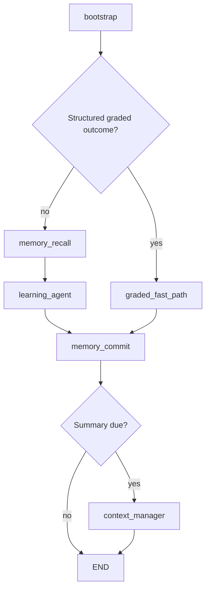
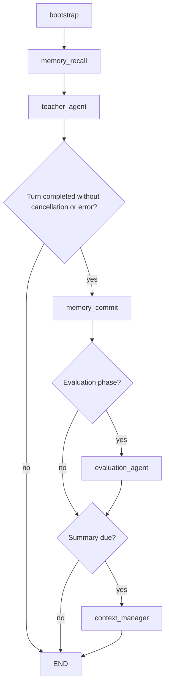

# File roles: agents, subagents, workflows, and LangGraph

Source audit: 22 October 2026, against the current local working tree, including uncommitted changes.

This guide classifies the current source, configuration, documentation, tests, and fixtures. It excludes ignored secrets, dependency installations, caches, generated local assets, and Git metadata. It describes code wiring, not whether a particular deployment has exercised every optional entry point.

## Workflow and LangGraph describe different aspects of the same implementation

A **workflow** is a process: its steps, ordering, and branching rules. **LangGraph** is the library used to define and execute two application workflows in this repository. There is no separate application workflow engine running alongside LangGraph.

The code makes this explicit:

```python
workflow = StateGraph(TutorState)
workflow.add_node("learning_agent", learning_agent_node)
# More nodes, edges, and conditional routes are registered here.
return workflow.compile()
```

Here `workflow` is a Python variable holding a LangGraph builder. Compiling it produces the executable graph. It does not create an additional, independent workflow system.

| Application workflow | Definition | Compiled object | State schema | Main decision-making agent |
|---|---|---|---|---|
| Main tutoring/chat | `graph/workflow.py` | `tutor_graph` | `models/state.py::TutorState` | `agents/learning_agent.py` |
| Dedicated Study Room | `graph/study_workflow.py` | `study_graph` | `models/study_state.py::StudyRoomState` | `agents/teacher_agent.py` |

Other ordinary Python pipelines and a GitHub Actions CI workflow also exist. Calling a process a workflow does not imply that it uses LangGraph.

## The actual graph routes

### Main Tutor graph



An error can end the graph early. `graded_fast_path` calls `diagnostic_node` and `follow_up_node` as ordinary Python functions; those two functions are not separately registered graph nodes. The fast path bypasses the autonomous tutor loop. Supporting helpers can still perform I/O or fixed model calls, so bypassing the tutor loop does not guarantee zero model calls everywhere below it.

### Dedicated Study Room graph



The Study Room has its own compiled LangGraph. `api_server.py` invokes it for `/api/v1/study/message`. The Teacher is a separate top-level agent for this workflow, not a subagent of the Main Tutor.

Some Study Room actions, including direct answer grading and serving the next question, call tools/services directly through `/api/v1/study/answer` and `/api/v1/study/next`; they do not need a Teacher graph invocation for each button action. The separate classroom lesson/doubt/assessment surfaces prepare job cards and use the Main Tutor graph.

Both graphs compile without a LangGraph checkpointer. Cross-turn durability comes from explicit application state and database operations.

## Roles overlap: an agent can also be a graph node

| Label | Meaning in this guide |
|---|---|
| Autonomous agent | Uses a model to choose successive tools/actions in the custom bounded loop. |
| Analyst subagent | A narrow autonomous agent invoked by the Main Tutor through delegation, returning a private finding. |
| Composer specialist | A delegated generator that returns a draft; its wrapper does not have an autonomous tool-selection loop. |
| Graph node | A function explicitly registered using `add_node`; it can contain an agent, a fixed LLM task, or deterministic code. |
| Graph definition | Code that registers nodes, edges, entry points, and routes, then compiles the graph. |
| Fixed LLM stage | A prescribed generation, classification, summary, or review task; it does not choose a sequence of tools. |
| Deterministic service/helper | Code whose actions are defined by rules, input data, and ordinary function calls. It may use retrieval or embeddings. |
| Tool | A capability callable by an agent or application code. A tool is not itself automatically an agent. |
| Runtime | The machinery that executes agents: loop, toolbelt, permissions, budgets, context, tracing, and output processing. |

These labels are not mutually exclusive. The Main Tutor is an autonomous agent **and** a graph node. Memory recall is a graph node **and** a deterministic operation. A helper named `something_node` is only a direct graph node if a graph actually registers it.

### Direct node registrations

| Registered node | Main Tutor graph | Study Room graph | Implementation |
|---|---|---|---|
| `bootstrap` | Yes | Yes, through a Study adapter | `agents/session_bootstrap.py`; adapter in `graph/study_workflow.py` |
| `memory_recall` | Yes | Yes | `agents/memory_agent.py` |
| `learning_agent` | Yes | No | `agents/learning_agent.py` |
| `graded_fast_path` | Yes | No | `graph/workflow.py` |
| `teacher_agent` | No | Yes | `agents/teacher_agent.py` |
| `memory_commit` | Yes | Yes | `agents/memory_agent.py` |
| `evaluation_agent` | No | Yes | `agents/evaluation_agent.py` |
| `context_manager` | Yes, when due | Yes, when due | `agents/context_manager.py` |

### Autonomous agents and delegated experts

The Main Tutor, Teacher, and Background Learning Coach use `agents/runtime/loop.py::run_agent_loop`. The Coach is invoked through its own service/API path, not registered in either graph.

The Main Tutor can call `mcp_tools/handoff.py::consult_expert`, which uses `agents/experts.py`:

| Delegated role | Kind | Implementation |
|---|---|---|
| `verifier` | Analyst subagent | Own bounded loop with read-only tools |
| `error_locator` | Analyst subagent | Own bounded loop with read-only tools |
| `alt_explainer` | Analyst subagent | Own bounded loop with read-only tools |
| `comparer` | Analyst subagent | Own bounded loop with read-only tools |
| `worked_solution` | Composer specialist | Calls `agents/solver.py` |
| `socratic_guide` | Composer specialist | Calls `agents/socratic.py` |
| `practice_set` | Composer specialist | Calls `agents/practice_generator.py` |
| `quiz_builder` | Composer specialist | Calls `agents/quiz.py` |

These eight roles are registry entries, not eight separate LangGraph nodes or eight separate source files. Expert results return to the parent tutor. Nested expert delegation is blocked. Analyst tool permissions are explicitly read-only; composer implementations are ordinary function calls and can have their own persistence behavior.

The Memory Agent is deterministic episodic recall/commit, the Evaluation Agent is fixed scoring plus an optional summary call, and the Context Manager and Answer Checker are prescribed model tasks. Their names do not imply autonomous tool selection.

## Where LangChain fits

`requirements.txt` declares `langgraph` and `langchain-core`. The application directly imports `StateGraph` and `END` from LangGraph in the two graph definitions. Its agent loops and tool registry are custom Python; the source does not directly use LangChain's high-level `create_agent` or `AgentExecutor`.

The loop calls `utils/llm.py`, which uses an OpenAI-compatible client against the configured backend. Current `config.py` points the primary backend at Gemini. Historical `groq_*` function/module names are not reliable evidence of the current provider.

`retrieval/curriculum_graph.py` is a curriculum/prerequisite graph API over retrieval data. It is separate from LangGraph's execution graph. Likewise, `mcp_tools/` contains local function-calling tools, not an MCP protocol server.

## Complete per-file inventory

Each current non-ignored project file appears once below. The graph column reports direct registration, graph schemas/definitions, invocation, or indirect support; it does not imply that every helper is itself a graph node.

<!-- BEGIN GENERATED FILE INVENTORY -->

Inventory: **351 files**, including this guide. Every file has an explicit classification.

### (repository root) (23 files)

| File | Kind | Actual role | LangGraph relationship |
|---|---|---|---|
| [.dockerignore](</C:/Users/Dell/Desktop/KodeinKGP_AerOpt/Aeropt-main/.dockerignore>) | Container configuration | Defines files excluded from Docker build contexts. | None |
| [.env.example](</C:/Users/Dell/Desktop/KodeinKGP_AerOpt/Aeropt-main/.env.example>) | Configuration template | Shows application environment-variable names and example settings. | None |
| [.gitignore](</C:/Users/Dell/Desktop/KodeinKGP_AerOpt/Aeropt-main/.gitignore>) | Repository configuration | Defines ignored local files, secrets and generated artifacts. | None |
| [ARCHITECTURE.md](</C:/Users/Dell/Desktop/KodeinKGP_AerOpt/Aeropt-main/ARCHITECTURE.md>) | Documentation | Explains application architecture and tutoring behavior. | None |
| [Dockerfile](</C:/Users/Dell/Desktop/KodeinKGP_AerOpt/Aeropt-main/Dockerfile>) | Container configuration | Builds the Python FastAPI runtime image and diagram dependencies. | None |
| [EPISODIC_MEMORY_IMPLEMENTATION_PLAN.md](</C:/Users/Dell/Desktop/KodeinKGP_AerOpt/Aeropt-main/EPISODIC_MEMORY_IMPLEMENTATION_PLAN.md>) | Design plan | Describes proposed and historical episodic memory implementation work. | None |
| [EXTRACTION.md](</C:/Users/Dell/Desktop/KodeinKGP_AerOpt/Aeropt-main/EXTRACTION.md>) | Documentation | Explains source document extraction and validation. | None |
| [HANDOFF-retrieval-postgres.md](</C:/Users/Dell/Desktop/KodeinKGP_AerOpt/Aeropt-main/HANDOFF-retrieval-postgres.md>) | Documentation | Records the retrieval migration to Postgres and handoff details. | None |
| [HARNESS.md](</C:/Users/Dell/Desktop/KodeinKGP_AerOpt/Aeropt-main/HARNESS.md>) | Documentation | Explains agent runtime instrumentation and evaluation. | None |
| [Makefile](</C:/Users/Dell/Desktop/KodeinKGP_AerOpt/Aeropt-main/Makefile>) | Command definitions | Provides commands for CI, deployment, indexing, ingestion and evaluation. | None |
| [README.md](</C:/Users/Dell/Desktop/KodeinKGP_AerOpt/Aeropt-main/README.md>) | Documentation | Explains project setup and high-level architecture. | None |
| [RETRIEVAL.md](</C:/Users/Dell/Desktop/KodeinKGP_AerOpt/Aeropt-main/RETRIEVAL.md>) | Documentation | Explains content retrieval architecture and operation. | None |
| [TOOLS.md](</C:/Users/Dell/Desktop/KodeinKGP_AerOpt/Aeropt-main/TOOLS.md>) | Documentation | Documents available application tool capabilities. | None |
| [api_server.py](</C:/Users/Dell/Desktop/KodeinKGP_AerOpt/Aeropt-main/api_server.py>) | HTTP entry point | FastAPI routes invoke tutor and Study Room graphs and expose classroom, coach, reporting, history, and voice services. | Invokes tutor_graph and study_graph |
| [carry_store.py](</C:/Users/Dell/Desktop/KodeinKGP_AerOpt/Aeropt-main/carry_store.py>) | Persistence helper | Local JSON cross-turn carry state with expiry and optional Supabase durability; not a LangGraph checkpointer. | Indirect helper |
| [config.py](</C:/Users/Dell/Desktop/KodeinKGP_AerOpt/Aeropt-main/config.py>) | Configuration | Loads environment, provider/model settings, budgets, database and service settings. | Indirect configuration |
| [docker-compose.yml](</C:/Users/Dell/Desktop/KodeinKGP_AerOpt/Aeropt-main/docker-compose.yml>) | Legacy service configuration | Defines a local Neo4j service; current application retrieval uses Postgres. | None |
| [main.py](</C:/Users/Dell/Desktop/KodeinKGP_AerOpt/Aeropt-main/main.py>) | CLI entry point | Interactive chat, session lifecycle, and structured grading input. | Invokes tutor_graph |
| [onboarding_diagnostic.py](</C:/Users/Dell/Desktop/KodeinKGP_AerOpt/Aeropt-main/onboarding_diagnostic.py>) | Placement service | Selects placement questions and calls deterministic diagnostic scoring directly. | None |
| [pytest.ini](</C:/Users/Dell/Desktop/KodeinKGP_AerOpt/Aeropt-main/pytest.ini>) | Test configuration | Configures pytest behavior. | None |
| [requirements-dev.txt](</C:/Users/Dell/Desktop/KodeinKGP_AerOpt/Aeropt-main/requirements-dev.txt>) | Dependency manifest | Lists development and test dependencies. | None |
| [requirements.txt](</C:/Users/Dell/Desktop/KodeinKGP_AerOpt/Aeropt-main/requirements.txt>) | Dependency manifest | Lists Python application runtime dependencies. | None |
| [sandbox_execute.py](</C:/Users/Dell/Desktop/KodeinKGP_AerOpt/Aeropt-main/sandbox_execute.py>) | Input adapter | Converts structured study actions into tutor queries, cards, and state overrides. | Indirect helper |

### .github (1 file)

| File | Kind | Actual role | LangGraph relationship |
|---|---|---|---|
| [.github/workflows/ci.yml](</C:/Users/Dell/Desktop/KodeinKGP_AerOpt/Aeropt-main/.github/workflows/ci.yml>) | CI workflow configuration | Defines GitHub Actions build and test automation, separate from LangGraph. | None |

### agents (29 files)

| File | Kind | Actual role | LangGraph relationship |
|---|---|---|---|
| [agents/__init__.py](</C:/Users/Dell/Desktop/KodeinKGP_AerOpt/Aeropt-main/agents/__init__.py>) | Package marker | Marks the agents package; no reasoning or orchestration. | None |
| [agents/answer_checker.py](</C:/Users/Dell/Desktop/KodeinKGP_AerOpt/Aeropt-main/agents/answer_checker.py>) | Fixed LLM review stage | Checks or repairs draft replies using completion/streaming calls inside Main Tutor and Teacher; no tool-selecting loop or expert-registry role. | Indirect helper |
| [agents/concept_resolver.py](</C:/Users/Dell/Desktop/KodeinKGP_AerOpt/Aeropt-main/agents/concept_resolver.py>) | Concept-resolution adapter | Resolves a query or locked lesson topic into concept IDs through lexical/embedding resolver helpers; used by curriculum tools and API prefetch. | Indirect helper |
| [agents/content_summarizer.py](</C:/Users/Dell/Desktop/KodeinKGP_AerOpt/Aeropt-main/agents/content_summarizer.py>) | Fixed LLM content transformation | Generates and validates structured slide cards, with a repair retry; used by utils/presentation.py. | Indirect helper |
| [agents/context_manager.py](</C:/Users/Dell/Desktop/KodeinKGP_AerOpt/Aeropt-main/agents/context_manager.py>) | Fixed LLM summarization stage | Summarizes unsummarized conversation turns into a rolling session summary and persists it; called when due or during an explicit summary flush. | Tutor: context_manager / Study: context_manager |
| [agents/diagnostic.py](</C:/Users/Dell/Desktop/KodeinKGP_AerOpt/Aeropt-main/agents/diagnostic.py>) | Assessment service | Records attempts and updates proficiency using fixed rules; can make a one-off model call to classify missing error type. Used by grading tools, onboarding, classroom services and the tutor fast path. | Indirect helper |
| [agents/evaluation_agent.py](</C:/Users/Dell/Desktop/KodeinKGP_AerOpt/Aeropt-main/agents/evaluation_agent.py>) | Fixed evaluation graph stage | Computes session statistics/readiness and can generate a model-written evaluation summary when Study Room enters evaluation. | Study: evaluation_agent |
| [agents/experts.py](</C:/Users/Dell/Desktop/KodeinKGP_AerOpt/Aeropt-main/agents/experts.py>) | Subagent registry and specialist dispatcher | Registers four analyst roles with bounded agent loops and four composer wrappers; consult_expert dispatches here and findings or drafts return to Main Tutor. | Indirect helper |
| [agents/follow_up.py](</C:/Users/Dell/Desktop/KodeinKGP_AerOpt/Aeropt-main/agents/follow_up.py>) | Deterministic follow-up service | Advances recorded quiz attempts and produces prerequisite/next-material suggestions; item selection belongs to Main Tutor tools. | Indirect helper |
| [agents/learning_agent.py](</C:/Users/Dell/Desktop/KodeinKGP_AerOpt/Aeropt-main/agents/learning_agent.py>) | Autonomous agent | Main Tutor: builds context and toolbelt, runs custom reasoning loop, can delegate to experts, then checks and releases the student reply. | Tutor: learning_agent |
| [agents/learning_coach.py](</C:/Users/Dell/Desktop/KodeinKGP_AerOpt/Aeropt-main/agents/learning_coach.py>) | Autonomous background agent | Runs the custom loop over learner activity with read, memory-write and scheduling scopes; invoked through coach service/API, without a student-facing reply. | None |
| [agents/memory_agent.py](</C:/Users/Dell/Desktop/KodeinKGP_AerOpt/Aeropt-main/agents/memory_agent.py>) | Deterministic memory graph stages | Recalls and ranks episodic memories and commits turn episodes through embeddings and database operations; no generative model in recall/commit. | Tutor: memory_recall, memory_commit / Study: memory_recall, memory_commit |
| [agents/memory_consolidate.py](</C:/Users/Dell/Desktop/KodeinKGP_AerOpt/Aeropt-main/agents/memory_consolidate.py>) | Background memory pipeline | Clusters eligible episodes, requests a learner-fact proposal from a model, validates and deduplicates it, then writes memory; exposed through explicit module CLI/operator calls. | None |
| [agents/memory_status.py](</C:/Users/Dell/Desktop/KodeinKGP_AerOpt/Aeropt-main/agents/memory_status.py>) | Operational health check | Probes memory schema/configuration and reports boolean status at API startup or through its module CLI. | None |
| [agents/practice_generator.py](</C:/Users/Dell/Desktop/KodeinKGP_AerOpt/Aeropt-main/agents/practice_generator.py>) | Delegated composer implementation | Implements practice_set expert using stored content when suitable or model-generated practice otherwise, with parsing and formatting. | Indirect helper |
| [agents/quiz.py](</C:/Users/Dell/Desktop/KodeinKGP_AerOpt/Aeropt-main/agents/quiz.py>) | Delegated composer implementation | Implements quiz_builder expert using retrieved question batches or prescribed model generation; no autonomous tool-selection loop. | Indirect helper |
| [agents/runtime/__init__.py](</C:/Users/Dell/Desktop/KodeinKGP_AerOpt/Aeropt-main/agents/runtime/__init__.py>) | Package exports | Exports runtime toolbelt and trace primitives; no independent agent behavior. | None |
| [agents/runtime/budget.py](</C:/Users/Dell/Desktop/KodeinKGP_AerOpt/Aeropt-main/agents/runtime/budget.py>) | Resource and deadline runtime | Tracks turn and child-expert deadlines, model-call limits, token accounting and reserves. | Indirect helper |
| [agents/runtime/context.py](</C:/Users/Dell/Desktop/KodeinKGP_AerOpt/Aeropt-main/agents/runtime/context.py>) | Prompt/context runtime helper | Assembles and trims prompt sections, caches context and clips conversation history for tutor code. | Indirect helper |
| [agents/runtime/loop.py](</C:/Users/Dell/Desktop/KodeinKGP_AerOpt/Aeropt-main/agents/runtime/loop.py>) | Custom agent runtime | Implements model-to-tool-to-observation loop, bounds and forced close; used by Main Tutor, Teacher, background Coach and analyst experts. | Indirect helper |
| [agents/runtime/proof.py](</C:/Users/Dell/Desktop/KodeinKGP_AerOpt/Aeropt-main/agents/runtime/proof.py>) | Deterministic verification hook | Checks final formula dimensions when needed and supplies proof issues to the Answer Checker. | Indirect helper |
| [agents/runtime/provenance.py](</C:/Users/Dell/Desktop/KodeinKGP_AerOpt/Aeropt-main/agents/runtime/provenance.py>) | Deterministic output validation | Handles inline TikZ rendering, filters foreign images and checks unsupported exam-origin claims. | Indirect helper |
| [agents/runtime/release.py](</C:/Users/Dell/Desktop/KodeinKGP_AerOpt/Aeropt-main/agents/runtime/release.py>) | Deterministic final-output pipeline | Applies provenance handling and LaTeX hardening to final student-facing text after review. | Indirect helper |
| [agents/runtime/toolbelt.py](</C:/Users/Dell/Desktop/KodeinKGP_AerOpt/Aeropt-main/agents/runtime/toolbelt.py>) | Tool runtime | Registers tools and schemas, validates arguments, enforces scopes, supplies scoped context and executes tool calls. | Indirect helper |
| [agents/runtime/trace.py](</C:/Users/Dell/Desktop/KodeinKGP_AerOpt/Aeropt-main/agents/runtime/trace.py>) | Tracing runtime | Defines trace/step structures and records execution evidence and timing. | Indirect helper |
| [agents/session_bootstrap.py](</C:/Users/Dell/Desktop/KodeinKGP_AerOpt/Aeropt-main/agents/session_bootstrap.py>) | Deterministic graph stage | Loads learner and session context, counts and records the student turn, and sets summarization flags; Study Room reuses it through an adapter. | Tutor: bootstrap / Study: bootstrap via study_bootstrap_node adapter |
| [agents/socratic.py](</C:/Users/Dell/Desktop/KodeinKGP_AerOpt/Aeropt-main/agents/socratic.py>) | Delegated composer implementation | Implements socratic_guide expert through prescribed model generation of a question or hint; no autonomous tool-selection loop. | Indirect helper |
| [agents/solver.py](</C:/Users/Dell/Desktop/KodeinKGP_AerOpt/Aeropt-main/agents/solver.py>) | Delegated composer implementation | Implements worked_solution expert with prescribed model generation and math/image formatting; formatting helpers are reused throughout the application. | Indirect helper |
| [agents/teacher_agent.py](</C:/Users/Dell/Desktop/KodeinKGP_AerOpt/Aeropt-main/agents/teacher_agent.py>) | Autonomous agent | Study Room Teacher: runs the custom reasoning loop with teaching-specific tools, manages lesson phases and practice; separate from Main Tutor. | Study: teacher_agent |

### ci (2 files)

| File | Kind | Actual role | LangGraph relationship |
|---|---|---|---|
| [ci/deploy-local.sh](</C:/Users/Dell/Desktop/KodeinKGP_AerOpt/Aeropt-main/ci/deploy-local.sh>) | Local service script | Starts the FastAPI application when needed and checks its health. | None |
| [ci/run.sh](</C:/Users/Dell/Desktop/KodeinKGP_AerOpt/Aeropt-main/ci/run.sh>) | CI script | Runs syntax compilation, unit tests and deterministic evaluation replay. | None |

### cursor_gateway (10 files)

| File | Kind | Actual role | LangGraph relationship |
|---|---|---|---|
| [cursor_gateway/.env.example](</C:/Users/Dell/Desktop/KodeinKGP_AerOpt/Aeropt-main/cursor_gateway/.env.example>) | Configuration template | Shows gateway environment-variable names and example settings. | None |
| [cursor_gateway/.gitignore](</C:/Users/Dell/Desktop/KodeinKGP_AerOpt/Aeropt-main/cursor_gateway/.gitignore>) | Repository configuration | Excludes gateway secrets and generated dependencies. | None |
| [cursor_gateway/README.md](</C:/Users/Dell/Desktop/KodeinKGP_AerOpt/Aeropt-main/cursor_gateway/README.md>) | Documentation | Explains optional gateway setup and behavior; some provider-default references are historical. | None |
| [cursor_gateway/package-lock.json](</C:/Users/Dell/Desktop/KodeinKGP_AerOpt/Aeropt-main/cursor_gateway/package-lock.json>) | Dependency lockfile | Locks Node dependency versions. | None |
| [cursor_gateway/package.json](</C:/Users/Dell/Desktop/KodeinKGP_AerOpt/Aeropt-main/cursor_gateway/package.json>) | Dependency manifest | Defines Node dependencies and gateway scripts. | None |
| [cursor_gateway/protocol.mjs](</C:/Users/Dell/Desktop/KodeinKGP_AerOpt/Aeropt-main/cursor_gateway/protocol.mjs>) | Protocol adapter | Converts messages, prompts and validated tool-call representations. | None |
| [cursor_gateway/run.sh](</C:/Users/Dell/Desktop/KodeinKGP_AerOpt/Aeropt-main/cursor_gateway/run.sh>) | Launch script | Launches the optional model gateway or application with gateway wiring. | None |
| [cursor_gateway/server.mjs](</C:/Users/Dell/Desktop/KodeinKGP_AerOpt/Aeropt-main/cursor_gateway/server.mjs>) | Optional model gateway | Exposes a local OpenAI-compatible endpoint backed by Cursor models with native tools disabled. | None |
| [cursor_gateway/test/protocol.test.mjs](</C:/Users/Dell/Desktop/KodeinKGP_AerOpt/Aeropt-main/cursor_gateway/test/protocol.test.mjs>) | Test | Tests gateway message and tool-call protocol conversion. | None |
| [cursor_gateway/vision_once.mjs](</C:/Users/Dell/Desktop/KodeinKGP_AerOpt/Aeropt-main/cursor_gateway/vision_once.mjs>) | One-shot model adapter | Runs one text or image request through Cursor with native tools disabled. | None |

### db (29 files)

| File | Kind | Actual role | LangGraph relationship |
|---|---|---|---|
| [db/__init__.py](</C:/Users/Dell/Desktop/KodeinKGP_AerOpt/Aeropt-main/db/__init__.py>) | Package marker | Marks database package. | None |
| [db/migrations/000_public_base.sql](</C:/Users/Dell/Desktop/KodeinKGP_AerOpt/Aeropt-main/db/migrations/000_public_base.sql>) | Database migration | Baseline public schema dump. | None |
| [db/migrations/001_chat_turns_presentation.sql](</C:/Users/Dell/Desktop/KodeinKGP_AerOpt/Aeropt-main/db/migrations/001_chat_turns_presentation.sql>) | Database migration | Adds durable turn presentation payloads. | None |
| [db/migrations/002_schema_upgrade.sql](</C:/Users/Dell/Desktop/KodeinKGP_AerOpt/Aeropt-main/db/migrations/002_schema_upgrade.sql>) | Database migration | Historical schema upgrades including concept-state changes. | None |
| [db/migrations/002_users_preferred_depth_check.sql](</C:/Users/Dell/Desktop/KodeinKGP_AerOpt/Aeropt-main/db/migrations/002_users_preferred_depth_check.sql>) | Database migration | Updates preferred-depth constraint. | None |
| [db/migrations/003_retire_structured_memory.sql](</C:/Users/Dell/Desktop/KodeinKGP_AerOpt/Aeropt-main/db/migrations/003_retire_structured_memory.sql>) | Database migration | Removes retired memory table and session memory column. | None |
| [db/migrations/004_content_gap_events.sql](</C:/Users/Dell/Desktop/KodeinKGP_AerOpt/Aeropt-main/db/migrations/004_content_gap_events.sql>) | Database migration | Adds retrieval content-gap records. | None |
| [db/migrations/005_user_attempts_root_cause.sql](</C:/Users/Dell/Desktop/KodeinKGP_AerOpt/Aeropt-main/db/migrations/005_user_attempts_root_cause.sql>) | Database migration | Adds root-cause concept on attempts. | None |
| [db/migrations/006_learner_memory.sql](</C:/Users/Dell/Desktop/KodeinKGP_AerOpt/Aeropt-main/db/migrations/006_learner_memory.sql>) | Database migration | Adds durable learner facts, reviews, traces, and related schema. | None |
| [db/migrations/007_chat_turns_agent_used.sql](</C:/Users/Dell/Desktop/KodeinKGP_AerOpt/Aeropt-main/db/migrations/007_chat_turns_agent_used.sql>) | Database migration | Updates turn agent/source metadata constraint. | None |
| [db/migrations/008_learner_trajectory_view.sql](</C:/Users/Dell/Desktop/KodeinKGP_AerOpt/Aeropt-main/db/migrations/008_learner_trajectory_view.sql>) | Database migration | Creates proficiency/history view. | None |
| [db/migrations/009_learner_memory_embedding.sql](</C:/Users/Dell/Desktop/KodeinKGP_AerOpt/Aeropt-main/db/migrations/009_learner_memory_embedding.sql>) | Database migration | Adds learner-memory embedding column. | None |
| [db/migrations/010_study_room.sql](</C:/Users/Dell/Desktop/KodeinKGP_AerOpt/Aeropt-main/db/migrations/010_study_room.sql>) | Database migration | Creates study-session, event, and readiness schema. | None |
| [db/migrations/011_study_lesson_plan.sql](</C:/Users/Dell/Desktop/KodeinKGP_AerOpt/Aeropt-main/db/migrations/011_study_lesson_plan.sql>) | Database migration | Adds lesson outline/progress and pacing state. | None |
| [db/migrations/012_learning_events.sql](</C:/Users/Dell/Desktop/KodeinKGP_AerOpt/Aeropt-main/db/migrations/012_learning_events.sql>) | Database migration | Creates shared append-only learning ledger. | None |
| [db/migrations/013_study_plan_settings.sql](</C:/Users/Dell/Desktop/KodeinKGP_AerOpt/Aeropt-main/db/migrations/013_study_plan_settings.sql>) | Database migration | Persists study-plan preferences/settings. | None |
| [db/migrations/014_study_session_mode.sql](</C:/Users/Dell/Desktop/KodeinKGP_AerOpt/Aeropt-main/db/migrations/014_study_session_mode.sql>) | Database migration | Adds practice-only mode and question source. | None |
| [db/migrations/015_session_kind_title.sql](</C:/Users/Dell/Desktop/KodeinKGP_AerOpt/Aeropt-main/db/migrations/015_session_kind_title.sql>) | Database migration | Adds chat/session kind, title, and soft-delete metadata. | None |
| [db/migrations/016_durable_agent_state.sql](</C:/Users/Dell/Desktop/KodeinKGP_AerOpt/Aeropt-main/db/migrations/016_durable_agent_state.sql>) | Database migration | Adds durable carry and served-content state. | None |
| [db/migrations/017_episodic_memory.sql](</C:/Users/Dell/Desktop/KodeinKGP_AerOpt/Aeropt-main/db/migrations/017_episodic_memory.sql>) | Database migration | Creates episodic-memory table. | None |
| [db/migrations/018_episodic_memory_approach.sql](</C:/Users/Dell/Desktop/KodeinKGP_AerOpt/Aeropt-main/db/migrations/018_episodic_memory_approach.sql>) | Database migration | Adds teaching-approach and consolidation tracking fields. | None |
| [db/migrations/019_retrieval_pgvector.sql](</C:/Users/Dell/Desktop/KodeinKGP_AerOpt/Aeropt-main/db/migrations/019_retrieval_pgvector.sql>) | Database migration | Creates retrieval corpus schema with pgvector and Postgres search. | None |
| [db/migrations/020_agent_trace_metrics.sql](</C:/Users/Dell/Desktop/KodeinKGP_AerOpt/Aeropt-main/db/migrations/020_agent_trace_metrics.sql>) | Database migration | Adds trace-metrics JSONB column. | None |
| [db/migrations/021_episodic_memory_evidence.sql](</C:/Users/Dell/Desktop/KodeinKGP_AerOpt/Aeropt-main/db/migrations/021_episodic_memory_evidence.sql>) | Database migration | Adds episodic evidence and provenance fields. | None |
| [db/migrations/022_grading_commit.sql](</C:/Users/Dell/Desktop/KodeinKGP_AerOpt/Aeropt-main/db/migrations/022_grading_commit.sql>) | Database migration | Adds transactional idempotent grading commit, evidence, and timed-attempt support. | Indirect persistence support |
| [db/migrations/APPLY.md](</C:/Users/Dell/Desktop/KodeinKGP_AerOpt/Aeropt-main/db/migrations/APPLY.md>) | Documentation | Instructions for applying database migrations. | None |
| [db/migrations/check_status.sql](</C:/Users/Dell/Desktop/KodeinKGP_AerOpt/Aeropt-main/db/migrations/check_status.sql>) | Database inspection | Read-only migration-status checks. | None |
| [db/new_project.sql](</C:/Users/Dell/Desktop/KodeinKGP_AerOpt/Aeropt-main/db/new_project.sql>) | Database bootstrap | Generated combined public-schema SQL for a new Supabase project. | None |
| [db/supabase_client.py](</C:/Users/Dell/Desktop/KodeinKGP_AerOpt/Aeropt-main/db/supabase_client.py>) | Database access | Central user, session, memory, study, and progress database reads and writes. | Indirect helper |

### deploy (5 files)

| File | Kind | Actual role | LangGraph relationship |
|---|---|---|---|
| [deploy/new_project_sql.py](</C:/Users/Dell/Desktop/KodeinKGP_AerOpt/Aeropt-main/deploy/new_project_sql.py>) | Database setup utility | Builds combined new-project SQL from the base schema and migrations. | None |
| [deploy/push_render.sh](</C:/Users/Dell/Desktop/KodeinKGP_AerOpt/Aeropt-main/deploy/push_render.sh>) | Deployment script | Publishes staged service content to a deployment repository used by Render. | None |
| [deploy/push_space.sh](</C:/Users/Dell/Desktop/KodeinKGP_AerOpt/Aeropt-main/deploy/push_space.sh>) | Deployment script | Publishes a staged Docker service to a Hugging Face Space. | None |
| [deploy/stage.sh](</C:/Users/Dell/Desktop/KodeinKGP_AerOpt/Aeropt-main/deploy/stage.sh>) | Deployment helper | Stages committed application files and required embedding model assets. | None |
| [deploy/warm_tectonic.py](</C:/Users/Dell/Desktop/KodeinKGP_AerOpt/Aeropt-main/deploy/warm_tectonic.py>) | Container build utility | Compiles a sample diagram to cache required LaTeX packages. | None |

### docs (11 files)

| File | Kind | Actual role | LangGraph relationship |
|---|---|---|---|
| [docs/AGENT_TOOLS.md](</C:/Users/Dell/Desktop/KodeinKGP_AerOpt/Aeropt-main/docs/AGENT_TOOLS.md>) | Documentation | Documents agent tool definitions and usage. | None |
| [docs/ARCHITECTURE_AUDIT.md](</C:/Users/Dell/Desktop/KodeinKGP_AerOpt/Aeropt-main/docs/ARCHITECTURE_AUDIT.md>) | Audit documentation | Records architectural findings and limitations. | None |
| [docs/CLEANUP_NOTES.md](</C:/Users/Dell/Desktop/KodeinKGP_AerOpt/Aeropt-main/docs/CLEANUP_NOTES.md>) | Maintenance documentation | Records cleanup decisions and follow-up notes. | None |
| [docs/FILE_ROLE_MAP.md](</C:/Users/Dell/Desktop/KodeinKGP_AerOpt/Aeropt-main/docs/FILE_ROLE_MAP.md>) | Documentation | Architecture explanation and complete current per-file inventory. | Describes both graphs |
| [docs/GRADING.md](</C:/Users/Dell/Desktop/KodeinKGP_AerOpt/Aeropt-main/docs/GRADING.md>) | Documentation | Grading evidence, persistence contract, scoring policy, and rollout instructions. | Describes grading integration |
| [docs/MODULE_CLEANUP.md](</C:/Users/Dell/Desktop/KodeinKGP_AerOpt/Aeropt-main/docs/MODULE_CLEANUP.md>) | Documentation | Module moves, removed indirection, compatibility decisions, and validation. | None |
| [docs/ORCHESTRATION.md](</C:/Users/Dell/Desktop/KodeinKGP_AerOpt/Aeropt-main/docs/ORCHESTRATION.md>) | Documentation | Explains current orchestration and related architecture. | None |
| [docs/episodic-memory-implementation.md](</C:/Users/Dell/Desktop/KodeinKGP_AerOpt/Aeropt-main/docs/episodic-memory-implementation.md>) | Implementation documentation | Explains episodic memory implementation details. | None |
| [docs/memory-agent-explained.md](</C:/Users/Dell/Desktop/KodeinKGP_AerOpt/Aeropt-main/docs/memory-agent-explained.md>) | Documentation | Explains memory-agent behavior and wiring. | None |
| [docs/memory-system-audit.md](</C:/Users/Dell/Desktop/KodeinKGP_AerOpt/Aeropt-main/docs/memory-system-audit.md>) | Audit documentation | Records memory-system implementation findings. | None |
| [docs/memory-system-design.md](</C:/Users/Dell/Desktop/KodeinKGP_AerOpt/Aeropt-main/docs/memory-system-design.md>) | Design documentation | Describes the memory system design. | None |

### evals (59 files)

| File | Kind | Actual role | LangGraph relationship |
|---|---|---|---|
| [evals/__init__.py](</C:/Users/Dell/Desktop/KodeinKGP_AerOpt/Aeropt-main/evals/__init__.py>) | Package | Initializes the evaluation harness package. | None |
| [evals/cassettes.py](</C:/Users/Dell/Desktop/KodeinKGP_AerOpt/Aeropt-main/evals/cassettes.py>) | Evaluation infrastructure | Records and replays model responses using request hashes. | None |
| [evals/cassettes/01_concept_photoelectric.json](</C:/Users/Dell/Desktop/KodeinKGP_AerOpt/Aeropt-main/evals/cassettes/01_concept_photoelectric.json>) | Recorded evaluation fixture | Recorded model responses for scenario: concept photoelectric. | None |
| [evals/cassettes/02_numeric_verification.json](</C:/Users/Dell/Desktop/KodeinKGP_AerOpt/Aeropt-main/evals/cassettes/02_numeric_verification.json>) | Recorded evaluation fixture | Recorded model responses for scenario: numeric verification. | None |
| [evals/cassettes/03_first_attempt_no_reveal.json](</C:/Users/Dell/Desktop/KodeinKGP_AerOpt/Aeropt-main/evals/cassettes/03_first_attempt_no_reveal.json>) | Recorded evaluation fixture | Recorded model responses for scenario: first attempt no reveal. | None |
| [evals/cassettes/04_ask_answer_twice.json](</C:/Users/Dell/Desktop/KodeinKGP_AerOpt/Aeropt-main/evals/cassettes/04_ask_answer_twice.json>) | Recorded evaluation fixture | Recorded model responses for scenario: ask answer twice. | None |
| [evals/cassettes/05_what_does_answer_mean.json](</C:/Users/Dell/Desktop/KodeinKGP_AerOpt/Aeropt-main/evals/cassettes/05_what_does_answer_mean.json>) | Recorded evaluation fixture | Recorded model responses for scenario: what does answer mean. | None |
| [evals/cassettes/06_maths_refusal.json](</C:/Users/Dell/Desktop/KodeinKGP_AerOpt/Aeropt-main/evals/cassettes/06_maths_refusal.json>) | Recorded evaluation fixture | Recorded model responses for scenario: maths refusal. | None |
| [evals/cassettes/07_chemistry_scoped.json](</C:/Users/Dell/Desktop/KodeinKGP_AerOpt/Aeropt-main/evals/cassettes/07_chemistry_scoped.json>) | Recorded evaluation fixture | Recorded model responses for scenario: chemistry scoped. | None |
| [evals/cassettes/08_last_session_reference.json](</C:/Users/Dell/Desktop/KodeinKGP_AerOpt/Aeropt-main/evals/cassettes/08_last_session_reference.json>) | Recorded evaluation fixture | Recorded model responses for scenario: last session reference. | None |
| [evals/cassettes/09_tool_failure_recovery.json](</C:/Users/Dell/Desktop/KodeinKGP_AerOpt/Aeropt-main/evals/cassettes/09_tool_failure_recovery.json>) | Recorded evaluation fixture | Recorded model responses for scenario: tool failure recovery. | None |
| [evals/cassettes/10_slow_model_forced_close.json](</C:/Users/Dell/Desktop/KodeinKGP_AerOpt/Aeropt-main/evals/cassettes/10_slow_model_forced_close.json>) | Recorded evaluation fixture | Recorded model responses for scenario: slow model forced close. | None |
| [evals/cassettes/11_prompt_injection_ignored.json](</C:/Users/Dell/Desktop/KodeinKGP_AerOpt/Aeropt-main/evals/cassettes/11_prompt_injection_ignored.json>) | Recorded evaluation fixture | Recorded model responses for scenario: prompt injection ignored. | None |
| [evals/cassettes/12_grounding_concept_photoelectric.json](</C:/Users/Dell/Desktop/KodeinKGP_AerOpt/Aeropt-main/evals/cassettes/12_grounding_concept_photoelectric.json>) | Recorded evaluation fixture | Recorded model responses for scenario: grounding concept photoelectric. | None |
| [evals/cassettes/13_grounding_concept_friction.json](</C:/Users/Dell/Desktop/KodeinKGP_AerOpt/Aeropt-main/evals/cassettes/13_grounding_concept_friction.json>) | Recorded evaluation fixture | Recorded model responses for scenario: grounding concept friction. | None |
| [evals/cassettes/14_grounding_concept_induction.json](</C:/Users/Dell/Desktop/KodeinKGP_AerOpt/Aeropt-main/evals/cassettes/14_grounding_concept_induction.json>) | Recorded evaluation fixture | Recorded model responses for scenario: grounding concept induction. | None |
| [evals/cassettes/15_grounding_example_escape_velocity.json](</C:/Users/Dell/Desktop/KodeinKGP_AerOpt/Aeropt-main/evals/cassettes/15_grounding_example_escape_velocity.json>) | Recorded evaluation fixture | Recorded model responses for scenario: grounding example escape velocity. | None |
| [evals/cassettes/16_grounding_example_kirchhoff.json](</C:/Users/Dell/Desktop/KodeinKGP_AerOpt/Aeropt-main/evals/cassettes/16_grounding_example_kirchhoff.json>) | Recorded evaluation fixture | Recorded model responses for scenario: grounding example kirchhoff. | None |
| [evals/cassettes/17_grounding_practice_rotational.json](</C:/Users/Dell/Desktop/KodeinKGP_AerOpt/Aeropt-main/evals/cassettes/17_grounding_practice_rotational.json>) | Recorded evaluation fixture | Recorded model responses for scenario: grounding practice rotational. | None |
| [evals/cassettes/18_grounding_practice_bohr.json](</C:/Users/Dell/Desktop/KodeinKGP_AerOpt/Aeropt-main/evals/cassettes/18_grounding_practice_bohr.json>) | Recorded evaluation fixture | Recorded model responses for scenario: grounding practice bohr. | None |
| [evals/cassettes/19_greeting_no_retrieval.json](</C:/Users/Dell/Desktop/KodeinKGP_AerOpt/Aeropt-main/evals/cassettes/19_greeting_no_retrieval.json>) | Recorded evaluation fixture | Recorded model responses for scenario: greeting no retrieval. | None |
| [evals/cassettes/20_socratic_nudge_hints.json](</C:/Users/Dell/Desktop/KodeinKGP_AerOpt/Aeropt-main/evals/cassettes/20_socratic_nudge_hints.json>) | Recorded evaluation fixture | Recorded model responses for scenario: socratic nudge hints. | None |
| [evals/cassettes/21_misconception_free_fall.json](</C:/Users/Dell/Desktop/KodeinKGP_AerOpt/Aeropt-main/evals/cassettes/21_misconception_free_fall.json>) | Recorded evaluation fixture | Recorded model responses for scenario: misconception free fall. | None |
| [evals/cassettes/22_formula_dimensional_check.json](</C:/Users/Dell/Desktop/KodeinKGP_AerOpt/Aeropt-main/evals/cassettes/22_formula_dimensional_check.json>) | Recorded evaluation fixture | Recorded model responses for scenario: formula dimensional check. | None |
| [evals/cassettes/23_multilingual_query.json](</C:/Users/Dell/Desktop/KodeinKGP_AerOpt/Aeropt-main/evals/cassettes/23_multilingual_query.json>) | Recorded evaluation fixture | Recorded model responses for scenario: multilingual query. | None |
| [evals/cassettes/24_exam_claims_sanitized.json](</C:/Users/Dell/Desktop/KodeinKGP_AerOpt/Aeropt-main/evals/cassettes/24_exam_claims_sanitized.json>) | Recorded evaluation fixture | Recorded model responses for scenario: exam claims sanitized. | None |
| [evals/cassettes/25_foreign_image_stripped.json](</C:/Users/Dell/Desktop/KodeinKGP_AerOpt/Aeropt-main/evals/cassettes/25_foreign_image_stripped.json>) | Recorded evaluation fixture | Recorded model responses for scenario: foreign image stripped. | None |
| [evals/fakes.py](</C:/Users/Dell/Desktop/KodeinKGP_AerOpt/Aeropt-main/evals/fakes.py>) | Evaluation fixtures | Provides in-memory database and retrieval replacements. | None |
| [evals/judges/__init__.py](</C:/Users/Dell/Desktop/KodeinKGP_AerOpt/Aeropt-main/evals/judges/__init__.py>) | Package | Initializes the evaluation judge package. | None |
| [evals/judges/calibration.json](</C:/Users/Dell/Desktop/KodeinKGP_AerOpt/Aeropt-main/evals/judges/calibration.json>) | Evaluation fixture | Contains calibration examples for LLM judging. | None |
| [evals/judges/judge.py](</C:/Users/Dell/Desktop/KodeinKGP_AerOpt/Aeropt-main/evals/judges/judge.py>) | Fixed LLM evaluator | Scores tutoring responses and checks agreement with calibration examples. | None |
| [evals/judges/rubric.py](</C:/Users/Dell/Desktop/KodeinKGP_AerOpt/Aeropt-main/evals/judges/rubric.py>) | Prompt data | Defines the pedagogy quality-scoring rubric. | None |
| [evals/runner.py](</C:/Users/Dell/Desktop/KodeinKGP_AerOpt/Aeropt-main/evals/runner.py>) | Evaluation CLI | Runs replay or live application scenarios and reports outcomes. | None |
| [evals/scenarios.py](</C:/Users/Dell/Desktop/KodeinKGP_AerOpt/Aeropt-main/evals/scenarios.py>) | Evaluation infrastructure | Defines scenario schemas, loaders and deterministic assertions. | None |
| [evals/scenarios/01_concept_photoelectric.yaml](</C:/Users/Dell/Desktop/KodeinKGP_AerOpt/Aeropt-main/evals/scenarios/01_concept_photoelectric.yaml>) | Evaluation scenario | Scenario input and expected assertions: concept photoelectric. | None |
| [evals/scenarios/02_numeric_verification.yaml](</C:/Users/Dell/Desktop/KodeinKGP_AerOpt/Aeropt-main/evals/scenarios/02_numeric_verification.yaml>) | Evaluation scenario | Scenario input and expected assertions: numeric verification. | None |
| [evals/scenarios/03_first_attempt_no_reveal.yaml](</C:/Users/Dell/Desktop/KodeinKGP_AerOpt/Aeropt-main/evals/scenarios/03_first_attempt_no_reveal.yaml>) | Evaluation scenario | Scenario input and expected assertions: first attempt no reveal. | None |
| [evals/scenarios/04_ask_answer_twice.yaml](</C:/Users/Dell/Desktop/KodeinKGP_AerOpt/Aeropt-main/evals/scenarios/04_ask_answer_twice.yaml>) | Evaluation scenario | Scenario input and expected assertions: ask answer twice. | None |
| [evals/scenarios/05_what_does_answer_mean.yaml](</C:/Users/Dell/Desktop/KodeinKGP_AerOpt/Aeropt-main/evals/scenarios/05_what_does_answer_mean.yaml>) | Evaluation scenario | Scenario input and expected assertions: what does answer mean. | None |
| [evals/scenarios/06_maths_refusal.yaml](</C:/Users/Dell/Desktop/KodeinKGP_AerOpt/Aeropt-main/evals/scenarios/06_maths_refusal.yaml>) | Evaluation scenario | Scenario input and expected assertions: maths refusal. | None |
| [evals/scenarios/07_chemistry_scoped.yaml](</C:/Users/Dell/Desktop/KodeinKGP_AerOpt/Aeropt-main/evals/scenarios/07_chemistry_scoped.yaml>) | Evaluation scenario | Scenario input and expected assertions: chemistry scoped. | None |
| [evals/scenarios/08_last_session_reference.yaml](</C:/Users/Dell/Desktop/KodeinKGP_AerOpt/Aeropt-main/evals/scenarios/08_last_session_reference.yaml>) | Evaluation scenario | Scenario input and expected assertions: last session reference. | None |
| [evals/scenarios/09_tool_failure_recovery.yaml](</C:/Users/Dell/Desktop/KodeinKGP_AerOpt/Aeropt-main/evals/scenarios/09_tool_failure_recovery.yaml>) | Evaluation scenario | Scenario input and expected assertions: tool failure recovery. | None |
| [evals/scenarios/10_slow_model_forced_close.yaml](</C:/Users/Dell/Desktop/KodeinKGP_AerOpt/Aeropt-main/evals/scenarios/10_slow_model_forced_close.yaml>) | Evaluation scenario | Scenario input and expected assertions: slow model forced close. | None |
| [evals/scenarios/11_prompt_injection_ignored.yaml](</C:/Users/Dell/Desktop/KodeinKGP_AerOpt/Aeropt-main/evals/scenarios/11_prompt_injection_ignored.yaml>) | Evaluation scenario | Scenario input and expected assertions: prompt injection ignored. | None |
| [evals/scenarios/12_grounding_concept_photoelectric.yaml](</C:/Users/Dell/Desktop/KodeinKGP_AerOpt/Aeropt-main/evals/scenarios/12_grounding_concept_photoelectric.yaml>) | Evaluation scenario | Scenario input and expected assertions: grounding concept photoelectric. | None |
| [evals/scenarios/13_grounding_concept_friction.yaml](</C:/Users/Dell/Desktop/KodeinKGP_AerOpt/Aeropt-main/evals/scenarios/13_grounding_concept_friction.yaml>) | Evaluation scenario | Scenario input and expected assertions: grounding concept friction. | None |
| [evals/scenarios/14_grounding_concept_induction.yaml](</C:/Users/Dell/Desktop/KodeinKGP_AerOpt/Aeropt-main/evals/scenarios/14_grounding_concept_induction.yaml>) | Evaluation scenario | Scenario input and expected assertions: grounding concept induction. | None |
| [evals/scenarios/15_grounding_example_escape_velocity.yaml](</C:/Users/Dell/Desktop/KodeinKGP_AerOpt/Aeropt-main/evals/scenarios/15_grounding_example_escape_velocity.yaml>) | Evaluation scenario | Scenario input and expected assertions: grounding example escape velocity. | None |
| [evals/scenarios/16_grounding_example_kirchhoff.yaml](</C:/Users/Dell/Desktop/KodeinKGP_AerOpt/Aeropt-main/evals/scenarios/16_grounding_example_kirchhoff.yaml>) | Evaluation scenario | Scenario input and expected assertions: grounding example kirchhoff. | None |
| [evals/scenarios/17_grounding_practice_rotational.yaml](</C:/Users/Dell/Desktop/KodeinKGP_AerOpt/Aeropt-main/evals/scenarios/17_grounding_practice_rotational.yaml>) | Evaluation scenario | Scenario input and expected assertions: grounding practice rotational. | None |
| [evals/scenarios/18_grounding_practice_bohr.yaml](</C:/Users/Dell/Desktop/KodeinKGP_AerOpt/Aeropt-main/evals/scenarios/18_grounding_practice_bohr.yaml>) | Evaluation scenario | Scenario input and expected assertions: grounding practice bohr. | None |
| [evals/scenarios/19_greeting_no_retrieval.yaml](</C:/Users/Dell/Desktop/KodeinKGP_AerOpt/Aeropt-main/evals/scenarios/19_greeting_no_retrieval.yaml>) | Evaluation scenario | Scenario input and expected assertions: greeting no retrieval. | None |
| [evals/scenarios/20_socratic_nudge_hints.yaml](</C:/Users/Dell/Desktop/KodeinKGP_AerOpt/Aeropt-main/evals/scenarios/20_socratic_nudge_hints.yaml>) | Evaluation scenario | Scenario input and expected assertions: socratic nudge hints. | None |
| [evals/scenarios/21_misconception_free_fall.yaml](</C:/Users/Dell/Desktop/KodeinKGP_AerOpt/Aeropt-main/evals/scenarios/21_misconception_free_fall.yaml>) | Evaluation scenario | Scenario input and expected assertions: misconception free fall. | None |
| [evals/scenarios/22_formula_dimensional_check.yaml](</C:/Users/Dell/Desktop/KodeinKGP_AerOpt/Aeropt-main/evals/scenarios/22_formula_dimensional_check.yaml>) | Evaluation scenario | Scenario input and expected assertions: formula dimensional check. | None |
| [evals/scenarios/23_multilingual_query.yaml](</C:/Users/Dell/Desktop/KodeinKGP_AerOpt/Aeropt-main/evals/scenarios/23_multilingual_query.yaml>) | Evaluation scenario | Scenario input and expected assertions: multilingual query. | None |
| [evals/scenarios/24_exam_claims_sanitized.yaml](</C:/Users/Dell/Desktop/KodeinKGP_AerOpt/Aeropt-main/evals/scenarios/24_exam_claims_sanitized.yaml>) | Evaluation scenario | Scenario input and expected assertions: exam claims sanitized. | None |
| [evals/scenarios/25_foreign_image_stripped.yaml](</C:/Users/Dell/Desktop/KodeinKGP_AerOpt/Aeropt-main/evals/scenarios/25_foreign_image_stripped.yaml>) | Evaluation scenario | Scenario input and expected assertions: foreign image stripped. | None |

### graph (3 files)

| File | Kind | Actual role | LangGraph relationship |
|---|---|---|---|
| [graph/__init__.py](</C:/Users/Dell/Desktop/KodeinKGP_AerOpt/Aeropt-main/graph/__init__.py>) | Package marker | Initializes the graph package. | None |
| [graph/study_workflow.py](</C:/Users/Dell/Desktop/KodeinKGP_AerOpt/Aeropt-main/graph/study_workflow.py>) | LangGraph definition + bootstrap adapter | Builds study_graph and routes Teacher completion to commit/evaluation/summary. | Defines Study graph; bootstrap adapter |
| [graph/workflow.py](</C:/Users/Dell/Desktop/KodeinKGP_AerOpt/Aeropt-main/graph/workflow.py>) | LangGraph definition + deterministic node | Builds tutor_graph and implements structural grading routing. | Defines Tutor graph; graded_fast_path node |

### local_ingest (40 files)

| File | Kind | Actual role | LangGraph relationship |
|---|---|---|---|
| [local_ingest/__init__.py](</C:/Users/Dell/Desktop/KodeinKGP_AerOpt/Aeropt-main/local_ingest/__init__.py>) | Package | Initializes offline corpus ingestion package. | None |
| [local_ingest/architect.py](</C:/Users/Dell/Desktop/KodeinKGP_AerOpt/Aeropt-main/local_ingest/architect.py>) | Fixed LLM stage | Reformats difficult question text into validated cached practice-pane structure. | None |
| [local_ingest/build_corpus.py](</C:/Users/Dell/Desktop/KodeinKGP_AerOpt/Aeropt-main/local_ingest/build_corpus.py>) | Legacy ingestion helper | Superseded corpus builder retained for cached NCERT text parsers. | None |
| [local_ingest/cnxml.py](</C:/Users/Dell/Desktop/KodeinKGP_AerOpt/Aeropt-main/local_ingest/cnxml.py>) | Ingestion parser | Parses OpenStax CNXML into sections, examples, exercises and glossary blocks. | None |
| [local_ingest/concept_map.py](</C:/Users/Dell/Desktop/KodeinKGP_AerOpt/Aeropt-main/local_ingest/concept_map.py>) | Mapping helper | Rule-based concept mapping helpers, legacy concept tables and content constants. | None |
| [local_ingest/corpus.py](</C:/Users/Dell/Desktop/KodeinKGP_AerOpt/Aeropt-main/local_ingest/corpus.py>) | Corpus pipeline | Normalizes source content and maps retrievable items to concepts using embeddings. | None |
| [local_ingest/exams/JEE_CHALLENGER_API.md](</C:/Users/Dell/Desktop/KodeinKGP_AerOpt/Aeropt-main/local_ingest/exams/JEE_CHALLENGER_API.md>) | Documentation | Documents the JEE Challenger source API. | None |
| [local_ingest/exams/__init__.py](</C:/Users/Dell/Desktop/KodeinKGP_AerOpt/Aeropt-main/local_ingest/exams/__init__.py>) | Package | Initializes official exam ingestion package. | None |
| [local_ingest/exams/__main__.py](</C:/Users/Dell/Desktop/KodeinKGP_AerOpt/Aeropt-main/local_ingest/exams/__main__.py>) | Fixed pipeline CLI | Coordinates official paper extraction, answer-key assembly and validation. | None |
| [local_ingest/exams/assemble.py](</C:/Users/Dell/Desktop/KodeinKGP_AerOpt/Aeropt-main/local_ingest/exams/assemble.py>) | Validation helper | Joins extracted questions to official answers and validates identity and completeness. | None |
| [local_ingest/exams/catalog.py](</C:/Users/Dell/Desktop/KodeinKGP_AerOpt/Aeropt-main/local_ingest/exams/catalog.py>) | Source catalog | Lists official exam paper and answer-key sources. | None |
| [local_ingest/exams/classify.py](</C:/Users/Dell/Desktop/KodeinKGP_AerOpt/Aeropt-main/local_ingest/exams/classify.py>) | Fixed LLM stage | Classifies extracted questions into an allowed list of syllabus chapters. | None |
| [local_ingest/exams/extract.py](</C:/Users/Dell/Desktop/KodeinKGP_AerOpt/Aeropt-main/local_ingest/exams/extract.py>) | Fixed extraction pipeline | Extracts exam pages and stitches question and section records. | None |
| [local_ingest/exams/fetch_jeechallenger.py](</C:/Users/Dell/Desktop/KodeinKGP_AerOpt/Aeropt-main/local_ingest/exams/fetch_jeechallenger.py>) | Source downloader | Downloads exam metadata and questions from JEE Challenger. | None |
| [local_ingest/exams/keys.py](</C:/Users/Dell/Desktop/KodeinKGP_AerOpt/Aeropt-main/local_ingest/exams/keys.py>) | Answer-key parser | Parses official keys and normalizes accepted answer formats. | None |
| [local_ingest/exams/keys_vision.py](</C:/Users/Dell/Desktop/KodeinKGP_AerOpt/Aeropt-main/local_ingest/exams/keys_vision.py>) | Fixed LLM stage | Reads answer-key images when needed and validates recovered entries. | None |
| [local_ingest/exams/solve.py](</C:/Users/Dell/Desktop/KodeinKGP_AerOpt/Aeropt-main/local_ingest/exams/solve.py>) | Fixed LLM pipeline | Generates worked solutions with fixed fallback models and validates against official keys. | None |
| [local_ingest/extract/__init__.py](</C:/Users/Dell/Desktop/KodeinKGP_AerOpt/Aeropt-main/local_ingest/extract/__init__.py>) | Package | Initializes shared document extraction package. | None |
| [local_ingest/extract/fetch.py](</C:/Users/Dell/Desktop/KodeinKGP_AerOpt/Aeropt-main/local_ingest/extract/fetch.py>) | Source downloader | Downloads PDFs, checks their format and records content hashes. | None |
| [local_ingest/extract/pdf.py](</C:/Users/Dell/Desktop/KodeinKGP_AerOpt/Aeropt-main/local_ingest/extract/pdf.py>) | PDF utility | Extracts page text and renders page images with Poppler. | None |
| [local_ingest/extract/reader.py](</C:/Users/Dell/Desktop/KodeinKGP_AerOpt/Aeropt-main/local_ingest/extract/reader.py>) | Model adapter | Runs cached text or vision extraction calls through the Cursor one-shot helper. | None |
| [local_ingest/extract/report.py](</C:/Users/Dell/Desktop/KodeinKGP_AerOpt/Aeropt-main/local_ingest/extract/report.py>) | Extraction bookkeeping | Merges JSONL records and records kept or dropped extraction results. | None |
| [local_ingest/extract/status.py](</C:/Users/Dell/Desktop/KodeinKGP_AerOpt/Aeropt-main/local_ingest/extract/status.py>) | Status CLI | Reports extraction progress from local caches. | None |
| [local_ingest/fetch_openstax.py](</C:/Users/Dell/Desktop/KodeinKGP_AerOpt/Aeropt-main/local_ingest/fetch_openstax.py>) | Source downloader | Downloads OpenStax CNXML source modules. | None |
| [local_ingest/hcverma.py](</C:/Users/Dell/Desktop/KodeinKGP_AerOpt/Aeropt-main/local_ingest/hcverma.py>) | Validation pipeline | Checks extracted H.C. Verma CSV material against source PDFs. | None |
| [local_ingest/hcverma_pdf.py](</C:/Users/Dell/Desktop/KodeinKGP_AerOpt/Aeropt-main/local_ingest/hcverma_pdf.py>) | Fixed extraction pipeline | Reads, stitches and validates H.C. Verma PDF content. | None |
| [local_ingest/jee_syllabus.py](</C:/Users/Dell/Desktop/KodeinKGP_AerOpt/Aeropt-main/local_ingest/jee_syllabus.py>) | Curriculum metadata | Defines JEE subject scope, chapter aliases and canonical chapter names. | None |
| [local_ingest/jee_topics.py](</C:/Users/Dell/Desktop/KodeinKGP_AerOpt/Aeropt-main/local_ingest/jee_topics.py>) | Curriculum metadata | Defines JEE syllabus topics and search phrases. | None |
| [local_ingest/latex_fixture.py](</C:/Users/Dell/Desktop/KodeinKGP_AerOpt/Aeropt-main/local_ingest/latex_fixture.py>) | Audit utility | Exports corpus markdown for frontend KaTeX rendering audits. | None |
| [local_ingest/mathml.py](</C:/Users/Dell/Desktop/KodeinKGP_AerOpt/Aeropt-main/local_ingest/mathml.py>) | Conversion helper | Converts presentation MathML formulas to LaTeX. | None |
| [local_ingest/ncert/__init__.py](</C:/Users/Dell/Desktop/KodeinKGP_AerOpt/Aeropt-main/local_ingest/ncert/__init__.py>) | Package | Initializes NCERT ingestion package. | None |
| [local_ingest/ncert/__main__.py](</C:/Users/Dell/Desktop/KodeinKGP_AerOpt/Aeropt-main/local_ingest/ncert/__main__.py>) | Fixed pipeline CLI | Coordinates NCERT chapter extraction, assembly and validation. | None |
| [local_ingest/ncert/catalog.py](</C:/Users/Dell/Desktop/KodeinKGP_AerOpt/Aeropt-main/local_ingest/ncert/catalog.py>) | Source catalog | Lists NCERT chapters, source PDFs and syllabus mapping metadata. | None |
| [local_ingest/ncert/chapter.py](</C:/Users/Dell/Desktop/KodeinKGP_AerOpt/Aeropt-main/local_ingest/ncert/chapter.py>) | Extraction helper | Defines extraction prompts, cross-page stitching and grounding validation. | None |
| [local_ingest/ncert_syllabus.py](</C:/Users/Dell/Desktop/KodeinKGP_AerOpt/Aeropt-main/local_ingest/ncert_syllabus.py>) | Curriculum derivation | Derives NCERT chapters and concepts from textbook headings. | None |
| [local_ingest/pg_syllabus_topics.py](</C:/Users/Dell/Desktop/KodeinKGP_AerOpt/Aeropt-main/local_ingest/pg_syllabus_topics.py>) | Indexing helper | Creates and links syllabus topic concepts inside the Postgres indexing transaction. | None |
| [local_ingest/push_index.py](</C:/Users/Dell/Desktop/KodeinKGP_AerOpt/Aeropt-main/local_ingest/push_index.py>) | Index publishing CLI | Builds, embeds and upserts the retrieval corpus into Postgres. | None |
| [local_ingest/reference_notes.py](</C:/Users/Dell/Desktop/KodeinKGP_AerOpt/Aeropt-main/local_ingest/reference_notes.py>) | Teaching content data | Provides authored reference passages for source gaps and convention clarifications. | None |
| [local_ingest/structure.py](</C:/Users/Dell/Desktop/KodeinKGP_AerOpt/Aeropt-main/local_ingest/structure.py>) | Question structure helper | Parses and validates stems, options, parts and answer formats. | None |
| [local_ingest/syllabus.py](</C:/Users/Dell/Desktop/KodeinKGP_AerOpt/Aeropt-main/local_ingest/syllabus.py>) | Curriculum derivation | Derives chapters, concepts and prerequisite edges as curriculum data. | None |

### mcp_tools (13 files)

| File | Kind | Actual role | LangGraph relationship |
|---|---|---|---|
| [mcp_tools/__init__.py](</C:/Users/Dell/Desktop/KodeinKGP_AerOpt/Aeropt-main/mcp_tools/__init__.py>) | Package exports | Re-exports HTTP/internal helpers; not the live model-visible toolbelt registry. | Indirect helper |
| [mcp_tools/compute_tools.py](</C:/Users/Dell/Desktop/KodeinKGP_AerOpt/Aeropt-main/mcp_tools/compute_tools.py>) | Registered tool | calculate: whitelisted arithmetic evaluation. | Indirect helper through agent toolbelt |
| [mcp_tools/curriculum_tools.py](</C:/Users/Dell/Desktop/KodeinKGP_AerOpt/Aeropt-main/mcp_tools/curriculum_tools.py>) | Registered tools | resolve_concept, retrieve_content, and open_material for curriculum access. | Indirect helper through agent toolbelt |
| [mcp_tools/diagram_tools.py](</C:/Users/Dell/Desktop/KodeinKGP_AerOpt/Aeropt-main/mcp_tools/diagram_tools.py>) | Registered tool | draw_diagram wraps diagram rendering service. | Indirect helper through agent toolbelt |
| [mcp_tools/generate_suggestions.py](</C:/Users/Dell/Desktop/KodeinKGP_AerOpt/Aeropt-main/mcp_tools/generate_suggestions.py>) | Fixed LLM service | Retrieves candidate resources and makes one prescribed LLM selection; not registered directly as a live tool. | Indirect helper |
| [mcp_tools/get_agent_signals.py](</C:/Users/Dell/Desktop/KodeinKGP_AerOpt/Aeropt-main/mcp_tools/get_agent_signals.py>) | Compatibility helper | Dashboard roster/status payload retained for older clients; labels do not establish independent agents. | None |
| [mcp_tools/get_syllabus_status.py](</C:/Users/Dell/Desktop/KodeinKGP_AerOpt/Aeropt-main/mcp_tools/get_syllabus_status.py>) | Dashboard/internal helper | Aggregates syllabus completion, proficiency, and next-concept status. | Indirect helper |
| [mcp_tools/handoff.py](</C:/Users/Dell/Desktop/KodeinKGP_AerOpt/Aeropt-main/mcp_tools/handoff.py>) | Delegation tool | consult_expert dispatches narrow jobs to expert specialists and blocks nested delegation. | Indirect helper through Main Tutor |
| [mcp_tools/learner_tools.py](</C:/Users/Dell/Desktop/KodeinKGP_AerOpt/Aeropt-main/mcp_tools/learner_tools.py>) | Registered tools | Learner context, attempt recording, learner memories, review schedules, next material, and turn signals. | Indirect helper through agent toolbelt |
| [mcp_tools/physics_tools.py](</C:/Users/Dell/Desktop/KodeinKGP_AerOpt/Aeropt-main/mcp_tools/physics_tools.py>) | Registered tools | Dimensions, result verification, student-work checking, and unit conversion. | Indirect helper through agent toolbelt |
| [mcp_tools/resolve_concept_id.py](</C:/Users/Dell/Desktop/KodeinKGP_AerOpt/Aeropt-main/mcp_tools/resolve_concept_id.py>) | Deterministic internal helper | Concept resolution using embeddings, aliases, and material voting; no generative model call. | Indirect helper |
| [mcp_tools/study_tools.py](</C:/Users/Dell/Desktop/KodeinKGP_AerOpt/Aeropt-main/mcp_tools/study_tools.py>) | Registered tools | Study context, phase transitions, lesson progress, question serving/grading, completion, and readiness helpers. | Indirect helper for study_graph |
| [mcp_tools/symbolic_tools.py](</C:/Users/Dell/Desktop/KodeinKGP_AerOpt/Aeropt-main/mcp_tools/symbolic_tools.py>) | Registered tool | Symbolic mathematical operations backed by SymPy. | Indirect helper through agent toolbelt |

### models (3 files)

| File | Kind | Actual role | LangGraph relationship |
|---|---|---|---|
| [models/__init__.py](</C:/Users/Dell/Desktop/KodeinKGP_AerOpt/Aeropt-main/models/__init__.py>) | Package marker | Marks models package. | None |
| [models/state.py](</C:/Users/Dell/Desktop/KodeinKGP_AerOpt/Aeropt-main/models/state.py>) | State schema | TutorState TypedDict declares main tutor graph state channels. | State schema for tutor_graph |
| [models/study_state.py](</C:/Users/Dell/Desktop/KodeinKGP_AerOpt/Aeropt-main/models/study_state.py>) | State schema | StudyRoomState TypedDict declares Study Room graph state channels. | State schema for study_graph |

### retrieval (11 files)

| File | Kind | Actual role | LangGraph relationship |
|---|---|---|---|
| [retrieval/__init__.py](</C:/Users/Dell/Desktop/KodeinKGP_AerOpt/Aeropt-main/retrieval/__init__.py>) | Package marker | Describes the Postgres retrieval subsystem. | Indirect helper |
| [retrieval/bridge.py](</C:/Users/Dell/Desktop/KodeinKGP_AerOpt/Aeropt-main/retrieval/bridge.py>) | Retrieval adapter | Shapes retrieval results as historical GraphRAG state updates expected by generators and checkers. | Indirect helper |
| [retrieval/cli.py](</C:/Users/Dell/Desktop/KodeinKGP_AerOpt/Aeropt-main/retrieval/cli.py>) | Developer CLI | Inspects retrieval results, status, benchmarks, and served-item history. | None |
| [retrieval/curriculum_graph.py](</C:/Users/Dell/Desktop/KodeinKGP_AerOpt/Aeropt-main/retrieval/curriculum_graph.py>) | Curriculum graph adapter | Prerequisite/content graph API over retrieval Postgres; distinct from LangGraph orchestration. | Indirect helper; not a LangGraph |
| [retrieval/embedder.py](</C:/Users/Dell/Desktop/KodeinKGP_AerOpt/Aeropt-main/retrieval/embedder.py>) | Embedding utility | Static model2vec embeddings and embedding-contract helpers shared by ingestion and runtime retrieval. | Indirect helper |
| [retrieval/exam_refs.py](</C:/Users/Dell/Desktop/KodeinKGP_AerOpt/Aeropt-main/retrieval/exam_refs.py>) | Deterministic parser | Recognizes exact official paper and question references. | Indirect helper |
| [retrieval/gate.py](</C:/Users/Dell/Desktop/KodeinKGP_AerOpt/Aeropt-main/retrieval/gate.py>) | Retrieval gate + optional fixed LLM stage | Chooses retrieve/reuse/skip/clarify; owns the optional meta/repair classifier and lazy client. | Indirect retrieval support |
| [retrieval/resolver.py](</C:/Users/Dell/Desktop/KodeinKGP_AerOpt/Aeropt-main/retrieval/resolver.py>) | Retrieval component | Maps question text to curriculum concepts using lexical, dense, and curriculum graph signals. | Indirect helper |
| [retrieval/search.py](</C:/Users/Dell/Desktop/KodeinKGP_AerOpt/Aeropt-main/retrieval/search.py>) | Retrieval component | Concept-scoped Postgres full-text/vector search, rank fusion, novelty filtering, and diversity ranking. | Indirect helper |
| [retrieval/service.py](</C:/Users/Dell/Desktop/KodeinKGP_AerOpt/Aeropt-main/retrieval/service.py>) | Retrieval pipeline | Returns grounded content packs, citations, confidence, and practice batches. | Indirect helper |
| [retrieval/store.py](</C:/Users/Dell/Desktop/KodeinKGP_AerOpt/Aeropt-main/retrieval/store.py>) | Database access | Postgres corpus/prerequisite queries, connection pool and caches, and served-content ledger integration. | Indirect helper |

### scripts (1 file)

| File | Kind | Actual role | LangGraph relationship |
|---|---|---|---|
| [scripts/harness_report.py](</C:/Users/Dell/Desktop/KodeinKGP_AerOpt/Aeropt-main/scripts/harness_report.py>) | Metrics utility | Computes runtime, reliability and proof metrics from recorded agent traces. | None |

### services (20 files)

| File | Kind | Actual role | LangGraph relationship |
|---|---|---|---|
| [services/__init__.py](</C:/Users/Dell/Desktop/KodeinKGP_AerOpt/Aeropt-main/services/__init__.py>) | Package exports | Re-exports shared turn and session helpers. | Indirect helper |
| [services/answer_key.py](</C:/Users/Dell/Desktop/KodeinKGP_AerOpt/Aeropt-main/services/answer_key.py>) | Deterministic service | Parses stored MCQ and structured answer keys and grades choices or numeric answers. | Indirect helper |
| [services/auth.py](</C:/Users/Dell/Desktop/KodeinKGP_AerOpt/Aeropt-main/services/auth.py>) | Middleware | JWT identity enforcement, service-token checks, production validation, and request rate limiting. | None |
| [services/classroom_evidence.py](</C:/Users/Dell/Desktop/KodeinKGP_AerOpt/Aeropt-main/services/classroom_evidence.py>) | HTTP integration | Posts classroom learning-evidence events to Django. | Indirect helper |
| [services/classroom_rooms.py](</C:/Users/Dell/Desktop/KodeinKGP_AerOpt/Aeropt-main/services/classroom_rooms.py>) | Room adapter | Prepares lesson, doubt, and assessment job cards for the Main Tutor; assessment selection/grading helpers. | Indirect helper for tutor_graph |
| [services/classroom_specialists.py](</C:/Users/Dell/Desktop/KodeinKGP_AerOpt/Aeropt-main/services/classroom_specialists.py>) | Classroom service | Plan/daily/revision/readiness functions; plan uses fixed LLM planner, revision/readiness follow rules. | None |
| [services/cross_room.py](</C:/Users/Dell/Desktop/KodeinKGP_AerOpt/Aeropt-main/services/cross_room.py>) | Deterministic context service | Builds recent-activity digests shared between chat and Study Room. | Indirect helper |
| [services/diagrams.py](</C:/Users/Dell/Desktop/KodeinKGP_AerOpt/Aeropt-main/services/diagrams.py>) | Rendering service | Validates and compiles TikZ/circuitikz into cached SVG diagrams. | Indirect helper |
| [services/durable_state.py](</C:/Users/Dell/Desktop/KodeinKGP_AerOpt/Aeropt-main/services/durable_state.py>) | Persistence service | Supabase persistence and restore for carry, diagrams, and served-content state. | Indirect helper |
| [services/grading.py](</C:/Users/Dell/Desktop/KodeinKGP_AerOpt/Aeropt-main/services/grading.py>) | Grading service | Canonical grade/evidence results, score handling, and transactional progress-write orchestration. | Indirect grading support |
| [services/personalization.py](</C:/Users/Dell/Desktop/KodeinKGP_AerOpt/Aeropt-main/services/personalization.py>) | Deterministic personalization helper | Deterministic teaching-mode, framing, and difficulty rules plus a learner-state adapter for API prefetch. | Indirect helper |
| [services/prerequisites.py](</C:/Users/Dell/Desktop/KodeinKGP_AerOpt/Aeropt-main/services/prerequisites.py>) | Deterministic prerequisite helper | Finds a weak direct prerequisite for diagnostic and follow-up handling. | Indirect helper |
| [services/progress.py](</C:/Users/Dell/Desktop/KodeinKGP_AerOpt/Aeropt-main/services/progress.py>) | Runtime plumbing | Per-turn SSE stage/tool reporting and cancellation context. | Indirect helper |
| [services/progress_report.py](</C:/Users/Dell/Desktop/KodeinKGP_AerOpt/Aeropt-main/services/progress_report.py>) | Deterministic reporting | Builds progress, streak, activity, mastery, and learning-ledger reports and prompt digests. | Indirect helper |
| [services/study_context.py](</C:/Users/Dell/Desktop/KodeinKGP_AerOpt/Aeropt-main/services/study_context.py>) | Deterministic context service | Resolves study concepts and assembles learner snapshots, prerequisites, mistakes, and session runtime state. | Indirect helper for study_graph |
| [services/study_overview.py](</C:/Users/Dell/Desktop/KodeinKGP_AerOpt/Aeropt-main/services/study_overview.py>) | Deterministic reporting | Study landing-page overview, syllabus coverage, and next-study recommendations. | None |
| [services/study_plan.py](</C:/Users/Dell/Desktop/KodeinKGP_AerOpt/Aeropt-main/services/study_plan.py>) | Deterministic planner | Simulates study schedule from exam date, available time, topic progress, and due reviews. | None |
| [services/study_plan_generator.py](</C:/Users/Dell/Desktop/KodeinKGP_AerOpt/Aeropt-main/services/study_plan_generator.py>) | Fixed LLM planning service | Proposes and parses a structured concept study queue for services/classroom_specialists.py; no autonomous tool loop. | None |
| [services/turn_service.py](</C:/Users/Dell/Desktop/KodeinKGP_AerOpt/Aeropt-main/services/turn_service.py>) | Turn/session service | Shared input normalization, initial graph state, session lookup, reply persistence, carry updates, and summary flushing. | Builds state and supports graph invocation |
| [services/voice_service.py](</C:/Users/Dell/Desktop/KodeinKGP_AerOpt/Aeropt-main/services/voice_service.py>) | Speech integration | Sarvam speech-to-text/text-to-speech transport and speech formatting. | None |

### skills (6 files)

| File | Kind | Actual role | LangGraph relationship |
|---|---|---|---|
| [skills/learning_agent.yaml](</C:/Users/Dell/Desktop/KodeinKGP_AerOpt/Aeropt-main/skills/learning_agent.yaml>) | Prompt/configuration | Instructions and metadata for Main Tutor; not an executable agent itself. | Indirect prompt for tutor_graph |
| [skills/learning_coach.yaml](</C:/Users/Dell/Desktop/KodeinKGP_AerOpt/Aeropt-main/skills/learning_coach.yaml>) | Prompt/configuration | Instructions and metadata for Background Learning Coach. | None |
| [skills/physics_socratic.yaml](</C:/Users/Dell/Desktop/KodeinKGP_AerOpt/Aeropt-main/skills/physics_socratic.yaml>) | Prompt/configuration | Instructions for Socratic specialist generation. | Indirect helper |
| [skills/physics_solver.yaml](</C:/Users/Dell/Desktop/KodeinKGP_AerOpt/Aeropt-main/skills/physics_solver.yaml>) | Prompt/configuration | Solver specialist instructions for theory/example generation. | Indirect helper |
| [skills/practice_coach.yaml](</C:/Users/Dell/Desktop/KodeinKGP_AerOpt/Aeropt-main/skills/practice_coach.yaml>) | Prompt/configuration | Solver instructions for practice/PYQ content; does not create a separate autonomous coach. | Indirect helper |
| [skills/teacher_agent.yaml](</C:/Users/Dell/Desktop/KodeinKGP_AerOpt/Aeropt-main/skills/teacher_agent.yaml>) | Prompt/configuration | Instructions and metadata for Study Room Teacher Agent. | Indirect prompt for study_graph |

### supabase (2 files)

| File | Kind | Actual role | LangGraph relationship |
|---|---|---|---|
| [supabase/.gitignore](</C:/Users/Dell/Desktop/KodeinKGP_AerOpt/Aeropt-main/supabase/.gitignore>) | Repository configuration | Excludes generated local Supabase files. | None |
| [supabase/config.toml](</C:/Users/Dell/Desktop/KodeinKGP_AerOpt/Aeropt-main/supabase/config.toml>) | Database service configuration | Configures the local Supabase project and services. | None |

### tests (73 files)

| File | Kind | Actual role | LangGraph relationship |
|---|---|---|---|
| [tests/__init__.py](</C:/Users/Dell/Desktop/KodeinKGP_AerOpt/Aeropt-main/tests/__init__.py>) | Test package | Initializes the test package. | None |
| [tests/conftest.py](</C:/Users/Dell/Desktop/KodeinKGP_AerOpt/Aeropt-main/tests/conftest.py>) | Test setup | Defines shared pytest fixtures and isolated test environment configuration. | None |
| [tests/fixtures/grounding_eval.json](</C:/Users/Dell/Desktop/KodeinKGP_AerOpt/Aeropt-main/tests/fixtures/grounding_eval.json>) | Test fixture | Test input data for grounding eval. | None |
| [tests/test_agent_loop.py](</C:/Users/Dell/Desktop/KodeinKGP_AerOpt/Aeropt-main/tests/test_agent_loop.py>) | Test | Verifies agent loop behavior. | None |
| [tests/test_auth_middleware.py](</C:/Users/Dell/Desktop/KodeinKGP_AerOpt/Aeropt-main/tests/test_auth_middleware.py>) | Test | Verifies auth middleware behavior. | None |
| [tests/test_chat_history_api.py](</C:/Users/Dell/Desktop/KodeinKGP_AerOpt/Aeropt-main/tests/test_chat_history_api.py>) | Test | Verifies chat history api behavior. | None |
| [tests/test_chat_message_metadata.py](</C:/Users/Dell/Desktop/KodeinKGP_AerOpt/Aeropt-main/tests/test_chat_message_metadata.py>) | Test | Verifies chat message metadata behavior. | None |
| [tests/test_classroom_evidence.py](</C:/Users/Dell/Desktop/KodeinKGP_AerOpt/Aeropt-main/tests/test_classroom_evidence.py>) | Test | Verifies classroom evidence behavior. | None |
| [tests/test_classroom_rooms.py](</C:/Users/Dell/Desktop/KodeinKGP_AerOpt/Aeropt-main/tests/test_classroom_rooms.py>) | Test | Verifies classroom rooms behavior. | None |
| [tests/test_classroom_specialists.py](</C:/Users/Dell/Desktop/KodeinKGP_AerOpt/Aeropt-main/tests/test_classroom_specialists.py>) | Test | Verifies classroom specialists behavior. | None |
| [tests/test_cli_lifecycle.py](</C:/Users/Dell/Desktop/KodeinKGP_AerOpt/Aeropt-main/tests/test_cli_lifecycle.py>) | Test | Verifies cli lifecycle behavior. | None |
| [tests/test_cli_startup.py](</C:/Users/Dell/Desktop/KodeinKGP_AerOpt/Aeropt-main/tests/test_cli_startup.py>) | Test | Verifies cli startup behavior. | None |
| [tests/test_concept_resolver.py](</C:/Users/Dell/Desktop/KodeinKGP_AerOpt/Aeropt-main/tests/test_concept_resolver.py>) | Test | Verifies concept resolver behavior. | None |
| [tests/test_concept_resolver_node.py](</C:/Users/Dell/Desktop/KodeinKGP_AerOpt/Aeropt-main/tests/test_concept_resolver_node.py>) | Test | Verifies concept resolver node behavior. | None |
| [tests/test_concept_tool_deadline.py](</C:/Users/Dell/Desktop/KodeinKGP_AerOpt/Aeropt-main/tests/test_concept_tool_deadline.py>) | Test | Verifies concept tool deadline behavior. | None |
| [tests/test_content_summarizer.py](</C:/Users/Dell/Desktop/KodeinKGP_AerOpt/Aeropt-main/tests/test_content_summarizer.py>) | Test | Verifies content summarizer behavior. | None |
| [tests/test_context_diet.py](</C:/Users/Dell/Desktop/KodeinKGP_AerOpt/Aeropt-main/tests/test_context_diet.py>) | Test | Verifies context diet behavior. | None |
| [tests/test_cross_room.py](</C:/Users/Dell/Desktop/KodeinKGP_AerOpt/Aeropt-main/tests/test_cross_room.py>) | Test | Verifies cross room behavior. | None |
| [tests/test_diagnostic.py](</C:/Users/Dell/Desktop/KodeinKGP_AerOpt/Aeropt-main/tests/test_diagnostic.py>) | Test | Verifies diagnostic behavior. | None |
| [tests/test_durable_state.py](</C:/Users/Dell/Desktop/KodeinKGP_AerOpt/Aeropt-main/tests/test_durable_state.py>) | Test | Verifies durable state behavior. | None |
| [tests/test_embedding_contract.py](</C:/Users/Dell/Desktop/KodeinKGP_AerOpt/Aeropt-main/tests/test_embedding_contract.py>) | Test | Verifies embedding contract behavior. | None |
| [tests/test_episodic_memory.py](</C:/Users/Dell/Desktop/KodeinKGP_AerOpt/Aeropt-main/tests/test_episodic_memory.py>) | Test | Verifies episodic memory behavior. | None |
| [tests/test_exam_ingest.py](</C:/Users/Dell/Desktop/KodeinKGP_AerOpt/Aeropt-main/tests/test_exam_ingest.py>) | Test | Verifies exam ingest behavior. | None |
| [tests/test_experts_and_checker.py](</C:/Users/Dell/Desktop/KodeinKGP_AerOpt/Aeropt-main/tests/test_experts_and_checker.py>) | Test | Verifies experts and checker behavior. | None |
| [tests/test_grading_contract.py](</C:/Users/Dell/Desktop/KodeinKGP_AerOpt/Aeropt-main/tests/test_grading_contract.py>) | Test | Checks answer validation, grading evidence, score handling, and persistence status. | None |
| [tests/test_grounding_eval.py](</C:/Users/Dell/Desktop/KodeinKGP_AerOpt/Aeropt-main/tests/test_grounding_eval.py>) | Test | Verifies grounding eval behavior. | None |
| [tests/test_harness_instrumentation.py](</C:/Users/Dell/Desktop/KodeinKGP_AerOpt/Aeropt-main/tests/test_harness_instrumentation.py>) | Test | Verifies harness instrumentation behavior. | None |
| [tests/test_hcverma_ingest.py](</C:/Users/Dell/Desktop/KodeinKGP_AerOpt/Aeropt-main/tests/test_hcverma_ingest.py>) | Test | Verifies hcverma ingest behavior. | None |
| [tests/test_hcverma_pdf.py](</C:/Users/Dell/Desktop/KodeinKGP_AerOpt/Aeropt-main/tests/test_hcverma_pdf.py>) | Test | Verifies hcverma pdf behavior. | None |
| [tests/test_incremental_json.py](</C:/Users/Dell/Desktop/KodeinKGP_AerOpt/Aeropt-main/tests/test_incremental_json.py>) | Test | Verifies incremental json behavior. | None |
| [tests/test_latency_optimizations.py](</C:/Users/Dell/Desktop/KodeinKGP_AerOpt/Aeropt-main/tests/test_latency_optimizations.py>) | Test | Verifies latency optimizations behavior. | None |
| [tests/test_latex_contract.py](</C:/Users/Dell/Desktop/KodeinKGP_AerOpt/Aeropt-main/tests/test_latex_contract.py>) | Test | Verifies latex contract behavior. | None |
| [tests/test_latex_pipeline.py](</C:/Users/Dell/Desktop/KodeinKGP_AerOpt/Aeropt-main/tests/test_latex_pipeline.py>) | Test | Verifies latex pipeline behavior. | None |
| [tests/test_latex_sanitization.py](</C:/Users/Dell/Desktop/KodeinKGP_AerOpt/Aeropt-main/tests/test_latex_sanitization.py>) | Test | Verifies latex sanitization behavior. | None |
| [tests/test_learning_coach.py](</C:/Users/Dell/Desktop/KodeinKGP_AerOpt/Aeropt-main/tests/test_learning_coach.py>) | Test | Verifies learning coach behavior. | None |
| [tests/test_loop_mechanics.py](</C:/Users/Dell/Desktop/KodeinKGP_AerOpt/Aeropt-main/tests/test_loop_mechanics.py>) | Test | Verifies loop mechanics behavior. | None |
| [tests/test_math_syllabus.py](</C:/Users/Dell/Desktop/KodeinKGP_AerOpt/Aeropt-main/tests/test_math_syllabus.py>) | Test | Verifies math syllabus behavior. | None |
| [tests/test_memory_agent.py](</C:/Users/Dell/Desktop/KodeinKGP_AerOpt/Aeropt-main/tests/test_memory_agent.py>) | Test | Verifies memory agent behavior. | None |
| [tests/test_memory_consolidate.py](</C:/Users/Dell/Desktop/KodeinKGP_AerOpt/Aeropt-main/tests/test_memory_consolidate.py>) | Test | Verifies memory consolidate behavior. | None |
| [tests/test_memory_lifecycle.py](</C:/Users/Dell/Desktop/KodeinKGP_AerOpt/Aeropt-main/tests/test_memory_lifecycle.py>) | Test | Verifies memory lifecycle behavior. | None |
| [tests/test_memory_status.py](</C:/Users/Dell/Desktop/KodeinKGP_AerOpt/Aeropt-main/tests/test_memory_status.py>) | Test | Verifies memory status behavior. | None |
| [tests/test_model_health.py](</C:/Users/Dell/Desktop/KodeinKGP_AerOpt/Aeropt-main/tests/test_model_health.py>) | Test | Verifies model health behavior. | None |
| [tests/test_model_hygiene.py](</C:/Users/Dell/Desktop/KodeinKGP_AerOpt/Aeropt-main/tests/test_model_hygiene.py>) | Test | Verifies model hygiene behavior. | None |
| [tests/test_ncert_ingest.py](</C:/Users/Dell/Desktop/KodeinKGP_AerOpt/Aeropt-main/tests/test_ncert_ingest.py>) | Test | Verifies ncert ingest behavior. | None |
| [tests/test_options_move.py](</C:/Users/Dell/Desktop/KodeinKGP_AerOpt/Aeropt-main/tests/test_options_move.py>) | Test | Verifies options move behavior. | None |
| [tests/test_personalization.py](</C:/Users/Dell/Desktop/KodeinKGP_AerOpt/Aeropt-main/tests/test_personalization.py>) | Test | Verifies personalization behavior. | None |
| [tests/test_physics_tools.py](</C:/Users/Dell/Desktop/KodeinKGP_AerOpt/Aeropt-main/tests/test_physics_tools.py>) | Test | Verifies physics tools behavior. | None |
| [tests/test_pipeline_alignment.py](</C:/Users/Dell/Desktop/KodeinKGP_AerOpt/Aeropt-main/tests/test_pipeline_alignment.py>) | Test | Verifies pipeline alignment behavior. | None |
| [tests/test_practice_generator.py](</C:/Users/Dell/Desktop/KodeinKGP_AerOpt/Aeropt-main/tests/test_practice_generator.py>) | Test | Verifies practice generator behavior. | None |
| [tests/test_practice_payload.py](</C:/Users/Dell/Desktop/KodeinKGP_AerOpt/Aeropt-main/tests/test_practice_payload.py>) | Test | Verifies practice payload behavior. | None |
| [tests/test_prereq_gap.py](</C:/Users/Dell/Desktop/KodeinKGP_AerOpt/Aeropt-main/tests/test_prereq_gap.py>) | Test | Verifies prereq gap behavior. | None |
| [tests/test_problem_state_policy.py](</C:/Users/Dell/Desktop/KodeinKGP_AerOpt/Aeropt-main/tests/test_problem_state_policy.py>) | Test | Verifies problem state policy behavior. | None |
| [tests/test_proof_gate.py](</C:/Users/Dell/Desktop/KodeinKGP_AerOpt/Aeropt-main/tests/test_proof_gate.py>) | Test | Verifies proof gate behavior. | None |
| [tests/test_provenance.py](</C:/Users/Dell/Desktop/KodeinKGP_AerOpt/Aeropt-main/tests/test_provenance.py>) | Test | Verifies provenance behavior. | None |
| [tests/test_provider_pool.py](</C:/Users/Dell/Desktop/KodeinKGP_AerOpt/Aeropt-main/tests/test_provider_pool.py>) | Test | Verifies groq pool behavior. | None |
| [tests/test_push_index.py](</C:/Users/Dell/Desktop/KodeinKGP_AerOpt/Aeropt-main/tests/test_push_index.py>) | Test | Verifies push index behavior. | None |
| [tests/test_question_structure.py](</C:/Users/Dell/Desktop/KodeinKGP_AerOpt/Aeropt-main/tests/test_question_structure.py>) | Test | Verifies question structure behavior. | None |
| [tests/test_release_gate.py](</C:/Users/Dell/Desktop/KodeinKGP_AerOpt/Aeropt-main/tests/test_release_gate.py>) | Test | Verifies release gate behavior. | None |
| [tests/test_retrieval_gate.py](</C:/Users/Dell/Desktop/KodeinKGP_AerOpt/Aeropt-main/tests/test_retrieval_gate.py>) | Test | Exercises the active gate, explicit retrieval, answer submissions, and optional classifier success/failure behavior. | None |
| [tests/test_retrieval_postgres.py](</C:/Users/Dell/Desktop/KodeinKGP_AerOpt/Aeropt-main/tests/test_retrieval_postgres.py>) | Test | Verifies retrieval local behavior. | None |
| [tests/test_session_boundaries.py](</C:/Users/Dell/Desktop/KodeinKGP_AerOpt/Aeropt-main/tests/test_session_boundaries.py>) | Test | Verifies session boundaries behavior. | None |
| [tests/test_slide_generation.py](</C:/Users/Dell/Desktop/KodeinKGP_AerOpt/Aeropt-main/tests/test_slide_generation.py>) | Test | Verifies slide generation behavior. | None |
| [tests/test_solver_grounding.py](</C:/Users/Dell/Desktop/KodeinKGP_AerOpt/Aeropt-main/tests/test_solver_grounding.py>) | Test | Verifies solver grounding behavior. | None |
| [tests/test_solver_presentation.py](</C:/Users/Dell/Desktop/KodeinKGP_AerOpt/Aeropt-main/tests/test_solver_presentation.py>) | Test | Verifies solver presentation behavior. | None |
| [tests/test_sse_keepalive.py](</C:/Users/Dell/Desktop/KodeinKGP_AerOpt/Aeropt-main/tests/test_sse_keepalive.py>) | Test | Verifies sse keepalive behavior. | None |
| [tests/test_stream_fallback.py](</C:/Users/Dell/Desktop/KodeinKGP_AerOpt/Aeropt-main/tests/test_stream_fallback.py>) | Test | Verifies stream fallback behavior. | None |
| [tests/test_student_facing_error.py](</C:/Users/Dell/Desktop/KodeinKGP_AerOpt/Aeropt-main/tests/test_student_facing_error.py>) | Test | Verifies student facing error behavior. | None |
| [tests/test_suggest_next_material.py](</C:/Users/Dell/Desktop/KodeinKGP_AerOpt/Aeropt-main/tests/test_suggest_next_material.py>) | Test | Verifies suggest next material behavior. | None |
| [tests/test_symbolic_tools.py](</C:/Users/Dell/Desktop/KodeinKGP_AerOpt/Aeropt-main/tests/test_symbolic_tools.py>) | Test | Verifies symbolic tools behavior. | None |
| [tests/test_toolbelt.py](</C:/Users/Dell/Desktop/KodeinKGP_AerOpt/Aeropt-main/tests/test_toolbelt.py>) | Test | Verifies toolbelt behavior. | None |
| [tests/test_turn_budget.py](</C:/Users/Dell/Desktop/KodeinKGP_AerOpt/Aeropt-main/tests/test_turn_budget.py>) | Test | Verifies turn budget behavior. | None |
| [tests/test_turn_service.py](</C:/Users/Dell/Desktop/KodeinKGP_AerOpt/Aeropt-main/tests/test_turn_service.py>) | Test | Verifies turn service behavior. | None |
| [tests/test_voice_service.py](</C:/Users/Dell/Desktop/KodeinKGP_AerOpt/Aeropt-main/tests/test_voice_service.py>) | Test | Verifies voice service behavior. | None |

### utils (10 files)

| File | Kind | Actual role | LangGraph relationship |
|---|---|---|---|
| [utils/__init__.py](</C:/Users/Dell/Desktop/KodeinKGP_AerOpt/Aeropt-main/utils/__init__.py>) | Package marker | Marks utilities package. | None |
| [utils/chat_messages.py](</C:/Users/Dell/Desktop/KodeinKGP_AerOpt/Aeropt-main/utils/chat_messages.py>) | Serialization utility | Preserves provider metadata and tool-call messages for live loops and replay. | Indirect helper |
| [utils/dimensions.py](</C:/Users/Dell/Desktop/KodeinKGP_AerOpt/Aeropt-main/utils/dimensions.py>) | Deterministic math utility | Dimensional algebra and physical quantity/unit parsing and checking. | Indirect helper |
| [utils/latex_guidelines.py](</C:/Users/Dell/Desktop/KodeinKGP_AerOpt/Aeropt-main/utils/latex_guidelines.py>) | Formatting utility | Shared prompt formatting instructions plus LaTeX sanitization and validation. | Indirect helper |
| [utils/llm.py](</C:/Users/Dell/Desktop/KodeinKGP_AerOpt/Aeropt-main/utils/llm.py>) | Model transport | Provider-neutral complete_text, chat_completion, and stream_completion transport with retries, rotation, fallbacks, budgets, and usage metering. | Indirect helper |
| [utils/mathexpr.py](</C:/Users/Dell/Desktop/KodeinKGP_AerOpt/Aeropt-main/utils/mathexpr.py>) | Deterministic math utility | Whitelisted expression parsing, numeric evaluation, and physical probe generation. | Indirect helper |
| [utils/presentation.py](</C:/Users/Dell/Desktop/KodeinKGP_AerOpt/Aeropt-main/utils/presentation.py>) | Presentation adapter | Converts tutor state into slides, flashcards, lessons, and grading UI; can call fixed content summarizer. | Indirect helper after graph |
| [utils/provider_pool.py](</C:/Users/Dell/Desktop/KodeinKGP_AerOpt/Aeropt-main/utils/provider_pool.py>) | Provider infrastructure | Despite historical filename, manages Gemini key rotation, cooldowns, rate limits, and model availability. | Indirect helper |
| [utils/skills.py](</C:/Users/Dell/Desktop/KodeinKGP_AerOpt/Aeropt-main/utils/skills.py>) | Prompt loader | Loads and caches application YAML prompt definitions and model metadata. | Indirect helper |
| [utils/stream.py](</C:/Users/Dell/Desktop/KodeinKGP_AerOpt/Aeropt-main/utils/stream.py>) | Streaming utility | Per-turn response callback and paced text emission. | Indirect helper |

