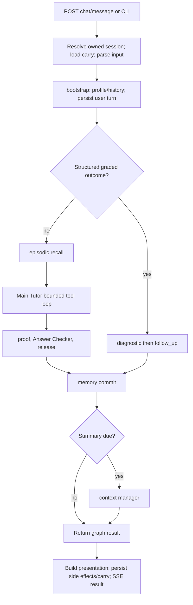
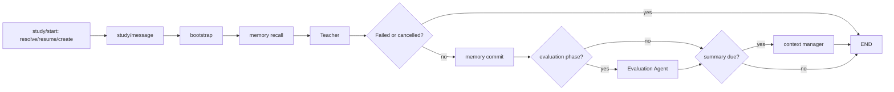

# Repository orchestration and agent guide

Source audit: 18 October 2026. This is the implementation guide for this checkout.
It distinguishes working code, optional entry points, and proposed work; it does
not assert that a particular deployment has exercised every reachable agent.

Read this file first. The [complete tool reference](AGENT_TOOLS.md) gives every
tool's schema, defaults, effects and JSON example. The
[architecture audit](ARCHITECTURE_AUDIT.md) explains loopholes, unused capabilities,
new-agent recommendations and priorities. [Cleanup notes](CLEANUP_NOTES.md) record
removals and why some legacy code remains.

## 1. What the application is

This repository is a Python/FastAPI tutoring service with LangGraph orchestration,
a bounded model tool loop, a separate Study Room, retrieval, learner memory,
grading, planning, diagrams and voice adapters. The default HTTP port is 8001;
the container defaults to 7860. Django authentication/roadmap APIs and the frontend
are separate applications, not implementations contained in this repository.

There is no resident swarm of twenty agents. The service invokes a few model
roles and many deterministic functions as needed. Files under `agents/` also
include bookkeeping, retrieval adapters and maintenance commands. The UI's
historical roster names do not identify independent autonomous processes.

The `mcp_tools/` directory contains **internal function-calling tools**, not an
MCP protocol server. No MCP stdio transport, `tools/list`, or `tools/call` server
is implemented. Chat SSE is an application streaming interface, not MCP.

## 2. Repository map

| Location | Responsibility |
|---|---|
| [`api_server.py`](../api_server.py) | HTTP schemas, auth middleware wiring, SSE, session/carry handling, tutor/study/classroom/voice endpoints |
| [`main.py`](../main.py) | Interactive tutor CLI using shared turn services |
| [`graph/workflow.py`](../graph/workflow.py) | Main Tutor graph and deterministic grading branch |
| [`graph/study_workflow.py`](../graph/study_workflow.py) | Teacher graph, completion/evaluation routing |
| [`models/state.py`](../models/state.py), [`study_state.py`](../models/study_state.py) | Typed graph state: identity, history, chunks, outcomes, study phases |
| [`agents/`](../agents/) | Tutor, teacher, reviewers, experts, memory nodes and supporting functions |
| [`agents/runtime/`](../agents/runtime/) | Loop, toolbelt, scopes, budget, trace, context, proof and release handling |
| [`mcp_tools/`](../mcp_tools/) | Registered tools plus four plain Python helper APIs |
| [`services/`](../services/) | Shared turn lifecycle, auth, answer keys, classroom, study context/plans, progress, persistence, diagrams and voice |
| [`retrieval/`](../retrieval/) | Syllabus resolution, retrieval gating, embedding, ranking, Postgres access, novelty tracking |
| [`db/supabase_client.py`](../db/supabase_client.py) | User-data and compatibility catalogue access |
| [`db/migrations/`](../db/migrations/) | User-data migrations and retrieval schema; read `APPLY.md` before applying |
| [`local_ingest/`](../local_ingest/) | Offline source fetching, extraction, validation, syllabus/corpus construction and index publishing |
| [`skills/`](../skills/) | YAML prompt templates loaded by `utils.skills`; these are application prompts |
| [`utils/`](../utils/) | Model calls/key pool, math parsers, dimensions, presentation and token emission |
| [`evals/`](../evals/) | Deterministic scenario replay, opt-in live evaluation and judges |
| [`tests/`](../tests/), [`ci/run.sh`](../ci/run.sh) | Unit/integration checks and CI entry point |
| [`cursor_gateway/`](../cursor_gateway/) | Optional local Cursor SDK to chat-completions protocol bridge |
| [`deploy/`](../deploy/), [`Dockerfile`](../Dockerfile) | Deployment packaging, embedding snapshot and diagram compiler setup |

## 3. Main chat: one complete turn



An error at bootstrap ends the Main Tutor graph. Summary execution depends on
`run_context_manager`; it is not an unconditional final node. Free text uses the
same tutor branch whether it asks for an explanation, a comparison or a problem.
There is no closed intent enum routing these meanings to separate graph nodes.

1. `services.turn_service.resolve_session` verifies an existing chat session's
   owner or creates one. `parse_turn_input` recognizes structured grading,
   contextual `1`/`0`, and the legacy CLI `ANSWER::` format.
2. `build_initial_state` merges a small carry with current request fields, clears
   stale practice state for a new question and initializes problem counters.
3. `session_bootstrap_node` reads the user/session, counts the interaction,
   records the user message, and loads recent turns and session summaries.
4. Structured grading calls `diagnostic_node` then `follow_up_node`, bypassing
   the Main Tutor reasoning loop. Proficiency updates use deterministic maths.
   This branch can still do I/O or supporting model work; it is not an absolute
   zero-model guarantee for every helper.
5. Free text recalls episodic experience, then `learning_agent_node` runs the
   tutor with its prompt, learner context, history, allowed tools and limits.
6. Tool results may stage full retrieval chunks, a draft, practice data,
   learner outcomes or follow-up suggestions. The loop feeds compact results
   back to the model and keeps full evidence for downstream use.
7. The tutor resolves its text or `USE_DRAFT`, applies proof/review/release logic,
   and emits finished text. The checker may revise once; it does not send the
   answer back through a tutor-repair/recheck loop. Checker outages fail open.
8. `memory_commit_node` best-effort stores eligible episodes and delayed grade
   feedback. The context manager summarizes when due (every five interactions
   by default). The API then builds/persists presentation and carry.

The diagram describes intended node ordering, not atomic commits. In particular,
legacy composer nodes can write assistant drafts before final review, and the
context manager currently runs synchronously. These remaining bugs are detailed
in the audit.

## 4. The model loop, tools and experts

`agents.runtime.loop.run_agent_loop` repeats:

```text
build prompt/history -> model -> tool calls -> validate/execute -> observations
                            \-> final text
step/deadline limit -> withdraw tools -> forced closing response
```

The Main Tutor defaults to six steps and a 45-second reasoning allowance; the
Teacher uses eight steps and 80 seconds. These are configuration/code defaults,
not guaranteed end-to-end HTTP deadlines. Retrieval, summarization, review,
fallback calls and uninterruptible worker activity require separate accounting.

`ToolSpec` records a name, Pydantic argument model, handler, scopes, result-shaping
target, optional consequential flag and timeout. Modules register specs with
`@tool` when imported. Tutor imports are in `learning_agent._import_tools`;
the Teacher imports additional study tools; the coach imports a narrower set.
The registry is process-wide, while a `Toolbelt` is per turn.

The dispatcher validates arguments and checks capabilities. Exceptions,
handler-returned `error` dictionaries and timeouts become failed `ToolResult`s.
It caches identical successful read calls and refuses further execution of
repeatedly failed tools. The loop currently captures its model schemas once, so
a failed tool's name may still be offered even after execution is refused.
The model must also inspect domain results such as `saved:false` or `passed:false`.
Dispatch success is not proof that a verification passed or a DB write landed.

Tutor scopes are `read`, `write:progress`, `write:memory`, `write:schedule`, and
`compose`. Analyst experts receive `read` only; the coach has read/memory/schedule.
Surface policy further limits offered tools for chat, study, classroom and coach.
The current tool-count heuristic and phase-change behavior have limitations;
consult the tool reference before treating those lists as a hard security boundary.

`consult_expert` has a 30-second dispatch cap bounded by remaining explicit turn
time. It refuses nested delegation at depth one or greater. The eight experts are:

| Expert name | Type | Implementation / typical job |
|---|---|---|
| `worked_solution` | Composer | `solver.py`: a grounded worked explanation |
| `socratic_guide` | Composer | `socratic.py`: one guiding question |
| `practice_set` | Composer | `practice_generator.py`: stored practice first, generation fallback |
| `quiz_builder` | Composer | `quiz.py`: retrieved quiz questions |
| `verifier` | Analyst | Independent calculation/solution check |
| `error_locator` | Analyst | Find the first incorrect step |
| `alt_explainer` | Analyst | Explain an idea using a different approach |
| `comparer` | Analyst | Distinguish concepts or methods |

Composers invoke existing nodes and return a staged `draft_response`. The tutor
may accept it with exactly `USE_DRAFT` to preserve formatting. Composer token
callbacks are suppressed until final review. Analysts run a small read-scoped
loop (three steps, nominally twenty seconds) and return findings privately.
Composer DB persistence and aggregate parent/child budgets still need repair;
the claimed isolation is stronger than the complete current implementation.

## 5. Study Room: a separate Teacher workflow



Study session phases are `learn -> examples -> practice -> evaluation`, with
completion/outcome state persisted by study tools. `current_phase` is the
canonical runtime phase. The API supports practice-only sessions and a `pyq`
question-source preference.

The Teacher receives conversation history, a learner snapshot, lesson pacing,
and the current/last answered question including the stored solution. Its
candidate tools deliberately exclude duplicate learner-context reads and
`record_attempt`: `grade_practice_answer` records the attempt itself.

`set_lesson_plan` commits up to four short parts; `complete_lesson_part` advances
parts/phases. Question serving selects corpus material, tracks novelty, stores
events and places a question in the pane. Grading updates statistics,
proficiency and difficulty. `complete_study_session` triggers evaluation.
The Evaluation Agent computes deterministic readiness and optionally generates a
short narrative summary; it preserves the Teacher's chat reply.

Direct `study/answer` and `study/next` endpoints support key-based grading and
retrieval without a full teacher model turn. Stop uses a cancellation event, and
a new study message supersedes the prior in-flight study turn. Cancellation is
cooperative; a running worker or external request cannot always be stopped.

## 6. Other agent roles and entry points

| Role/module | Caller and behavior |
|---|---|
| `learning_coach.py` | `coach_user` after API session close or `POST /coach/run`; examines activity and may save memory/schedule review. Returns an internal note, not a student message. No recurring scheduler is wired here. |
| `services/study_plan_generator.py` | Classroom plan specialist calls `generate_study_plan`; returns a plan with deterministic fallback/filtering. |
| `content_summarizer.py` | Presentation helpers call `summarize_to_slide_cards` for requested lesson cards; not a chat graph node. |
| `concept_resolver.py` | Curriculum resolution, retrieval setup and optional API prefetch. |
| `services/personalization.py` | Personalization heuristic through retrieval bridge and prefetch; no autonomous intent-routing authority. |
| `retrieval/bridge.py` | Tools, classroom assessment, and prefetch directly adapt Postgres retrieval packs into tutor state. |
| `retrieval/gate.py` | Active retrieval decisions and optional meta/repair classifier in one module. |
| `agents/diagnostic.py`, `services/prerequisites.py`, `agents/follow_up.py` | Attempts/proficiency, weak prerequisites, quiz advancement and suggestions. |
| `memory_status.py` | Startup diagnostic and manual CLI. |
| `memory_consolidate.py` | Manual maintenance CLI/Make target; proposes evidence-backed durable facts from episodes. |

Every agent module has a graph, tool, service, helper or command entry point.
Reachability does not prove recent model selection or deployment usage. Measure
per-agent/tool counts and outcomes from traces before retiring optional roles.
`turn_signals` and `get_study_context` are registered tools withheld from all
current production surface lists; they are dormant capabilities, not extra agents.

Classroom lesson/doubt/assessment rooms use `services.classroom_rooms`, scoped
tutor context and deterministic assessment helpers. Plan/daily/revise/readiness
routes use `classroom_specialists`; the planning route can invoke a model even
though an old module docstring describes the whole module as model-free.
Onboarding placement diagnostics and sandbox actions are separate API services.

## 7. All tools at a glance

These are all 24 `@tool` registrations. Full arguments, defaults, side effects
and a valid JSON example for each are in [AGENT_TOOLS.md](AGENT_TOOLS.md).

| Group | Registered tool names |
|---|---|
| Curriculum | `resolve_concept`, `retrieve_content`, `open_material` |
| Learner/follow-up | `get_learner_context`, `record_attempt`, `remember_about_learner`, `schedule_review`, `suggest_next_material`, `turn_signals` (withheld) |
| Arithmetic | `calculate` |
| Symbolic maths | `solve_symbolically` |
| Physics checks | `check_dimensions`, `verify_result`, `check_student_work`, `convert_units` |
| Diagrams | `draw_diagram` |
| Delegation | `consult_expert` |
| Study | `get_study_context` (withheld), `transition_phase`, `set_lesson_plan`, `complete_lesson_part`, `serve_practice_question`, `grade_practice_answer`, `complete_study_session` |

Four additional exported helpers use direct Python calls, not `@tool`
registration: `resolve_concept_id`, `generate_suggestions`, `get_syllabus_status`
and `get_agent_signals`. They support live resolution/follow-up/API paths and
must not be deleted just because they are absent from the model schema list.

## 8. Retrieval, memory and state ownership

| State | Owner / storage | Lifecycle |
|---|---|---|
| Course content, syllabus, graph edges, vectors | Retrieval Postgres: `RETRIEVAL_DATABASE_URL`; `retrieval.store` | Published offline by `local_ingest.push_index`; read during tutoring |
| Users, sessions, chat turns, attempts, proficiency, reviews, study events | User Supabase project; `db.supabase_client` | Per-user application data |
| Served content/novelty ledger | User DB `public.served_items`, with in-process cache | Survives corpus rebuilds; `AEROPT_LEDGER=memory` isolates tests |
| Durable learner facts | `learner_memory` | Explicit tool writes and maintenance consolidation; read into learner context |
| Episodic experience | `episodic_memory` | Both graphs recall before teaching and commit eligible completed turns; delayed grading closes pending evidence |
| Session summaries | User DB summaries/chat data | Every-Nth context manager or explicit session flush |
| Carry | `carry_store.py`: local JSON, optional Supabase copy | Practice/quiz cursor, suggestions, problem state and presentation fallback across fresh graph invocations |
| Diagram SVGs | Local diagram cache, optional durable storage | Content-hashed SVGs served by authenticated-policy/public diagram route |
| Context/prefetch caches | Per process | Latency optimization; not authoritative learner records |

`retrieval.embedder` defines the embedding contract: Potion base 8M, dimension
256. Startup verifies stored model IDs and vector width. The resolver maps the
query to concepts; search combines vector and lexical signals and content policy;
the service returns citations, confidence, caveats, prerequisites and novelty.
An unresolved/low-confidence result must not be described as a verified course
answer. Counts in older docs are snapshots; query your configured database to
know current coverage.

Ingestion commands fetch/extract NCERT, exam, HCV and other supported sources,
build syllabus/corpus rows and publish embeddings to the retrieval database.
`local_ingest/corpus.py` is the active assembly; not every retained source parser
is enabled in that assembly. Cached source files and embedding weights are
gitignored dependencies, so a fresh clone cannot reproduce all corpus tests
without those assets. See [RETRIEVAL.md](../RETRIEVAL.md),
[EXTRACTION.md](../EXTRACTION.md), and [migration instructions](../db/migrations/APPLY.md).

Episodic recall/commit are deterministic best-effort nodes, not another model
conversation. Recall combines relevance, concept, outcome and recency; formatting
is bounded to three episodes. Consolidation is a separate command. The removed
legacy `MEMORY_MODE`/sweeper constants never gated these current nodes; setting
`MEMORY_MODE=off` was not a way to disable their writes. Tests must mock DB clients.

## 9. HTTP interface

Paths below are relative to the service base URL. Detailed request/response
schemas are available at FastAPI `/docs` or `/openapi.json` when permitted by
the configured authentication middleware.

| Methods and paths | Purpose |
|---|---|
| `GET /health`, `/api/v1/health` | Process liveness; not a live corpus/LLM readiness check |
| `POST /api/v1/chat/message` | Tutor/classroom conversation; SSE |
| `POST, GET /api/v1/chat/sessions`; `GET, PATCH, DELETE /api/v1/chat/sessions/{session_id}` | Session lifecycle and history |
| `POST /api/v1/chat/end-session` | Flush summary/release carry; background coaching |
| `GET /api/v1/agents/status` | Compatibility roster/syllabus signals |
| `GET /api/v1/concepts/{concept_id}/proficiency` | Learner concept proficiency |
| `POST /api/v1/coach/run` | Explicit background coach run |
| `POST /api/v1/onboarding/diagnostic`, `/api/v1/sandbox/execute` | Placement flow / structured tutor actions |
| `POST /api/v1/classroom/plan`, `/daily`, `/revise`, `/readiness` | Classroom specialist outputs; suffixes share `/api/v1/classroom` |
| `POST /api/v1/classroom/assess/build`, `/grade` | Build assessment / grade submissions |
| `POST /api/v1/study/start`, `/message`, `/answer`, `/next`, `/advance`, `/stop` | Study lifecycle, teaching, key grading, question retrieval and cancellation |
| `GET /api/v1/study/session/{study_session_id}` | Study runtime and transcript |
| `GET /api/v1/study/overview/{user_id}`, `/api/v1/study/history/{user_id}` | Study progress and history |
| `GET /api/v1/plan/{user_id}`, `PUT /api/v1/plan/settings` | Personalized plan and saved settings |
| `GET /api/v1/progress/{user_id}` | Progress report |
| `GET /api/v1/diagrams/{diagram_id}.svg` | Compiled diagram |
| `GET /api/v1/voice/speakers`; `POST /api/v1/voice/transcribe`, `/synthesize` | Sarvam voice adapter; text/audio conversion outside the tutor graph |

With `DJANGO_JWT_SIGNING_KEY`, middleware verifies Django access tokens and binds
request learner IDs to the signed `supabase_user_id`. Production requires that
key. A trusted server token can bypass learner authentication. Without the key,
local authentication is off. Some public exemptions, particularly paid voice
routes, currently bypass normal quotas; the audit calls this out explicitly.
The limiter, in-flight cancellation registry and some locks/caches are per
process, so the shipped container intentionally uses one worker.

Voice endpoints exist, and diagram generation is connected. Chat/study schemas
still accept text; uploading a PDF/photo into the tutor graph or doing document
OCR is not implemented. Voice transcription can produce text for a later chat
request; this is not automatic multimodal graph input.

## 10. Worked usage examples

Use real owned user/session IDs returned by your application. Tool/agent choices
below are possible trajectories, not promises about nondeterministic model choices.

### A. Explain a concept with a checked numerical example

Student: “Explain escape velocity and calculate it for Earth.”

```text
bootstrap -> memory recall -> Main Tutor
  resolve_concept(query="escape velocity", content_type_hint="theory")
  retrieve_content(content_type="theory", query="escape velocity")
  calculate(expression="sqrt(2*6.6743e-11*5.972e24/6.371e6)")
  optional consult_expert(expert="verifier", task="Check escape speed ...")
  final explanation -> proof/checker/release -> memory commit -> result
```

The tutor should state assumptions and units and use the retrieved citation.
The calculator checks arithmetic, not whether the physical model is applicable.

### B. A self-reported practice result

After a served practice question, the UI submits `graded_outcome:"incorrect"`
with its session. The parser makes a structured outcome. Bootstrap routes to
`diagnostic_node -> follow_up_node`, records the self-report with appropriate
provenance, checks weak prerequisites and offers a next step. A self-report is
not equivalent to an official-key assessment of typed work.

### C. Study Room

```json
{"user_id":"YOUR_USER_UUID","concept_id":"Newton's laws","mode":"learn","force_new":false}
```

Send that body to `POST /api/v1/study/start`. Keep the returned chat `session_id`
and `study_session_id`, then call `POST /api/v1/study/message`:

```json
{"user_id":"YOUR_USER_UUID","session_id":"RETURNED_CHAT_UUID","study_session_id":"RETURNED_STUDY_UUID","query":"Start with a free-body diagram."}
```

The Teacher can set a lesson outline, retrieve theory, draw a diagram and mark
parts complete. In Practice, `study/next` selects a question; `study/answer`
accepts choices/numeric values for key-based grading. Completion runs evaluation.
Current phase transitions can leave the current turn's belt stale; retry on the
next turn until that policy is refactored as described in the audit.

### D. Why did my work go wrong?

Student supplies text steps. The tutor may call:

```json
{"name":"check_student_work","arguments":{"steps":["m*a = m*g - T","a = g - T"]}}
```

This exposes a missing division by mass and/or dimensional inconsistency. The
tutor may ask `error_locator` for a second reading, then teach the first error.
An unparsed or indeterminate step is not proof of correctness, even if a current
tool verdict is too reassuring; see the audit's verification findings.

### E. Internal tool call in Python

```python
from agents.learning_agent import _import_tools
from agents.runtime.toolbelt import ToolContext, Toolbelt, registry

_import_tools()
ctx = ToolContext(user_id="owned-user", session_id="owned-session")
belt = Toolbelt(registry().values(), ctx)
print(belt.call("calculate", {"expression": "sqrt(2*9.81*20)"}).to_json())
```

The result is an `ok/data` envelope with a speed of approximately 19.809 m/s.
The snippet demonstrates dispatch; a server must derive identity from trusted
authentication, not accept arbitrary context identities from a remote client.
All remaining tools have schema-validated examples in the full tool reference.

## 11. Run and verify

Use Python 3.12 to match CI/container. On Windows PowerShell:

```powershell
python -m venv .venv
.\.venv\Scripts\python.exe -m pip install -r requirements.txt -r requirements-dev.txt
if (-not (Test-Path .env)) { Copy-Item .env.example .env }
# Fill .env with your own user DB, retrieval DB and provider configuration.
.\.venv\Scripts\python.exe -m uvicorn api_server:app --port 8001
```

On Linux/macOS use `.venv/bin/python` and `cp`. Do not overwrite an existing
`.env`. Configuration loads `.env` then optional `.env.local` with override.

For interactive CLI testing, run `python main.py --user-id YOUR_USER_UUID` with
that environment's Python (or `--register` for a new learner). Before asking for
learner/session input, the CLI checks the retrieval embedding contract and
warms the database, concept cache and embedding model. First startup may load
model files; that work happens outside the first turn's tool timeout. If setup
fails, the CLI reports a retrieval initialization error and exits before creating
a learner/session. Fix the database/index/model setup and restart.

Required deployment inputs are user Supabase URL/service key,
`RETRIEVAL_DATABASE_URL`, the embedding model snapshot and functioning model
credentials. `config.py` currently selects Gemini through its OpenAI-compatible
endpoint; many `groq_*` function/variable names are historical. Sarvam keys are
for voice. Optional retrieval REST keys support catalogue compatibility reads.
Production also needs the Django JWT key and the chosen durable-state settings.

```powershell
.\.venv\Scripts\python.exe -m pytest tests/
.\.venv\Scripts\python.exe -m evals.runner --mode replay
node --test cursor_gateway/test/*.test.mjs
.\.venv\Scripts\python.exe -m agents.memory_status
.\.venv\Scripts\python.exe -m agents.memory_consolidate --help
```

`bash ci/run.sh` performs syntax compilation, pytest and deterministic replay.
Corpus-dependent tests require local extraction assets; Postgres-dependent tests
require a configured test database. Provider availability/live evaluation is
opt-in. Windows sandbox restrictions can block the local socket pair needed by
FastAPI TestClient; do not confuse that with an application routing failure.
Do not point write-capable checks at production learner data.

Useful offline commands (bash/Make environment): `make push-dry`, `make ncert`,
`make exams`, `make hcverma`, `make retrieval-bench`, `make memory-status`, and
`make memory-consolidate USER=<uuid> DRY=1`. Ingestion can use network/models and
publish data; inspect flags before running. The optional Cursor gateway has its
own [setup guide](../cursor_gateway/README.md) and is not an MCP server. Its
legacy `run-cursor` launcher exports Groq settings that current Gemini config
does not consume, so it does not currently redirect the tutor to that gateway.

## 12. What to improve next

Repair orchestration boundaries before adding model roles: one reviewed final
reply write, real cancellation/late-write fencing, explicit concurrency/effect
metadata, claim-specific verification, aggregate budgets, phase-correct tool
exposure, and authenticated/limited voice endpoints.

Then consider a material reader, an offline question quality auditor, and a
misconception analyst that extends existing diagnosis. Remediation design,
cross-concept transfer and semantic evidence auditing are further options.
Build durable review delivery
and workflow retries as deterministic services. Avoid another general supervisor
or duplicate verifier when `verifier`/`error_locator` already cover the task.
The audit specifies permissions, inputs, outputs, evaluation criteria and an
implementation order for these proposals.

When changing the system, update this guide, the tool catalog, and an actual
entry-point regression together. Test live graph/tool contracts rather than
only helper functions that the production path may no longer call.
