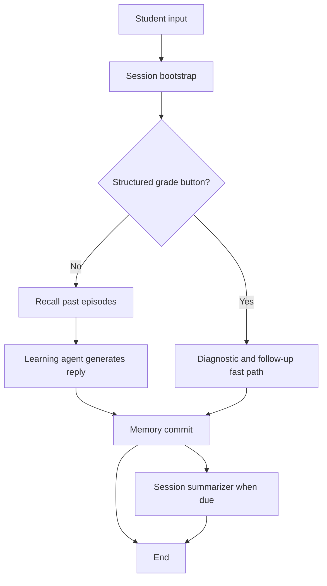
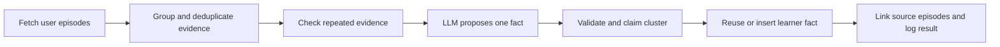

# How episodic memory and the memory agent work

Reading guide refreshed against the working tree on 17 October 2026, including the migration 021 evidence changes. Live Supabase and tests were not run for this documentation update.

An episode in this code is one successful tutor reply, not the whole topic. Several replies about Newton's first law are several rows that share `session_id` and, when lookup worked, `concept_id`. The outcome of an explanation with no grade is `unknown`. A missing correctness flag is not stored as incorrect. The score itself is `user_concept_state.proficiency_score`. See `docs/memory-system-audit.md` and `docs/memory-system-design.md`.

This explains the implementation in the working tree, including the new consolidation code. It does not certify that migrations are applied to your hosted Supabase project or that a scheduled job is running. The deployment guide has also been refreshed; no earlier hosted-database observations are presented as current verification.

## 1. The main idea

Your tutor remembers a student in several different ways. An **episode** records a particular tutoring experience: what the student asked, what the tutor did, the concept involved, and the observed result. A **learner fact** records a more durable observation, such as a recurring misconception or a learning preference.

For example:

- Episode: “The student asked about torque signs. The tutor explained a sign convention. A subsequent attempt was marked incorrect.”
- Learner fact: “The student repeatedly struggles with torque sign conventions.”

The episode describes an event. The fact interprets evidence across events. The actual storage unit is still one successful assistant reply. Related rows may share an interaction_id, but no multi-turn narrative extractor has been added. Neither changes the model's weights: the application retrieves stored information and includes it in later prompts.

The module called `memory_agent.py` is deterministic Python code. Its recall and commit functions do not ask a generative LLM what to save or retrieve. They do use an embedding model to represent text numerically. A separate consolidation job uses a generative LLM to propose a learner fact.

## 2. The different stores

| Information | Location | Purpose |
|---|---|---|
| Current request state | `TutorState` or `StudyRoomState` | Pass information between graph nodes during a turn. |
| Conversation messages | `chat_turns` | Keep the actual user and assistant messages. |
| Session summaries | `sessions.session_summary` | Condense a session for continuity. |
| Tutoring experiences | `episodic_memory` | Retrieve useful past events across sessions. |
| Durable learner facts | `learner_memory` | Remember misconceptions, strengths, preferences, context, and goals. |
| Consolidation decisions | `episodic_consolidation` | Record which episode sets were considered and their result. |
| Detailed agent decisions | `agent_trace` | Observe tool calls and agent behavior. |
| Shared course material | Separate retrieval database | Retrieve concepts, explanations, and questions. |
| Tutor procedures | Skill prompt files | Supply application instructions; episode storage does not rewrite them. |

Personal memory belongs in the **user Supabase project**. Course content belongs in the **retrieval project**. Reusing the same embedding model does not merge these databases.

The current bootstrap also loads the latest non-null summary from another session for this user on the first interaction of a new session. The learning-agent prompt can show this as “Last session.” This is a latest-summary lookup, not semantic search over all old summaries. The older pasted assessment saying new sessions never read prior summaries no longer describes this code.

## 3. Where memory fits in a turn

The graph definitions are in `graph/workflow.py` and `graph/study_workflow.py`.



Bootstrap prepares the user/session context and saves the user message. For normal free-text input, recall supplies past experiences before the learning agent responds. After the response, commit builds and stores this turn's episode.

The Correct/Incorrect button path skips episode recall and the normal learning-agent reasoning loop. It records the grading outcome, prepares follow-up, and still calls memory commit. Skipping recall saves work; commit still includes database operations and embedding work.

The study-room path is:

```text
bootstrap -> memory_recall -> teacher_agent -> memory_commit
                                              |
                                              +-> evaluation when required
                                              +-> context_manager when due
                                              +-> end
```

A cancelled or failed teacher turn exits before commit. Evaluation is after commit in this graph, so the episode reflects state available at commit time; it does not automatically include later evaluation changes.

Both graphs call `compile()` without a checkpointer. Persistence here comes from explicit database operations, not a LangGraph checkpoint store.

## 4. How an episode is created

`memory_commit_node(state)` performs these steps:

1. If the turn contains a grade, try to attach that feedback to one pending episode.
2. Call `build_episode()` to construct a compact row from the current state.
3. Embed the row's `retrieval_text`.
4. Pass the row to `db.upsert_episode()`.
5. Return an empty update to graph state.

Episode creation requires a user ID, session ID, valid interaction count, and a non-empty assistant response. Cancelled turns and the explicitly recognized physics-only/fallback responses are skipped. Graph guards also skip nodes when state already contains an error.

An episode is tied to an assistant turn:

```text
user turn index      = interaction_count * 2 - 1
assistant turn index = interaction_count * 2
```

The first user message has index 1 and its assistant response has index 2.

The episode builder selects the first available concept from `primary_concept_id`, `roadmap_concept_id`, `concept_id`, and then the grade's concept. Study grades can override it. Content normally comes from the first retrieved chunk, with a study-grade override. Missing concept/content values are possible: an episode is not guaranteed to identify a specific lesson or question.

Actions come from the agent trace path, capped at 12 entries. The graded fallback uses `node:diagnostic` and `node:follow_up`; study turns can use `tools_used`. The first `handoff:` action identifies `expert_used`.

## 5. Every episode column explained

Migration `017_episodic_memory.sql` creates the base table. Migration `018_episodic_memory_approach.sql` adds approach and consolidation tracking. Migration `021_episodic_memory_evidence.sql` adds four evidence fields and permits consolidation claims. No historical evidence is inferred by that migration.

| Column | Meaning / source |
|---|---|
| `episode_id` | UUID generated by PostgreSQL for the row. |
| `user_id` | Student owning the experience, supplied by application state. |
| `session_id` | Conversation containing the assistant turn. |
| `study_session_id` | Optional study-room session reference. |
| `assistant_turn_index` | Assistant message position, computed as interaction count times two. |
| `surface` | `chat`, `graded`, `study`, `lesson`, `doubt`, or `assess`. |
| `route` | `agent_loop`, `graded_fast_path`, or `teacher`. |
| `task_type` | `doubt`, `explain`, `practice`, `grade`, or `study_phase`. |
| `content_id` | Optional associated content reference. |
| `concept_id` | Optional associated concept reference. |
| `attempt_id` | Optional graded-attempt UUID associated with this turn. |
| `query_excerpt` | First 300 characters of the student's query. |
| `assessment_status` | not_requested, pending, completed, failed, or persistence_failed; see below. |
| `evidence_source` | none, dialogue, student_self_report, answer_key, checker, or model. A caller-supplied provenance label. |
| `student_response` | Up to 300 characters from student_answer, otherwise the query excerpt; not necessarily an answer. |
| `interaction_id` | Computed grouping key; not a unique attempt ID. |
| `approach` | Up to 180 characters from the tutor response after whitespace normalization and clipping. |
| `actions` | JSON array of at most 12 action labels. |
| `expert_used` | Expert name extracted from a handoff action, if present. |
| `checker_verdict` | Checker result copied from state, if present. |
| `observed_outcome` | Current builder uses unknown for ungraded turns and correct/incorrect for boolean grades. Historical taught values remain allowed. |
| `proficiency_before` | Optional proficiency before an associated grade. |
| `proficiency_after` | Optional proficiency after that grade. |
| `feedback_status` | `pending` by default; grading uses `next_attempt`. Schema also permits `none`. |
| `feedback_outcome` | Later/associated grading outcome: `correct` or `incorrect`, otherwise null. |
| `feedback_attempt_id` | Attempt responsible for the feedback. |
| `feedback_at` | Timestamp set when pending feedback is closed. |
| `retrieval_text` | Search-oriented text assembled from episode fields, capped at 800 characters. |
| `embedding` | Numeric `real[]` representation of retrieval text; may be absent if embedding fails. |
| `embed_model` | Model identifier used for the embedding. |
| `status` | `active` or `invalid`; retrieval selects active rows. |
| `created_at` | Database insertion time, defaulting to `now()`. |
| `updated_at` | Updated by application writes. |
| `consolidated_at` | Time this episode was consumed by successful/duplicate consolidation. |
| `consolidation_memory_id` | Learner fact to which the consumed episode is linked. |

`approach` is a clipped beginning of the response, not a model-generated summary of the teaching technique. A response opening with a greeting can therefore produce a weak approach description. The full explanation remains in the transcript.

The episode table deliberately has no foreign keys because existing ID types differ between tables. These references are logical links, not database-enforced relationships.

### Example row

This is illustrative, not a record read from your Supabase project. UUIDs and the vector are omitted for readability.

```json
{
  "user_id": "student-A",
  "session_id": "session-A",
  "assistant_turn_index": 2,
  "surface": "chat",
  "route": "agent_loop",
  "task_type": "explain",
  "concept_id": "torque-sign",
  "query_excerpt": "Why is my torque negative?",
  "approach": "Choose anticlockwise as positive, then check the rotation caused by the force.",
  "actions": ["handoff:solver"],
  "expert_used": "solver",
  "observed_outcome": "unknown",
  "assessment_status": "not_requested",
  "evidence_source": "dialogue",
  "feedback_status": "pending",
  "status": "active"
}
```

The current builder uses unknown for ungraded teaching. Historical taught rows do not establish learning either.

### Assessment and grouping

| Status | Current behavior |
|---|---|
| not_requested | Ordinary ungraded chat. |
| pending | Allowed by SQL, not emitted as assessment status by the current builder. |
| completed | Boolean correctness and an attempt ID are available. |
| failed | Invalid correctness on recognized graded-turn branches. |
| persistence_failed | Explicit attempt_record_failed flag, or boolean grade without attempt ID. |

Assessment status differs from feedback_status: an ungraded explanation can be not_requested while pending later feedback.

Interaction IDs are the first 24 hexadecimal characters of SHA-256 over user/concept/content when all are available, otherwise user/session/concept. Without a concept the ID is null. The content-based key groups repeated use across sessions; the concept-only key groups turns within a session. Neither defines a complete interaction open/close lifecycle.

Ordinary dialogue defaults to dialogue provenance. Boolean grades default to student_self_report unless the caller supplies another source. The label itself does not prove a checker ran.

Edge cases remain: without an attempt ID, a boolean grade can retain correct/incorrect outcome despite persistence_failed. An invalid study last_grade without other grading flags can retain not_requested. These are gaps, not recommended semantics.

## 6. How the write reaches Supabase

The backend uses the Python Supabase client, initialized with `SUPABASE_URL` and `SUPABASE_KEY`. In `db/supabase_client.py`, the write follows this pattern:

```python
self.client.table("episodic_memory").upsert(
    payload,
    on_conflict="session_id,assistant_turn_index",
    default_to_null=False,
).execute()
```

PostgreSQL enforces a unique constraint on `(session_id, assistant_turn_index)`. Retrying the same turn updates its row instead of creating a second episode. Before writing, the code checks that an existing row at this position belongs to the same user.

The payload omits null feedback fields. A replay of an ordinary teaching turn should not reset feedback to pending after a subsequent grade has closed it. `default_to_null=False` helps preserve omitted values. A stored next_attempt row now also preserves retrieval_text, embedding, and embed_model when the replay has no feedback_outcome.

If migration 018 is absent, the client omits approach. If the assessment_status column probe fails, it omits all four migration 021 fields. That single-column probe does not validate every column in a partially applied migration. If the base episode table is unavailable, memory operations return without breaking the tutoring response. Some schema probes are cached; restart the process after applying migrations.

## 7. How later feedback changes an episode

Suppose the tutor explains torque and the student later clicks Incorrect.

`apply_delayed_feedback()` extracts the grade and asks `close_pending_episode()` to find a suitable active, pending episode for the same user and concept. Matching interaction_id is preferred, then matching content_id. A provided content ID without a match prevents concept-only fallback. With no content ID, newest-pending concept fallback remains.

The update sets:

```text
feedback_status     = next_attempt
feedback_outcome    = incorrect
feedback_attempt_id = associated attempt ID
feedback_at         = current UTC time
```

Missing proficiency fields may also be filled. The original observed_outcome stays unknown (or historical taught), while feedback records the later result. The patch does not copy assessment_status, evidence_source, or student_response to the earlier row, so those fields still describe its original dialogue.

The code rebuilds `retrieval_text` and re-embeds the episode to include feedback. If that embedding fails, it preserves the previous vector. The current grade turn also gets its own episode, created with an already-known correct/incorrect outcome.

When an attempt ID is available, the client first checks whether that attempt already closed an episode. This reduces duplicate feedback updates during retries.

**Matching limitation:** the implementation excludes the current numeric turn index, but does not restrict selection to the current session or explicitly compare timestamps. Because turn indices restart in each session, the exclusion can also omit an unrelated prior-session row with the same index. Treat this as heuristic association, not proof that a particular explanation caused a result. Delayed feedback also runs before episode building and does not reject attempt_record_failed or require an attempt ID. It can still close an older row using a boolean grade whose attempt failed to persist. Delayed feedback also runs before episode building and does not reject attempt_record_failed or require an attempt ID. It can still close an older row using a boolean grade whose attempt failed to persist.

## 8. How recall chooses useful episodes

`memory_recall_node()` calls `retrieve_relevant_episodes(user_id, query, concept_id)`.

### Candidate retrieval

The database returns active rows for this student only:

- Known concept: newest 24 episodes on that concept plus newest 16 episodes across concepts, deduplicated by episode ID.
- Unknown concept: newest 40 episodes.

This is a bounded recent-history search, not a search across the student's complete lifetime history.

### Embedding and scoring

The current shared embedder is `model2vec` using `minishlab/potion-base-8M`. It produces 256-dimensional, L2-normalized vectors. It uses a bundled local model when available; otherwise model loading can require obtaining the model. Once loaded, text encoding runs locally.

The agent compares query and episode embeddings using cosine similarity. Comparisons are skipped when the query embedding fails, the model names differ, or vector dimensions are incompatible. A missing stored vector counts as zero similarity when the query embedded successfully.

A numeric cosine below 0.25 drops a candidate unless its concept matches. Remaining candidates receive:

```text
score = 0.50 * cosine_similarity
      + 0.25 * concept_match
      + 0.15 * exp(-age_in_days / 14)
      + 0.10 * quality
```

Unavailable cosine contributes zero. Concept match is 1 or 0. Recency decays gradually; 14 days is not a deletion deadline.

| Episode condition, in priority order | Quality value |
|---|---:|
| Incorrect feedback or immediate outcome | 1.0 |
| Correct feedback or immediate outcome | 0.7 |
| Checker revised the answer | 0.5 |
| Feedback remains pending | 0.2 |
| Otherwise | 0.3 |

Here “quality” means usefulness for recall, not student performance. Failures are deliberately useful reminders.

### Prompt construction

After ranking, the new filter drops an incorrect row if any fetched candidate on the same concept has a newer correct outcome. It compares creation-time strings and does not validate evidence source; even null concept groups can be compared. This is a recovery heuristic, not proof of mastery. Up to three remaining rows are formatted under:

```text
Past experiences (this student, not course material):
```

Each line contains date, concept, task, outcome, approach, actions, and query. Later feedback takes precedence over the immediate outcome when displayed. Each line is capped at 280 characters and the whole block at 900 characters. Later fields can be cut off by truncation.

The block becomes `state["episode_context"]`; the learning or teacher agent incorporates it into the prompt. The user is not directly shown this block, though the tutor can use it. Formatting still omits assessment_status and evidence_source, so self-reported and independently checked grades are not explicitly distinguished in the prompt.

**There is no pgvector query for episodes here.** Episode vectors are PostgreSQL arrays; Python calculates the similarity over fetched candidates. The separate course-retrieval system uses pgvector, which is a different path.

## 9. How consolidation turns episodes into facts

The separate agents/memory_consolidate.py job is not scheduled by API startup and does not run before tutoring.



### Implemented eligibility rules

1. Group by user and concept.
2. Count attempt_id, otherwise feedback_attempt_id, once. Without either, fall back to episode ID. First encountered evidence wins.
3. Exclude explicit student_self_report rows.
4. For misconception, require at least two incorrect rows whose normalized student_response is identical and at least 12 characters. Every incorrect row in the group must pass; matching subgroups are not discovered.
5. For strength, require at least two correct rows, all labelled answer_key or checker.
6. Prefer a qualifying misconception, cap its sources at six, and prioritize clusters by retained size then concept.
7. Hash the user and selected episode IDs; skip previously recorded sets.

This is literal repeated-response matching, not semantic misconception detection. Incorrect evidence does not require a verified source or completed assessment; missing attempt IDs still permit row-based counting.

### Database integration gap

The real list_unconsolidated_episodes SELECT omits attempt_id, feedback_attempt_id, student_response, evidence_source, and assessment_status. It returns at most 80 recent active unconsolidated rows.

Consequently, the current database-fed job cannot apply the stricter rules as intended: it sees no response text for misconceptions and no verified provenance for strengths, so normally returns no_repeated_outcome without invoking the model. Rich fake rows in unit tests do not establish that the database query supplies them.

### What happens with eligible input

The model can propose JSON with save, kind, fact, concept_id, and confidence, or return save=false. Application validation checks expected kind/concept, non-empty fact, and a 300-character limit. Confidence is bounded to 0.5-0.9; it is not a calibrated probability. User identity comes from the job argument.

The prompt includes concept, outcome, approach, and query; it does not explicitly include the new student-response or provenance fields. At most one new proposal is processed per user invocation.

The resulting learner fact uses source=consolidation, concept as subject_key, and source episode IDs as evidence. Exact-text duplicate lookup normalizes whitespace/case and checks kind/compatible subject against up to 200 active facts. It does not recognize paraphrases.

Saved or duplicate results mark source episodes with consolidated_at and consolidation_memory_id. Skipped/rejected results are logged without consuming episodes.

### Claims and recovery are incomplete

Migration 021 permits a claimed result in episodic_consolidation. The job attempts to INSERT that claim before fact storage, after the model call. The unique user/cluster key can prevent duplicate writers when claiming and readback succeed, but concurrent model calls are still possible.

record_consolidation always INSERTs. Its later saved/duplicate insertion conflicts with the claim instead of updating it, leaving history at claimed. Failed fact storage also leaves a claim that blocks ordinary retry. No expiry/recovery is implemented. If claiming fails and the subsequent existence check is false, processing continues without a successful claim.

This is not an atomic transaction or a complete exactly-once guarantee. The schema-ready probe does not check migration 021's claimed constraint.

Dry-run writes nothing but may call the model. Pending-user discovery takes the oldest 500 unconsolidated rows without pagination. Ineligible rows can remain in that window indefinitely; another run does not guarantee progress.

## 10. The other way learner facts are saved

The tutor can call `remember_about_learner` through the application's tool layer. This is separate from automatic episode commit and from the scheduled consolidation job.

The tool accepts these kinds:

```text
preference, misconception, strength, context, goal
```

Pydantic describes its arguments. Application validation checks the kind and requires a fact of 10–300 characters. `ToolContext` supplies the user/session identity. The tool then calls `insert_learner_memory()` with evidence, confidence, subject, and source.

The learning agent loads up to eight active learner facts before reasoning. This is separate from its maximum of three recalled episodes. The database fact reader excludes superseded rows, applies a confidence floor, and prioritizes kinds and confidence; it also has an optional similarity-ranking path.

**Current implementation caveat:** learner-fact insertion now checks None/size explicitly and converts values to floats, fixing its NumPy truth-value issue. Optional query-based fact retrieval still uses boolean query/vector checks that can fail on NumPy arrays and return no memories through exception handling. Normal learning-agent recall passes no query and avoids that branch. Episode embedding converts arrays to lists separately.

## 11. Frameworks and libraries: what each actually does

| Technology | Role in this implementation |
|---|---|
| Python | Implements extraction, matching, scoring, formatting, validation, and persistence rules. |
| LangGraph | Runs the ordered workflow using `StateGraph`, nodes, edges, and state. It does not automatically create this memory system. |
| LangChain Core | Declared application dependency; the episode store and ranker are custom code rather than a built-in LangChain memory object. |
| Supabase Python SDK | Sends table reads, inserts, upserts, and updates to the user project. |
| PostgreSQL on Supabase | Persists rows and enforces uniqueness, checks, defaults, and indexes. |
| model2vec | Encodes text using the static Potion model. It produces vectors, not conversational responses. |
| NumPy | Supports vector representation and normalization in the shared embedder. |
| OpenAI Python SDK | Provides the client interface used by consolidation to call an OpenAI-compatible endpoint. This does not imply an OpenAI-hosted model. |
| Gemini endpoint | `config.py` points the client at Google's OpenAI-compatible API. The configured model is `GEMINI_MODEL`; the source default is `gemini-3-flash-preview`, subject to environment override. |
| `utils.llm.complete_text` | Existing completion wrapper invoked by consolidation with configured model/fallbacks. The function name alone does not establish that the request goes to Groq. |
| Pydantic | Defines/validates tool argument schemas, including the learner-memory tool. Consolidation JSON also has explicit Python validation. |
| FastAPI | Hosts the application API and startup status reporting. It is not the memory storage engine. |
| psycopg2 / pgvector | Used by the separate retrieval database path; not the episode upsert or episode similarity scorer described here. |

Consolidation requests JSON output, temperature 0.1, and up to 400 output tokens. Recall and commit do not make this completion call.

These descriptions come from repository source and dependency declarations, not assumptions about the latest versions of the libraries.

## 12. Scope, failure handling, and deletion

Episode candidate reads and feedback updates are scoped to the student. Consolidation also processes per-user rows. The supplied SQL enables RLS on episode and consolidation tables and grants backend service-role access. It does not supply end-user RLS policies. A service-role backend still depends on correct application authorization and user filtering.

Avoid saying “every database method filters user_id”: invalidation helpers filter by session ID, or session plus turn index, and rely on the caller's ownership checks. The upsert also uses a session/turn conflict key with an explicit existing-owner check.

The API has hooks to invalidate episodes when a session is deleted or a turn is undone. Invalidation updates `status="invalid"`; it is not physical deletion. Normal recall and consolidation ignore invalid rows. Invalidation now invokes retire_facts_without_active_support and checks other active links. However, retirement calls supersede_learner_memory(memory_id, None), writing superseded_by=NULL, while active reads select NULL. Thus the current operation does not retire the unsupported fact. The helper also inspects at most 100 invalidated linked rows.

The memory code is designed to **fail open**: if recall/storage fails, tutoring continues without that memory. Consequently, a successful reply is not proof that its episode was stored. Commit does not return a saved-row acknowledgement in graph state. Consult diagnostics and database rows to verify persistence.

## 13. How to inspect your deployment

Run from the repository root in the configured Python environment:

```powershell
python -m agents.memory_status
```

This probes the user memory tables/columns and checks whether `RETRIEVAL_DATABASE_URL` is non-empty. It does not apply migrations, verify retrieval connectivity, or verify scheduling. It also omits the migration 021 fields/claim constraint, so ok=true is insufficient for the updated design. A failed probe is not always proof a table is absent; permissions or connectivity can also make it unqueryable.

Relevant migrations are:

- `006_learner_memory.sql`: learner facts and related tables.
- `009_learner_memory_embedding.sql`: optional fact embedding column.
- `017_episodic_memory.sql`: base episode storage.
- `018_episodic_memory_approach.sql`: approach and consolidation storage.
- `021_episodic_memory_evidence.sql`: assessment status, evidence source, student response, interaction ID, and claimed result.

Follow `db/migrations/APPLY.md` for application order and project selection. Migration 009's comment mentions an older embedding arrangement; the current embedder source specifies the single 256-dimensional Potion model.

Read-only SQL examples for the **user project's SQL editor**:

```sql
-- Replace the placeholder with the student's actual application user ID.
SELECT episode_id, session_id, assistant_turn_index, concept_id,
       task_type, query_excerpt, approach, observed_outcome,
       feedback_status, feedback_outcome, feedback_attempt_id,
       assessment_status, evidence_source, student_response, interaction_id,
       status, consolidated_at, created_at
FROM public.episodic_memory
WHERE user_id = '<student-user-id>'
ORDER BY created_at DESC
LIMIT 20;

SELECT memory_id, kind, subject_key, fact, evidence, source, confidence
FROM public.learner_memory
WHERE user_id = '<student-user-id>'
  AND superseded_by IS NULL
ORDER BY created_at DESC;

SELECT cluster_key, episode_ids, result, memory_id, fact, created_at
FROM public.episodic_consolidation
WHERE user_id = '<student-user-id>'
ORDER BY created_at DESC;
```

Consolidation commands:

```powershell
# Proposes a fact but does not write to the database; can still call the LLM.
python -m agents.memory_consolidate --user-id <student-user-id> --dry-run

# Processes at most one new proposal for this user.
python -m agents.memory_consolidate --user-id <student-user-id>

# Processes discovered users with unconsolidated episodes.
python -m agents.memory_consolidate --pending
```

Pending-user discovery reads the oldest 500 episode rows, not 500 distinct users, with no pagination. Ineligible rows can repeatedly occupy the window. Fact duplicate lookup is capped at 200 facts. These bounds matter as usage grows.

An end-to-end demonstration is: create a normal teaching turn, verify its episode, record a subsequent grade, verify feedback, start another session, and inspect the generated prompt/context for recall. Use controlled repeated evidence before demonstrating consolidation. This guide did not perform that live demonstration.

## 14. Source map and suggested reading order

All paths below are relative to the repository root.

| Read | File | Focus |
|---:|---|---|
| 1 | `graph/workflow.py` | Normal chat and graded-button ordering. |
| 2 | `graph/study_workflow.py` | Teacher, commit, and evaluation ordering. |
| 3 | `agents/memory_agent.py` | Build, recall, score, format, commit, and feedback. |
| 4 | `db/migrations/017_episodic_memory.sql` | Base schema and constraints. |
| 5 | `db/migrations/018_episodic_memory_approach.sql` | Approach and consolidation schema. |
| 6 | `db/supabase_client.py` | Actual database queries and failure behavior. |
| 7 | `retrieval/embedder.py` | Model identity, dimensions, and normalization. |
| 8 | `agents/memory_consolidate.py` | Cluster selection, model proposal, validation, and tracking. |
| 9 | `mcp_tools/learner_tools.py` | Explicit learner-fact writing tool. |
| 10 | `agents/learning_agent.py`, `agents/teacher_agent.py` | How memories enter prompts. |
| 11 | `agents/session_bootstrap.py`, `agents/context_manager.py` | Conversation continuity and summaries. |
| 12 | `agents/memory_status.py` | Deployment probes. |

Relevant existing tests: `tests/test_memory_agent.py`, `tests/test_episodic_memory.py`, `tests/test_memory_consolidate.py`, `tests/test_memory_lifecycle.py`, and `tests/test_memory_status.py`. They provide examples of expected behavior; their existence alone does not verify the hosted deployment. No application code or live database data was changed while writing this guide.

## 15. A short explanation you can present

“Our tutor uses LangGraph to run a custom memory pipeline. Before a normal tutoring response, it fetches a bounded set of the student's active episodes from Supabase, ranks them using embedding similarity, concept match, recency, and outcome, and adds up to three compact experiences to the prompt. After the response, deterministic code stores a compact episode with the question excerpt, response excerpt, action labels, and outcome. Later grades can update a pending episode. Separately, consolidation is designed to propose facts from repeated evidence. Its stricter eligibility helpers are present, but the database field selection and claim lifecycle still need correction before that path is complete. Transcripts, summaries, personal memory, and shared course content remain separate. This is retrieval-based personalization, not model retraining.”
